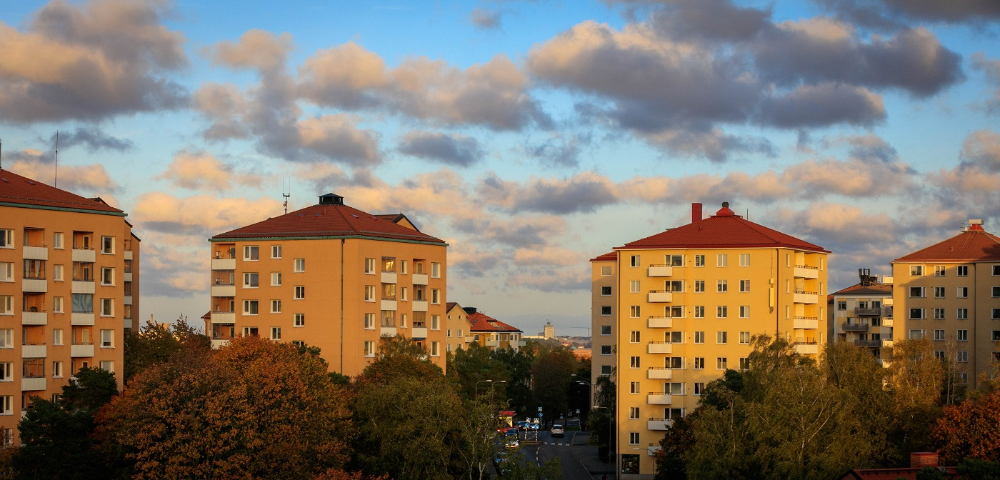
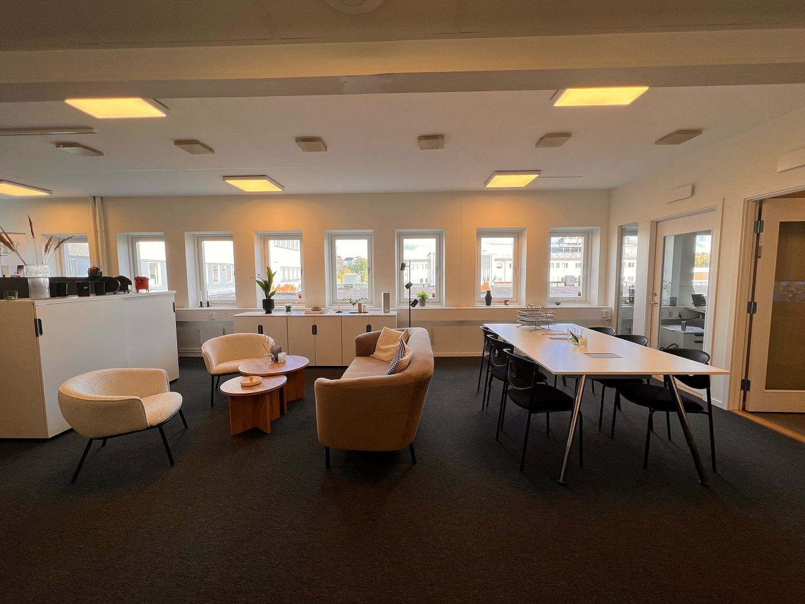
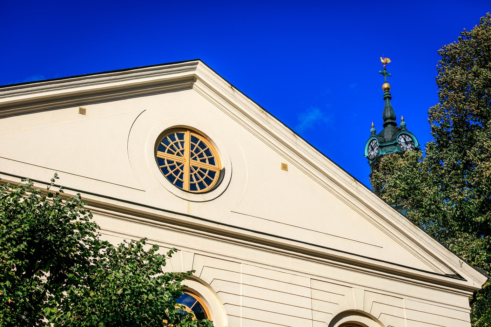

# Hämta återvinning Stockholm

- **URL:** https://avfallskonsulten.se/atervinning-stockholm
- **Title-tagg:** Återvinning | Hämta återvinning Stockholm | Avfallskonsulten
- **Meta description:** Smidig & effektiv återvinning i Stockholm! Vi är experter på att sortera och hämta återvinning stockholm. Få kostnadsfri offert för din fastighet eller företag.
- **Canonical:** 
- **Ord i brödtext:** 1736
- **Bilder:** 5

---

# Hämta återvinning Stockholm

För att öka trivsamheten i soprummet är det viktigt att både rum och kärl hålls i gott skick. Med vår tjänst hämta återvinning Stockholm ser vi till att ni slipper dålig lukt och ohyra, samtidigt som soprummet hålls rent och snyggt. Vi tvättar [sopkärl och soprum](karltvatt) på beställning eller på abonnemang.

[KONTAKTA OSS](#kontakt-form)

## Vad våra kunder säger om oss

## Vi hjälper dig att hämta återvinning i Stockholm

Vare sig du är en BRF, ett företag eller privatperson så kan vi hjälpa dig med upphämtning av återvinning och [avfallshantering i Stockholm](/). Vi erbjuder långsiktiga lösningar genom återvinningsabonnemang men finns också till hands när du t.ex behöver [hyra en container i Stockholm](bygg-och-tradgardsavfall).

### Fastighet & BRF

I en fastighet blir det viktigare och viktigare att tillhandahålla en välfungerad återvinning. Vi har
genom våra år i branschen samlat på oss den erfarenhet som krävs för att kunna erbjuda den bästa
upphämtningen av återvinning för fastigheter och bostadsrättsföreningar i Stockholm. Läs mer här nedan om hur det går till.

[Läs mer för fastighet & BRF:er](atervinning_fastighet_och_brf)

### Kontorsåtervinning

Att återvinna ska vara något självklart, det gäller också på kontoret. Vi skräddarsyr en återvinningslösning som gör det enkelt att återvinna och vi erbjuder olika typer av designade källsorteringsmöbler som passar in i er miljö. Vi kan även hämta er återvinning direkt från ert kontor i Stockholm.

[Läs mer för kontorsåtervinning](kontorsatervinning)

### Företag & verksamheter

Oavsett storlek och typ av verksamhet som bedrivs är det viktigt att ha koll på sin avfallshantering. Många företag betalar alldeles för dyra pengar för något som dessutom inte fungerar så väl. Vi ser till att ni kan göra det ni är bäst på, er verksamhet. Och vi tar hand om resten.

[Läs mer för företag & verksamheter](atervinning_for_foretag_och_verksamheter)

## Hämta återvinning Stockholm

Vi hjälper dig med att hämta återvinning i Stockholm! Avfallskonsulten är en modern och flexibel återvinningspartner som hjälper fastigheter & bostadsrättsföreningar, kontor, företag & verksamheter samt privatpersoner i Stockholm med att hantera sitt avfall på ett effektivt och miljövänligt sätt.

### Varför välja oss för att hämta återvinning i Stockholm?

Vi gör det enkelt och smidigt för dig när vi hämtar återvinning. Vi erbjuder:

- Hämtning av grovsopor och återvinning i Stockholm: Vi hämtar allt från skrymmande möbler och elektronik till papper, glas och plast direkt på plats.
- Flexibla lösningar: Vi anpassar våra tjänster efter dina behov och kan erbjuda hämtning på fasta tider eller vid behov.
- Miljövänlig hantering: Vi sorterar och återvinner allt avfall på ett ansvarsfullt sätt.

### Vad kan återvinnas?

I en värld där miljömedvetenheten ständigt växer är det viktigt att förstå vad som faktiskt kan återvinnas. Återvinning bidrar till att minska avfall, spara värdefulla naturresurser och minska miljöpåverkan. Här går vi igenom de vanligaste materialen och produkterna som kan återvinnas och hur de återvinns.

#### Återvinning av papper

Papper är ett av de mest återvunna materialen. Allt från tidningar, kontorspapper, och kartonger till wellpapp kan återvinnas. Återvunnet papper används för att skapa nya pappersprodukter, vilket minskar behovet av nytt råmaterial och energiförbrukning.

#### Återvinning av plast

Plaståtervinning är komplex på grund av de olika typerna av plast som finns. Dock kan de flesta plastförpackningar återvinnas, inklusive PET-flaskor, HDPE-behållare (som mjölkflaskor) och plastpåsar. Återvunnen plast kan omvandlas till allt från nya förpackningar till syntetiska textilfibrer.

#### Återvinning av metall

Metaller som aluminium och stål är extremt återvinningsbara. Aluminiumburkar, konservburkar och till och med större föremål som vitvaror kan återvinnas. Återvinning av metall kräver betydligt mindre energi än att producera ny metall, vilket gör det till en mycket energieffektiv process.

#### Återvinning av glas

Glas är unikt eftersom det kan återvinnas om och om igen utan att förlora kvalitet. Glasflaskor och burkar är de vanligaste glasprodukterna som återvinns. Återvunnet glas smälts ner och formas till nya glasprodukter, vilket minskar behovet av nya råmaterial.

#### Återvinning av elektronik

Elektroniskt avfall, eller e-avfall, innehåller värdefulla material som kan återvinnas, inklusive guld, silver och koppar. Återvinning av elektronik hjälper till att återvinna dessa material och förhindrar farliga ämnen från att hamna på soptippen.

#### Återvinning av textil

Textilåtervinning växer i omfattning, och allt från kläder till sängkläder kan återvinnas. Återvunna textilier kan antingen användas för att skapa nya textilprodukter eller andra industriella produkter som isolering.

### Att tänka på när man sorterar återvinning

Att sortera återvinning kan kännas som en djungel ibland. Vad ska egentligen sorteras var, och hur ska man tänka? Vi på Avfallskonsulten vill göra det enkelt för dig att göra rätt för miljön. Därför har vi samlat några tips och råd på vad du bör tänka på när du sorterar din återvinning i Stockholm.

#### Förberedelser för återvinning

- **Skölj ur förpackningar:** Skölj ur förpackningar som har innehållit mat eller dryck för att undvika lukt och bakterier.
- **Ta bort lock och etiketter:** Plastlock och etiketter sorteras ofta som plast, men vissa återvinningsstationer sorterar dem separat.
- **Vik ihop kartonger:** Platta till kartonger och wellpapp för att spara plats.
- **Ta isär kompositmaterial:** Vissa förpackningar, t.ex. juicekartonger, består av flera material. Separera delarna och sortera dem i rätt fraktioner.

#### Sortering av återvinning

- **Följ lokala riktlinjer:** Reglerna för sortering kan variera beroende på var du bor. Kontrollera din kommuns hemsida för specifika instruktioner.
- **Använd rätt behållare:** Sortera återvinningsmaterial i rätt behållare. De vanligaste behållarna är för papper, plast, glas och metall.
- **Tveka inte att fråga:** Om du är osäker på hur något ska sorteras, fråga personalen på återvinningsstationen eller kontakta din kommun.

### Effektiv återvinning nära dig

Att hämta återvinning i Stockholm behöver inte vara komplicerat. Med rätt planering och organisation kan både fastighetsägare och bostadsrättsföreningar säkerställa en smidig insamling av avfall. Vi på Avfallskonsulten erbjuder lösningar där vi guidar er genom hela processen – från kartläggning av behov till praktisk hantering av kärl och fraktioner. Genom att välja en partner som tar hand om logistiken kan ni fokusera på er verksamhet, samtidigt som ni bidrar till en hållbar stad med minskat restavfall och ökad återvinning av material som papper, plast, metall och glas.

### Skräddarsydda lösningar för alla fastigheter

Behovet av att hämta återvinning i Stockholm varierar mellan olika fastigheter och verksamheter. Vissa BRF:er behöver fler kärl och fler fraktioner, medan kontor ofta har mindre volymer men högre frekvens. Vi på Avfallskonsulten hjälper er att skapa en lösning som fungerar i praktiken och uppfyller alla lagkrav. Vi analyserar utrymme, logistik och hämtintervall och ser till att ert avfall hanteras på ett effektivt och miljövänligt sätt. Med skräddarsydda lösningar blir det enklare för boende och personal att sortera korrekt och bidra till ökad återvinning.

### Trygg och pålitlig service

När ni låter oss hämta återvinning i Stockholm får ni en partner som tar ansvar för hela processen. Vi säkerställer att allt avfall tas om hand på rätt sätt, från sortering till transport och återvinning, samtidigt som vi följer kommunens regler och miljökrav. Tjänsten hämta återvinning Stockholm är flexibel och kan anpassas efter era behov, oavsett om ni är en liten BRF eller ett större fastighetsbolag. Genom att outsourca hämtning och rådgivning sparar ni tid och resurser, samtidigt som ni visar ett aktivt miljöengagemang gentemot era boende eller kunder.

## Vanliga frågor kring hämta återvinning i Stockholm

1. ### Hur bokar jag hämtning av återvinning i Stockholm?
   - För att boka hämtning av återvinning i Stockholm kan du enkelt [Kontakta oss](#kontakt-form) via vårt onlineformulär eller ringa vår kundtjänst. Vi erbjuder flexibla scheman för att passa ditt behov, och hämtningen kan anpassas efter hur ofta du behöver det.
2. ### Vad kan jag återvinna och vilka material tas emot?
   - Vi tar emot en mängd olika material för återvinning, inklusive plast, papper, metall och glas, samt elektroniskt avfall och farligt avfall i vissa fall. [Kontakta oss](#kontakt-form) för att få en detaljerad lista över de material som vi kan hämta och återvinna.
3. ### Hur ofta hämtas mitt återvinningsmaterial?
   - Hämtning av återvinning sker enligt det schema som passar dig bäst, från veckovis till månadsvis. Vi erbjuder både regelbundna hämtningar och engångshämtningar beroende på ditt behov och mängden avfall.
4. ### Vilka kostnader är förknippade med hämtning av återvinning?
   - Kostnaden för hämtning av återvinning beror på volymen av material som ska samlas in samt hur ofta hämtning behövs. Vi erbjuder skräddarsydda lösningar och prisalternativ som passar både företag och privatpersoner.
5. ### Kan jag återvinna elektronik eller farligt avfall?
   - Ja, vi erbjuder hämtning av elektronik och farligt avfall som batterier, lysrör och kemikalier. Dessa typer av avfall måste hanteras med försiktighet, och vi ser till att de tas om hand på ett korrekt sätt enligt miljöstandarder.
6. ### Hur förbereder jag mitt avfall för hämtning?
   - För att förbereda ditt avfall för hämtning bör du sortera det enligt [materialtyp](/atervinningsguide), såsom plast, papper eller metall, och förpacka det ordentligt. Vi rekommenderar att du använder de behållare eller säckar vi tillhandahåller för att förenkla hämtningen och se till att materialet kan hanteras korrekt.
7. ### Finns det abonnemang för att hämta återvinning i Stockholm?
   - Ja, vi erbjuder flexibla abonnemang för hämtning av återvinning i Stockholm. Du kan välja intervall utifrån era behov - veckovis, månadsvis eller mer sällan.
8. ### Kan ni hämta återvinning från BRF:er och bostadsrättsföreningar?
   - Absolut. Vi har lång erfarenhet av att arbeta med BRF:er och bostadsrättsföreningar och erbjuder både regelbunden hämtning och extra insatser vid behov.
9. ### Hur fungerar det om jag behöver hämta återvinning i Stockholm akut eller vid enstaka tillfällen?
   - Vi erbjuder även hämtning vid akuta situationer eller enstaka tillfällen. Kontakta oss så bokar vi snabbt en tid som passar dig.
10. ### Ingår rengöring av soprum eller sopkärl i samband med hämtning av återvinning?
    - Ja, vi erbjuder rengöring av både soprum och sopkärl som en tilläggstjänst. Detta kan bokas tillsammans med hämtning av återvinning eller som separat service för att hålla soprummen fräscha och hygieniska.
11. ### Kan ni hjälpa till med återvinning vid kontorsflytt eller större utrensningar?
    - Absolut. Vi kan sköta hämtning och återvinning av stora mängder material vid kontorsflyttar eller större utrensningar, så att ni slipper hantera logistiken själva.
12. ### Erbjuder ni hämtning av återvinning för företag?
    - Ja, vi erbjuder skräddarsydda [återvinningstjänster för företag](/atervinnings_for_foretag_och_verksamheter) i Stockholm, inklusive hämtning av kontorspapper, plast, elektronik och andra typer av avfall. Vi kan också hjälpa till att optimera din återvinningshantering för att minska ditt företags miljöpåverkan

## Frågor?

Vid frågor eller funderingar når du oss på [08-68427888](tel:08-68427888) eller så kan du fylla i kontaktformuläret nedan så återkommer vi till dig.

### KONTAKTA OSS

Berätta lite mer om vad du vill ha hjälp med
