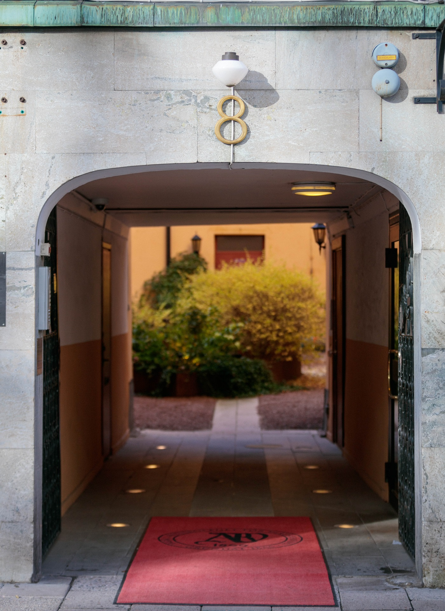
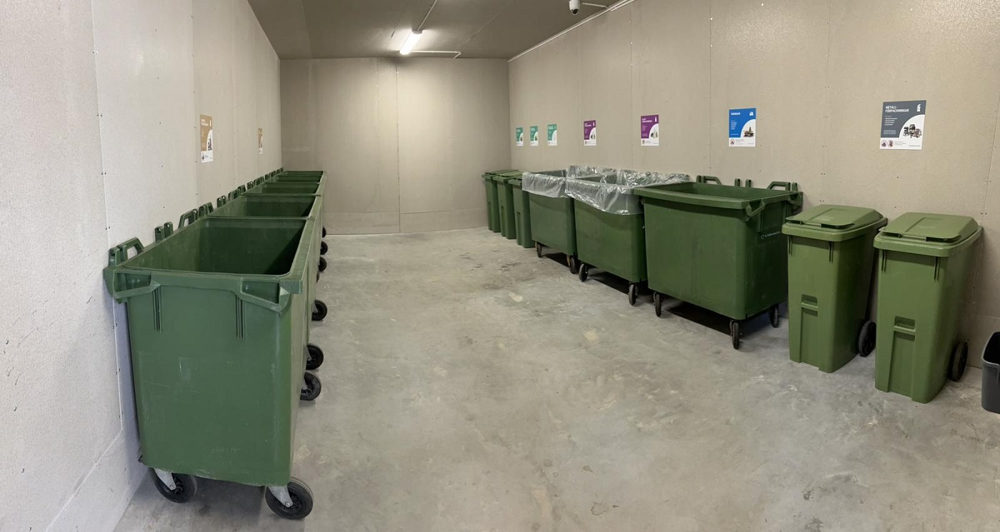
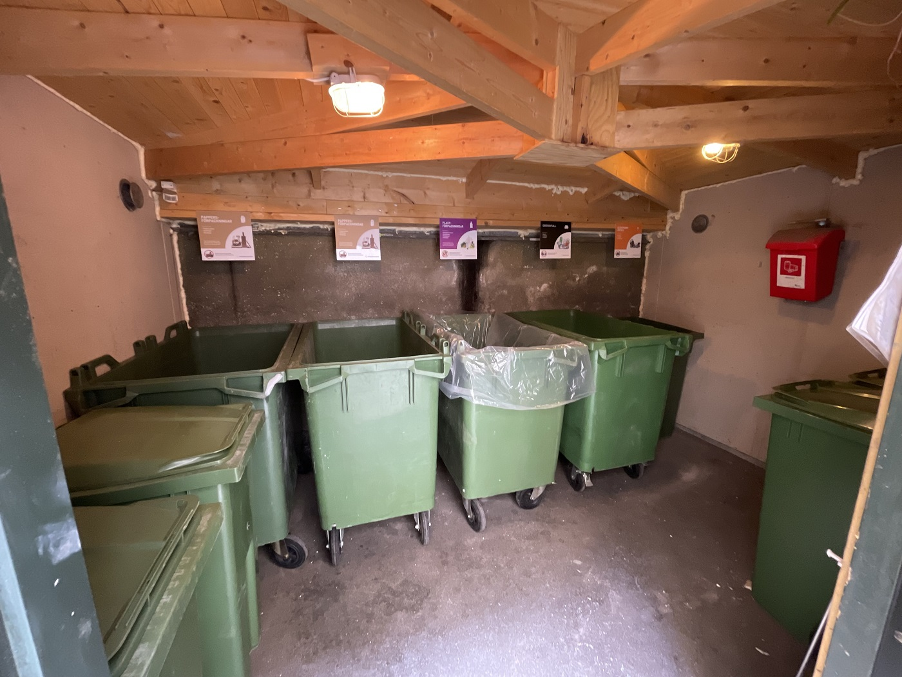

# Återvinning brf

- **URL:** https://avfallskonsulten.se/atervinning_fastighet_och_brf
- **Title-tagg:** Återvinning brf | Sophantering | Avfallskonsulten
- **Meta description:** Smidig & effektiv återvinning för brf! Vi är experter på sortering och hämtning av avfall. Få kostnadsfri offert för ditt företag.
- **Canonical:** https://avfallskonsulten.se/atervinning_brf
- **Ord i brödtext:** 1633
- **Bilder:** 6

---

# Återvinning brf

Återvinning är idag en central del för bostadsrättsföreningar och fastigheter. Med vår långa branscherfarenhet erbjuder vi optimala återvinningslösningar för både fastighetsägare och BRF.   
  
Läs mer nedan om hur vår avfallshantering kan anpassas efter just er BRF nedan.

[KONTAKTA OSS](#kontakt-form)

## Vad våra kunder säger om oss

## Våra tjänster för sophantering och återvinning BRF

Vi erbjuder skräddarsydd återvinning för bostadsrättsföreningar (BRF:er) i Stockholm och hjälper er att hantera avfall på ett effektivt och miljövänligt sätt. Vårt mål är att skapa långsiktigt hållbara lösningar som gör källsorteringen enkel, ökar återvinningen och minskar föreningens totala avfallsmängd.

**Vad ingår i våra tjänster för återvinning BRF?**

- **-Källsortering** - vi säkerställer smidiga rutiner
- **-Anpassade avfallsbehållare** – korrekt märkta kärl för plast, papper, glas, metall och annat material.
- **-Avfallshämtning** - regelbunden service direkt på plats.
- **-Rådgivning**- tips och vägledning för en mer effektiv avfallshantering.
- **-Miljövänliga lösningar**- vi arbetar alltid med fokus på återbruk och hållbarhet.

## Förutsättningar för återvinning i BRF

Varje fastighet och bostadsrättsförening (BRF) har unika förutsättningar när det gäller förpackningssortering. Ofta behövs kreativa lösningar som fungerar både för de boende och för oss som ansvarar för hämtningen. Vi har lång erfarenhet av att hantera utmaningar som små utrymmen, långa gångsträckor eller andra praktiska hinder. Oavsett situation strävar vi alltid efter att leverera det lilla extra. Kontakta oss gärna för ett kostnadsfritt platsbesök och rådgivning kring återvinning för er BRF.

[BOKA UPPHÄMTNING](#kontakt-form)

## Inredning och placering för sophantering i BRF

När utrymmet för avfall är bestämt är det viktigt att optimera sophanteringen med rätt antal behållare, strategisk placering och tydliga anvisningar. Med vår långa erfarenhet erbjuder vi i våra återvinningsabonnemang alla nödvändiga behållare och skyltar för en effektiv sophantering i BRF. Vid övertagande från en annan leverantör fräschar vi dessutom upp avfallsrummet med enhetliga behållare och nya skyltar, så att er BRF får ett snyggt, funktionellt och hygieniskt avfallsområde. Med våra lösningar blir sophanteringen enkel, smidig och miljövänlig för alla boende.

[Kontakta oss](#kontakt-form) om ni behöver vår hjälp!

## Återvinningsabonnemang för sophantering BRF

När utrymmet är bestämt är det avgörande att optimera det med rätt antal behållare, strategisk placering och tydliga skyltar för enkel sortering. Med våra återvinningsabonnemang ingår alla nödvändiga behållare och skyltar, och vid övertagande från en annan leverantör fräschar vi upp rummet med enhetliga behållare och uppdaterade skyltar. Allt för att förenkla och effektivisera sophanteringen i er BRF!

Läs mer här om du behöver hjälp med byggavfall, [hämtning av byggsäckar](https://avfallskonsulten.se/hamta-byggsackar) eller [containerhyra i Stockholm](hyra-container-stockholm).

[BOKA UPPHÄMTNING](#kontakt-form)

## Mer om återvinning brf

Att ha en välfungerande återvinningslösning i en bostadsrättsförening (BRF) är inte bara en fråga om ordning och trivsel, det är också ett viktigt steg mot en mer hållbar framtid. I Stockholm, där många människor bor tätt och delar gemensamma utrymmen, är det avgörande att återvinningen är enkel, tydlig och effektiv.

En BRF ansvarar för att alla boende har möjlighet att sortera sitt avfall på ett korrekt sätt. Detta gäller oavsett om det handlar om hushållssopor, förpackningar, glas, elektronik eller grovavfall. Genom att skapa bra rutiner och tydliga förutsättningar kan man inte bara minska mängden avfall som går till deponi, utan också bidra till att värdefulla resurser återvinns och kommer till nytta igen.

### Varför återvinning är extra viktigt för BRF:er i Stockholm

Stockholm är en växande stad där hållbarhetsfrågor står högt på agendan. När många hushåll delar på samma återvinningsutrymmen ställs höga krav på struktur och logistik. En välorganiserad återvinningslösning minskar risken för överfulla kärl, dålig lukt och nedskräpning, samtidigt som den skapar en trevligare boendemiljö.

För en bostadsrättsförening är återvinning dessutom ett sätt att visa ansvarstagande gentemot både medlemmar och miljön. Genom att följa stadens riktlinjer och erbjuda bra återvinningsmöjligheter signalerar styrelsen att hållbarhet är en prioriterad fråga.

### Steg för att lyckas med återvinning i en BRF

1. #### Kartlägg behovet

   Börja med att undersöka vilka fraktioner som genereras mest i föreningen. Är det mycket pappersförpackningar? Många glasflaskor? Mycket grovavfall? Kartläggningen ger en bra grund för att anpassa återvinningslösningen.
2. #### Inred återvinningsrummet smart

   Ett återvinningsrum ska vara lätt att använda och logiskt utformat. Ställ de mest använda kärlen närmast ingången, använd tydlig skyltning och se till att det finns tillräckligt med utrymme för att undvika trängsel.
3. #### Inför tydliga rutiner för tömning

   Hur ofta återvinningen behöver tömmas beror på föreningens storlek och säsong. Vi rekommenderar att upprätta ett tömningsschema tillsammans med en erfaren avfallsentreprenör.
4. #### Informera och engagera medlemmarna

   En återvinningslösning är bara så bra som de boendes engagemang. Informera regelbundet via nyhetsbrev, anslagstavlor och digitala kanaler om hur sorteringen ska ske.
5. #### Följ upp och förbättra

   Utvärdera återvinningslösningen minst en gång per år. Finns det fraktioner som ofta blir överfulla? Behövs fler kärl? Kan skyltningen förbättras? Små justeringar kan göra stor skillnad.

### Vanliga fraktioner i återvinning för BRF

- **-Plastförpackningar:** allt från yoghurtburkar till plastflaskor.
- **-Pappersförpackningar:**exempelvis mjölkpaket, kartonger och påsar.
- **-Glasförpackningar:**färgat och ofärgat glas.
- **-Metallförpackningar:**konservburkar, aluminiumfolie, kapsyler.
- **-Tidningar och papper:**reklamblad, dagstidningar och kontorspapper.
- **-Elavfall:**småelektronik, lampor, batterier.
- **-Farligt avfall:**kemikalier, målarfärg, sprayburkar.
- **-Textilier:**hela och trasiga kläder, skor och hemtextil.
- **-Grovavfall:**möbler, vitvaror och större föremål som inte får plats i kärlen.

### Fördelar med professionell hjälp för sophantering och återvinning i BRF

Att anlita en professionell partner för återvinning i bostadsrättsföreningar innebär att föreningen får tillgång till expertis, rätt utrustning och pålitlig hämtning. Det frigör tid för styrelsen och minskar risken för felhantering av avfall.

Hos oss på Avfallskonsulten kan vi erbjuda skräddarsydda lösningar som inkluderar allt från planering och inredning av återvinningsrum till löpande hämtning och specialhantering av farligt avfall.

### Miljöperspektivet – mer än bara återvinning

Återvinning handlar inte bara om att sortera avfall, utan också om att minska mängden avfall som uppstår från början. Genom att uppmuntra till återbruk, reparation och delning av saker kan en BRF ytterligare minska sitt klimatavtryck.

En idé är att ordna gemensamma bytesdagar där medlemmarna kan lämna saker de inte längre behöver och ta med sig något nytt. Det skapar gemenskap samtidigt som det minskar avfallsmängden.

### Framtiden för återvinning i BRF:er

Teknikutvecklingen gör att återvinning blir allt enklare och mer automatiserad. I framtiden kan vi se lösningar som smarta kärl som meddelar när de är fulla, digitala sorteringsguider och ännu bättre materialåtervinning.

För BRF:er i Stockholm gäller det att ligga steget före genom att redan nu investera i hållbara och användarvänliga återvinningslösningar.

### Kommunikation och engagemang kring sophantering BRF

För att sophanteringen i en bostadsrättsförening verkligen ska fungera krävs mer än bara rätt utrustning, det handlar också om att skapa engagemang hos medlemmarna. En styrelse som aktivt kommunicerar vikten av återvinning och ger tydliga instruktioner ökar chanserna att alla bidrar på rätt sätt.

Ett effektivt sätt att nå ut är att använda flera kanaler samtidigt: anslagstavlor i trapphusen, nyhetsbrev, föreningens hemsida och sociala medier. Påminnelser vid årsstämman eller gemensamma aktiviteter, som städdagar, är också ett bra tillfälle att informera om rutiner och uppdateringar i återvinningssystemet.

För att öka intresset kan föreningen dela med sig av statistik över hur mycket material som återvinns varje månad eller hur mycket kostnaderna minskar tack vare minskad felsortering. Det gör nyttan mer konkret och motiverande.

## Vanliga frågor kring återvinning brf

1. ### Vilka typer av avfall hämtar ni för BRF?
   - Vi hämtar en mängd olika avfallstyper för bostadsrättsföreningar, inklusive hushållsavfall, pappersprodukter, plast, glas, metall och organiskt avfall. Vi hanterar också specialavfall som elektronik och batterier.
2. ### Hur ofta hämtar ni återvinning för BRF?
   - Vi erbjuder flexibla hämtningsscheman som kan anpassas efter er förenings behov, med alternativ som sträcker sig från veckovis till månatlig hämtning. Kontakta oss för att skapa ett schema som passar er bäst.
3. ### Behöver vi sortera avfallet innan ni hämtar det?
   - Ja, vi ber er att sortera avfallet i olika kategorier som papper, plast, glas och metall innan hämtning. Detta hjälper oss att hantera återvinningen på ett effektivt och miljövänligt sätt.
4. ### Vad händer med det återvunna avfallet?
   - Efter att vi hämtat ditt avfall transporteras det till våra återvinningsanläggningar där det sorteras och bearbetas för återanvändning. Materialen återvinns till nya produkter, vilket minskar behovet av nya råvaror och bidrar till en hållbar framtid.
5. ### Är det obligatoriskt med återvinning i BRF
   - Enligt avfallsförordningen och lokala regler i Stockholm är källsortering och återvinning obligatoriskt för alla fastigheter, inklusive BRF:er. Föreningen ansvarar för att rätt fraktioner samlas in och hanteras på rätt sätt.
6. ### Vilka fraktioner bör en BRF ha i sin återvinningsstation?
   - En välutrustad återvinningsstation i en BRF bör ha kärl för bland annat plast, papper, kartong, metall, glas, batterier och elavfall. Det är också bra att erbjuda lösningar för textilinsamling och farligt avfall.
7. ### Kan vi få hjälp med att inreda återvinningsrum i vår BRF?
   - Ja, vi erbjuder lösningar för att inreda och optimera återvinningsrum, inklusive sopkärl, skyltar och ergonomiska hjälpmedel som underlättar för de boende.
8. ### Hur kan vi öka sorteringsgraden i vår BRF?
   - Tydlig skyltning, lättillgängliga kärl och regelbunden information till medlemmarna är nycklar för att öka sorteringsgraden i en bostadsrättsförening. Vi kan även hjälpa till med utbildning och informationsmaterial.
9. ### Hur säkerställer ni att återvinningen sker miljövänligt?
   - Vi samarbetar med godkända återvinningsanläggningar och följer gällande regler för transport och hantering av avfall. Allt material återvinns eller behandlas enligt de högsta miljökraven.
10. ### Kan ni erbjuda en skräddarsydd lösning för återvinning för vår BRF?
    - Ja, vi kan skapa en anpassad återvinningslösning som uppfyller ditt företags specifika behov och krav. Vårt team arbetar nära dig för att utveckla en effektiv och hållbar återvinningsstrategi.

## Frågor?

Vid frågor eller funderingar når du oss på [08-68427888](tel:08-68427888) eller så kan du fylla i kontaktformuläret nedan så återkommer vi till dig.

### KONTAKTA OSS

Berätta lite mer om vad du vill ha hjälp med
