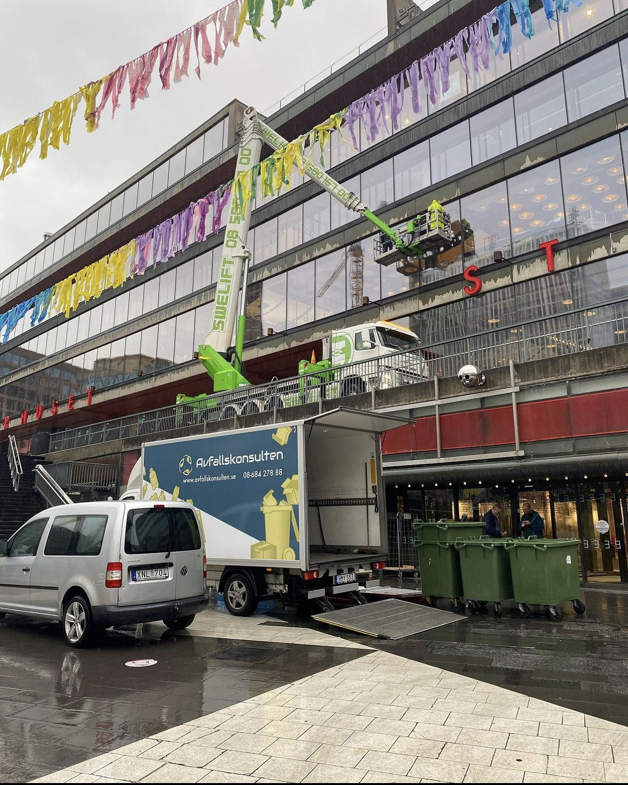
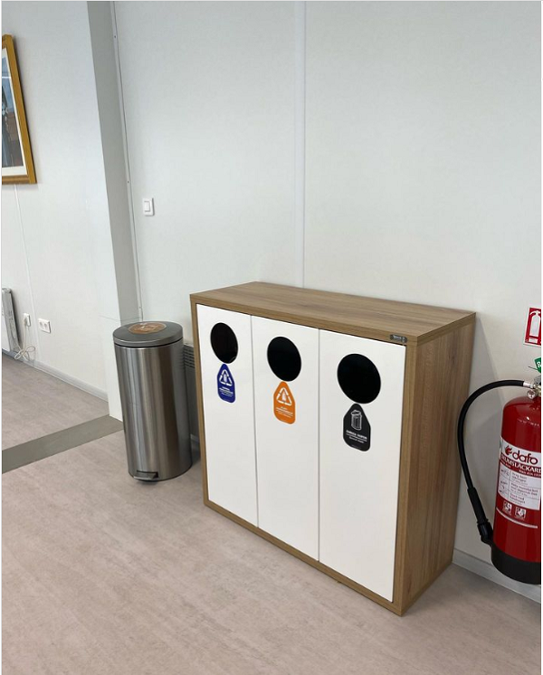

# Återvinning för företag

- **URL:** https://avfallskonsulten.se/atervinning_for_foretag_och_verksamheter
- **Title-tagg:** Återvinning för företag | Avfallshantering | Avfallskonsulten
- **Meta description:** Smidig & effektiv återvinning för företag! Vi är experter på sortering och hämtning av avfall. Få kostnadsfri offert för ditt företag.
- **Canonical:** https://avfallskonsulten.se/atervinning_for_foretag_och_verksamheter
- **Ord i brödtext:** 679
- **Bilder:** 5

---

# Återvinning för företag

Oavsett företagets storlek och verksamhet är effektiv avfallshantering viktigt. Många betalar onödigt höga kostnader för lösningar som inte riktigt fungerar. Vi ser till att ni kan fokusera på det ni gör bäst – er verksamhet – medan vi tar hand om resten.

[KONTAKTA OSS](#kontakt-form)

## Vad våra kunder säger om oss

## Avfallshantering för företag

Vi som [återvinningsföretag i Stockholm](https://avfallskonsulten.se/atervinningsforetag-stockholm) förstår vikten av effektiv avfallshantering för ett framgångsrikt företag. Vi erbjuder skräddarsydda lösningar för att minska miljöpåverkan, spara kostnader och förbättra arbetsmiljön.

### Hämtning och transport av avfall

Vi hämtar ditt avfall vid tider som passar er och transporterar det säkert för vidare sortering och återvinning. Med flexibla hämtningsintervall hanterar vi alla typer av avfall, från blandat avfall till farligt avfall.

### Sortering och återvinning

Genom noggrann sortering maximerar vi återvinningen och minimerar deponiavfallet. Vår utbildade personal säkerställer en effektiv och miljövänlig process.

### Farligt avfall

Vi hanterar farligt avfall enligt alla lagkrav med den utrustning och expertis som krävs för en trygg och ansvarsfull behandling.

### Byggavfall

Vi hämtar och återvinner byggavfall och kan även utföra sortering och återvinning på plats vid behov.

### Elektronikskrot

Elektronikavfall hanteras miljövänligt och enligt gällande lagar, med fokus på återvinning av alla komponenter.

### Kontorsavfall

Vi hanterar kontorsavfall och erbjuder även säker destruktion av sekretessbelagt material.

Kontakta oss för en lösning anpassad till just ert företags behov!

[Kontakta oss](#kontakt-form)

## Ansvarsfull återvinning för företag

Vi tar hand om din återvinning för företag med ansvar och hållbarhet i fokus:

- **Sortering och återvinning**: Vi sorterar avfallet i olika fraktioner och återvinner så mycket som möjligt.
- **Behandling av farligt avfall**: Vi hanterar farligt avfall säkert och enligt gällande lagar och förordningar.
- **Energiåtervinning**: Vi samarbetar med anläggningar som energiåtervinner avfall på ett miljövänligt sätt.

För att underlätta återvinning är det viktigt med en [avfallshantering](/) anpassad till er verksamhet. Vi erbjuder källsorteringsmöbler, sopkärl, säckar och containrar. Kontakta oss för ett kostnadsfritt platsbesök där vi ser över era behov och nuvarande kostnader.

[Kontakta oss](#kontakt-form) för hjälp med er avfallshantering!

## Fördelar med återvinning för företag

Återvinning för företag för med sig en mängd fördelar, både ekonomiskt och miljömässigt. Genom att införa ett effektivt återvinningssystem kan företag minska sina avfallshanteringskostnader, samtidigt som de minskar sin miljöpåverkan. Återvinning gör det möjligt att spara resurser och energi genom att omvandla avfall till nya produkter, vilket bidrar till en cirkulär ekonomi. Dessutom kan ett företag som prioriterar återvinning stärka sitt varumärke och sitt anseende, vilket gör att det attraherar både kunder och medarbetare som värderar hållbarhet.

## Vanliga frågor kring Avfallskonsultens återvinning för företag

1. ### Vilka typer av avfall hämtar ni?
   - Vi hämtar en bred variation av avfall inklusive hushållsavfall, pappersprodukter, plast, glas, metall och organiskt avfall. Vi hanterar också specialavfall som elektronik och batterier.
2. ### Hur ofta hämtar ni återvinning?
   - Vi erbjuder flexibla hämtningsscheman som kan anpassas efter dina behov, med allt från veckovis till månatliga hämtningsfrekvenser. Kontakta oss för att skapa ett schema som passar dig bäst.
3. ### Behöver jag sortera mitt avfall innan ni hämtar det?
   - Ja, vi ber dig att sortera ditt avfall i olika kategorier som papper, plast, glas och metall innan hämtning. Detta hjälper oss att effektivt och miljövänligt hantera återvinningen.
4. ### Vad händer med det återvunna avfallet?
   - Efter att vi hämtat ditt avfall transporteras det till våra återvinningsanläggningar där det sorteras och bearbetas för återanvändning. Materialen återvinns till nya produkter, vilket minskar behovet av nya råvaror och bidrar till en hållbar framtid.
5. ### Kan ni erbjuda en skräddarsydd lösning för återvinning för vårt företag?
   - Ja, vi kan skapa en anpassad återvinningslösning som uppfyller ditt företags specifika behov och krav. Vårt team arbetar nära dig för att utveckla en effektiv och hållbar återvinningsstrategi.

## Frågor?

Vid frågor eller funderingar når du oss på [08-68427888](tel:08-68427888) eller så kan du fylla i kontaktformuläret nedan så återkommer vi till dig.

### KONTAKTA OSS

Berätta lite mer om vad du vill ha hjälp med
