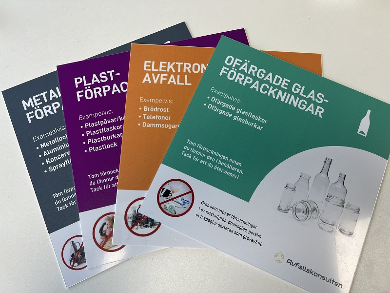
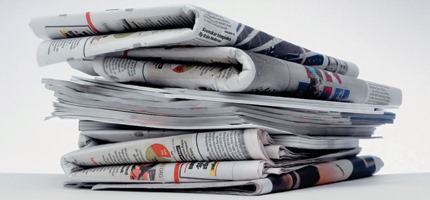
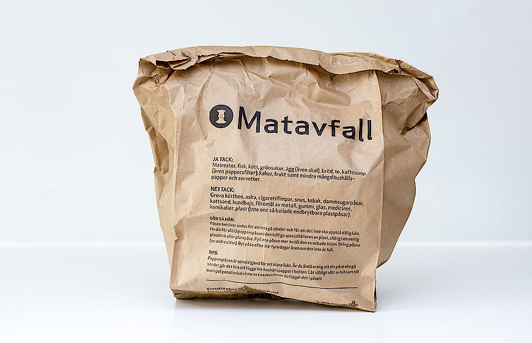

# Återvinningsguide

- **URL:** https://avfallskonsulten.se/atervinningsguide
- **Title-tagg:** Återvinningsguide | Avfallskonsulten
- **Meta description:** Upptäck Avfallskonsultens återvinningsguide – praktiska tips för effektiv sortering och hantering av avfall. Lär dig hur du bidrar till en hållbar miljö.
- **Canonical:** https://avfallskonsulten.se/atervinningsguide
- **Ord i brödtext:** 1238
- **Bilder:** 6

---

# Återvinningsguide

Den här återvinningsguiden ger dig en översikt över hur du bäst hanterar och återvinner vanliga typer av avfall – från pappersförpackningar och plast till elektronik och textilier. Lär dig mer om hur du kan bidra till en hållbar framtid genom att följa enkla steg i din vardag.

[KONTAKTA OSS](#kontakt-form)

## Pappersförpackningar

**Papperspåsar - Wellpappkartonger - Mjölkförpackningar - Pizzakartonger**

Papper och kartong är lätta att återvinna, men viktigt att de inte är förorenade av matrester eller vätska. Kartonger bör plattas till för att spara plats, och om möjligt, ta bort eventuella plast- eller metallkomponenter.

## Plastförpackning

**Plastflaskor - Yoghurtburkar - Plastpåsar - Matförpackningar - Tvålflaskor - Rengöringsmedelsbehållare**

Plast kommer i olika typer och alla är återvinningsbara på samma sätt. Rengör förpackningarna innan återvinning för att undvika lukt och förorening.

## Glas

**Vinflaskor - Syltburkar - Glasflaskor för drycker - Burkar**

Glas är oändligt återvinningsbart och bör sorteras efter färg – ofärgat och färgat glas återvinns separat. Ta bort lock och korkar innan du slänger glaset. Observera att keramik, porslin och glödlampor inte ska återvinnas tillsammans med glas.

## Metallförpackningar

**Konservburkar - Läskburkar - Aluminiumfolie - Tuber från t.ex. kaviar - Metallkapsyler - Metallock**

Metall kan smältas och återvinnas många gånger utan att kvaliteten försämras. Skölj ur konservburkar och platta till aluminiumförpackningar för att spara utrymme. Tänk på att även små metallföremål, som kapsyler och lock, kan återvinnas.

## Elektronik och batterier

**Mobiltelefoner - Laptops - Elverktyg - Batterier - Glödlampor - Små hushållsapparater**

Elektronik innehåller både värdefulla metaller och miljöfarliga ämnen, vilket gör det extra viktigt att dessa återvinns korrekt. Lämna elektronik och batterier på speciella insamlingsställen eller återvinningscentraler.

## Textilier

**Kläder - Handdukar - Lakan - Gardiner - Trasiga tygprodukter**

Många textilier kan återvinnas eller återanvändas om de är i gott skick. Textilbehållare eller second-hand-butiker tar ofta emot kläder, medan trasiga eller slitna textilier kan lämnas för textilåtervinning. Undvik att slänga textilier i hushållssoporna för att minska avfall.

## Organiskt avfall

**Matrester - Frukt och grönsaksskal - Kaffefilter - Tepåsar - Trädgårdsavfall som löv, kvistar och gräsklipp.**

Organiskt avfall kan komposteras eller samlas in för att omvandlas till biogas och gödsel. Se till att endast biologiskt nedbrytbart material hamnar här, och undvik att blanda in plastpåsar. En egen kompost kan vara ett bra sätt att minska avfallet och skapa näringsrik jord för trädgården.

## Vanliga frågor om sortering av förpackningar

1. ### Kan jag lämna förpackningar med etiketter på, eller måste jag ta bort dem?
   - Ja, du kan lämna förpackningar med etiketter kvar. De flesta sorteringsanläggningar kan hantera etiketter under återvinningsprocessen. Om etiketten är lätt att ta bort kan det dock vara bra att göra det, särskilt på plastförpackningar.
2. ### Ska jag diska ur förpackningarna innan återvinning?
   - En snabb sköljning är oftast tillräcklig, särskilt för förpackningar som har haft mat i sig. Det viktigaste är att ta bort matrester för att undvika lukt och hålla återvinningsmaterialet rent. Det behövs ingen diskmedel – bara skölj ur med vatten.
3. ### Kan jag lägga metallock och kapsyler med metallförpackningar?
   - Ja, metallock och kapsyler kan återvinnas som metall. Även små föremål som kapsyler är viktiga att sortera rätt, eftersom de kan återvinnas många gånger. Lägg dessa tillsammans med större metallförpackningar som konservburkar.
4. ### Kan jag lägga pappersförpackningar med plastfönster i pappersåtervinningen?
   - Ja, mindre plastfönster på pappersförpackningar är vanligtvis okej och kan sorteras med papper. Större plastfönster bör dock tas bort om möjligt, eftersom det underlättar återvinningsprocessen.
5. ### Ska jag ta bort korkar från plastflaskor och lägga dem separat?
   - Det är faktiskt bäst att låta korkarna sitta kvar på plastflaskorna. På moderna återvinningsanläggningar separeras korkar och flaskor automatiskt, och korkarna kan återvinnas tillsammans med resten av plasten.
6. ### Hur ska jag sortera mjölk- och juiceförpackningar?
   - Förpackningar som mjölk- och juicekartonger, ofta kallade "tetrapack", består vanligtvis av både papper och plast. Sortera dem som papper eller kartong, och skölj gärna ur dem innan du återvinner dem.
7. ### Vad gör jag med metallfolie och aluminiumformar?
   - Aluminiumfolie och formar kan återvinnas som metall. Se till att de är rena och fria från matrester. Platta gärna till större bitar av aluminiumfolie för att spara plats i återvinningskärlet.

## Tips för effektiv återvinning med vår återvinningsguide

Här kommer några tips kring återvinning i vår återvinningsguide:

- **Sortera direkt:** Skapa separata behållare för olika typer av avfall (plast, papper, metall, glas, kompost) för att undvika att allt blandas ihop. Detta sparar tid och underlättar hanteringen när det är dags att tömma soporna.
- **Känn till vad som går att återvinna:** Vissa förpackningar och material kan återvinnas medan andra inte kan det. Ha en snabbguide nära till hands, exempelvis på kylskåpet, så att du enkelt ser vad som ska sorteras var.
- **Komprimera förpackningar:** För att spara plats, tryck ihop plastförpackningar och kartonger. Detta gör att du får plats med mer i behållaren och behöver tömma den mer sällan.
- **Rengör förpackningar:** Skölj ur burkar, flaskor och andra förpackningar innan du lägger dem i återvinningen. Detta minskar risken för lukt och håller återvinningsmaterialet fräscht tills det hämtas.
- **Återvinn elektronik på rätt plats:** Gamla batterier, elektronik och lampor hör inte hemma i vanliga återvinningskärl. Lämna dessa på speciella insamlingsställen eller återvinningscentraler för att säkerställa att de hanteras på ett miljösäkert sätt.
- **Undvik plastpåsar:** Förvara återvinningen direkt i behållare istället för i plastpåsar. Detta gör processen enklare och eliminerar onödigt plastavfall.
- **Använd mindre engångsartiklar:** Försök att minimera användningen av engångsartiklar genom att välja flergångsprodukter, som återanvändbara vattenflaskor och matkassar. På så sätt minskar mängden avfall som behöver återvinnas.
- **Engagera familjen:** Gör återvinningen till en naturlig del av vardagen genom att inkludera alla i hushållet. Sätt upp en enkel återvinningsstation där alla vet var saker hör hemma.
- **Använd en återvinningsapp:** Det finns appar som hjälper dig att hålla koll på vad som går att återvinna och var närmaste återvinningsstation ligger. Perfekt för den som vill göra återvinningen ännu smidigare.

## Bästa sättet att rengöra material innan återvinning

Rengöring av förpackningar och andra material innan återvinning är ett viktigt steg för att säkerställa att de kan återvinnas effektivt och undvika att smuts och matrester förstör andra återvinningsbara material. Här är några tips för att enkelt rengöra material innan de sorteras:

1. **Skölj med kallt vatten:** För många förpackningar, särskilt plast- och glasbehållare, räcker det med en snabb sköljning med kallt vatten för att avlägsna rester. Kallvatten hjälper också till att minska energianvändningen.
2. **Använd en diskborste:** För kladdigare material, som syltburkar eller konservburkar med sås, kan en enkel diskborste eller svamp användas för att snabbt få bort resterna.
3. **Undvik diskmedel när det går:** Diskmedel är oftast inte nödvändigt; vatten och en borste räcker oftast bra. Om diskmedel behövs, använd det sparsamt.
4. **Låt torka innan sortering:** Låt gärna förpackningarna lufttorka innan de läggs i återvinningskärlen, särskilt papper och kartong, som kan förstöras om de är blöta.
5. **Ta bort etiketter om möjligt:** Om etiketter lossnar enkelt från plast- eller glasbehållare, ta bort dem innan återvinning. De flesta återvinningsprocesser hanterar dock detta, så gör det bara om det är lätt att få bort dem.
6. **Separera olika material:** Om en förpackning innehåller flera material (t.ex. plast och metall), separera dem så att varje del kan återvinnas på rätt sätt.

Genom att följa dessa enkla steg hjälper du till att hålla återvinningsflödet rent och bidrar till en mer hållbar återvinningsprocess!

## Frågor?

Vid frågor eller funderingar når du oss på [08-68427888](tel:08-68427888) eller så kan du fylla i kontaktformuläret nedan så återkommer vi till dig.

### KONTAKTA OSS

Berätta lite mer om vad du vill ha hjälp med
