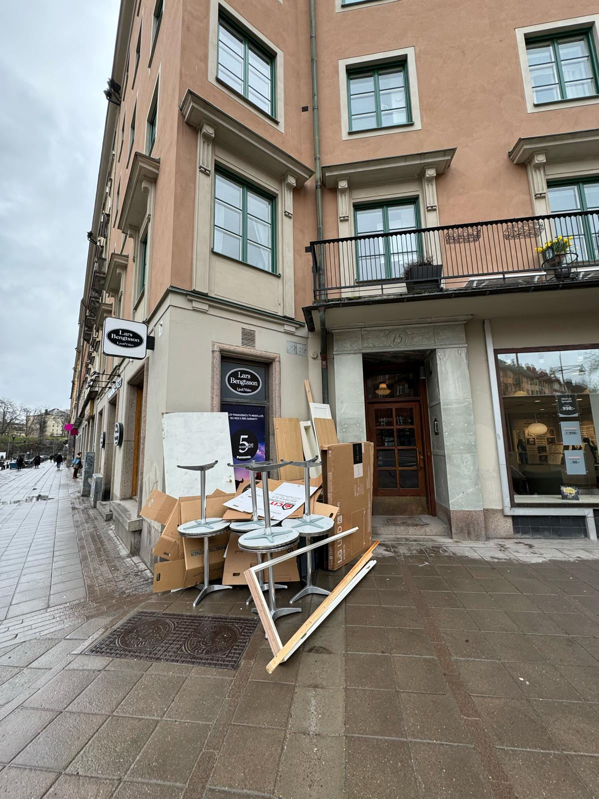

# Avfallshantering restaurang

- **URL:** https://avfallskonsulten.se/avfallshantering-restaurang
- **Title-tagg:** Avfallshantering restaurang | Avfallskonsulten
- **Meta description:** Effektiv och miljövänlig avfallshantering för restauranger. Avfallskonsulten hjälper dig med återvinning och bortforsling av matavfall och förpackningar.
- **Canonical:** https://avfallskonsulten.se/avfallshantering-restaurang
- **Ord i brödtext:** 808
- **Bilder:** 6

---

# Avfallshantering restaurang

Avfallshantering för restauranger är en viktig del för att säkerställa en hållbar verksamhet och en ren arbetsmiljö. Vi på Avfallskonsulten erbjuder skräddarsydda lösningar för att hjälpa restauranger effektivt hantera sitt avfall. Från wellpapp, plastförpackningar och grovsopor – vi tar hand om hela flödet, så att du kan fokusera på att driva din verksamhet.

[KONTAKTA OSS](#kontakt-form)

## Våra tjänster inom avfallshantering för restauranger

Vi erbjuder en rad tjänster som är anpassade för att möta behoven hos restauranger. Vårt mål är att göra din avfallshantering så smidig som möjligt, samtidigt som vi arbetar för att minimera miljöpåverkan. Vi tar hand om glas, plast, papper, förpackningar och även bortforsling av grovsopor och köksutrustning.

### Hantering av matavfall och organiskt avfall

Hämtas enbart av kommunens upphandlade entreprenör – vi kan hjälpa till med kostnadseffektivering av ditt abonnemang

### Återvinning av förpackningar och plast

Förpackningar är en stor del av avfallet som genereras på en restaurang. Vi hjälper till att samla in och återvinna förpackningar, plast och annat material för att minska din miljöpåverkan. Genom att arbeta med oss får du en säker och hållbar lösning för att hantera förpackningar effektivt.

### Bortforsling av grovsopor och överbliven utrustning

När du byter ut köksutrustning eller får grovsopor kan vi hjälpa till med bortforslingen. Vi hämtar och tar hand om allt från gamla köksmaskiner till möbler eller övriga större föremål som inte längre behövs. Vi ser till att alla föremål tas om hand på ett miljövänligt sätt.

### Anpassade lösningar för små och stora restauranger

Oavsett om du driver ett litet café eller en stor restaurangkedja, erbjuder vi anpassade lösningar som passar din verksamhet. Vi har flexibiliteten att skapa avfallshanteringssystem som passar just dina behov och kan skala upp eller ner beroende på mängden avfall du genererar.

[Boka tjänst!](#kontakt-form)

## Så fungerar vår process för avfallshantering för restauranger

Vår process för avfallshantering är enkel och effektiv. Vi skräddarsyr en plan för din restaurang baserat på de specifika behoven och typerna av avfall som du genererar. När planen är på plats samlar vi regelbundet in avfallet och ser till att det tas om hand på ett ansvarsfullt och hållbart sätt. Vi erbjuder också kontinuerlig support för att säkerställa att allt fungerar smidigt.

[Kontakta oss](#kontakt-form) om ni vill börja planera!

## Varför välja oss för avfallshantering till din restaurang?

Avfallskonsulten erbjuder en helhetslösning för avfallshantering som är både kostnadseffektiv och miljövänlig. Vi har lång erfarenhet av att arbeta med restauranger och skräddarsyr varje lösning för att passa just din verksamhet. Genom att använda oss får du en pålitlig partner som fokuserar på hållbarhet och effektivitet, och som alltid strävar efter att minska din restaurangs miljöpåverkan.

## Kontakta oss för hjälp med avfallshantering till din restaurang

Du kan enkelt komma i kontakt med oss genom att ringa oss direkt, skicka ett mejl eller fylla i vårt kontaktformulär på hemsidan. Vi svarar snabbt på alla frågor och hjälper dig att komma igång med en effektiv lösning för din avfallshantering.

[Boka avfallshantering!](#kontakt-form)

## Vanliga frågor vi får kring avfallshantering för restauranger

1. ### Hur fungerar insamling av matavfall för restauranger?
   - Hämtas enbart av kommunens upphandlade entreprenör – vi kan hjälpa till med kostnadseffektivering av ditt abonnemang.
2. ### Kan ni hantera farligt avfall från restaurangkök?
   - Ja, vi kan hjälpa till med hantering av farligt avfall, såsom kemikalier, batterier och andra specialavfall som kan uppkomma i ett restaurangkök. Vi har rätt rutiner och tillstånd för att hantera och transportera farligt avfall på ett säkert och miljövänligt sätt.
3. ### Vilka typer av avfall kan ni hjälpa till att återvinna?
   - Vi återvinner många typer av avfall, inklusive plast, papper, glas, metall. Vi erbjuder även lösningar för att återvinna förpackningar och organiskt avfall, vilket hjälper till att minska mängden avfall som går till deponi.
4. ### Hur ofta kan ni hämta avfall från vår restaurang?
   - Vi anpassar hämtningarna efter din verksamhet. Vanligtvis erbjuder vi hämtningsintervall från dagliga till veckovisa, beroende på avfallets mängd och din restaurangs behov. Vi skräddarsyr en plan för att passa just din verksamhet.
5. ### Vad kostar det att anlita er för avfallshantering för restauranger?
   - Priserna för våra tjänster varierar beroende på mängden avfall, typ av avfall och hämtningens frekvens. Vi erbjuder kostnadsfria offertförslag så att du kan få en tydlig bild av kostnaden innan vi påbörjar vårt samarbete.

## Frågor?

Vid frågor eller funderingar når du oss på [08-68427888](tel:08-68427888) eller så kan du fylla i kontaktformuläret nedan så återkommer vi till dig.

### KONTAKTA OSS

Berätta lite mer om vad du vill ha hjälp med
