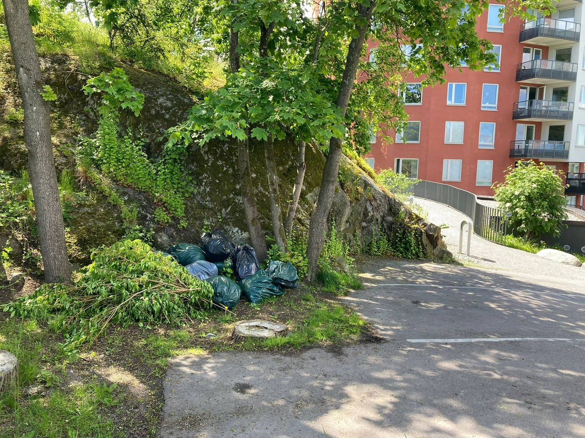
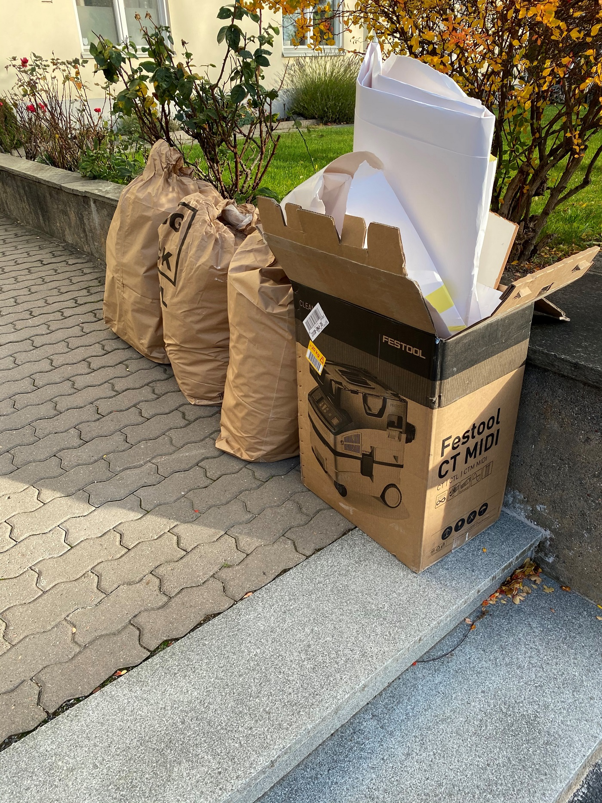
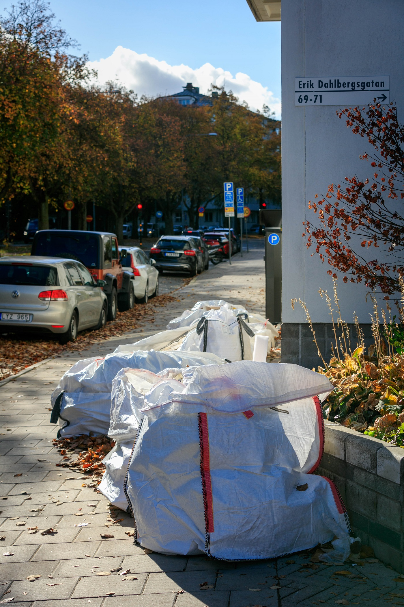
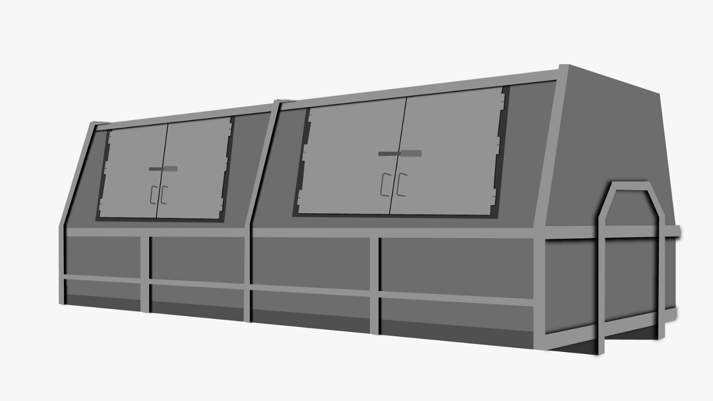
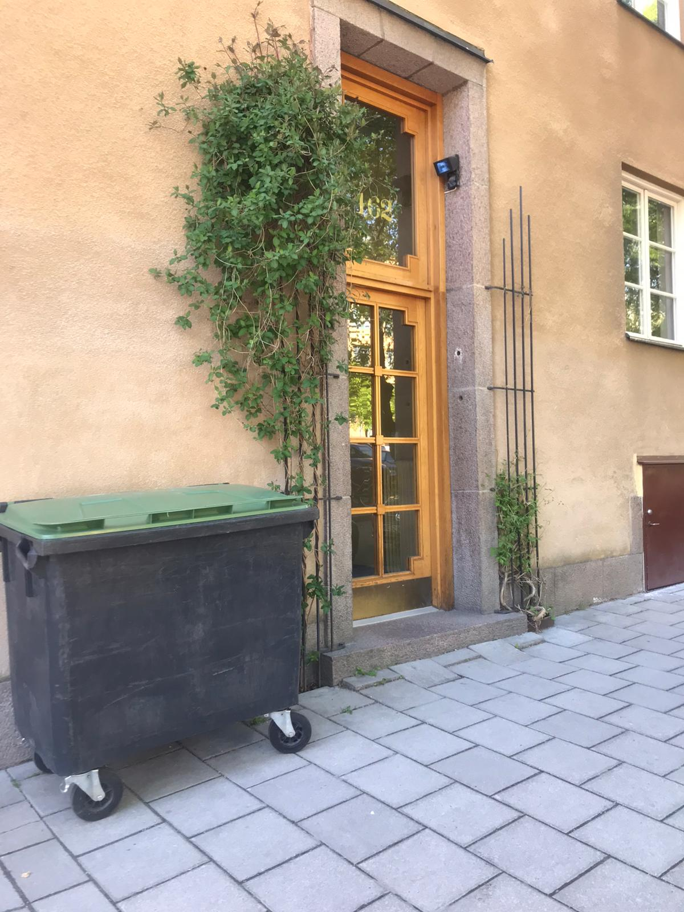

# Hämtning av byggavfall i Stockholm

- **URL:** https://avfallskonsulten.se/bygg-och-tradgardsavfall
- **Title-tagg:** Hämta byggavfall Stockholm | Gratis offert | Avfallskonsulten
- **Meta description:** Hämta byggavfall i Stockholm med Avfallskonsulten. Vi erbjuder både avfallshämtning och containeruthyrning. Få en kostnadsfri offert idag.
- **Canonical:** 
- **Ord i brödtext:** 628
- **Bilder:** 6

---

# Hämtning av byggavfall i Stockholm

Har du trädgårdsavfall eller byggavfall från en renovering? Vi hämtar ditt avfall och ser till att det sorteras korrekt på miljöcertifierade återvinningsanläggningar. Oavsett om du är privatperson eller hantverkare, har vi en lösning som passar dina behov.

[KONTAKTA OSS](#kontakt-form)

## Upphämtning av byggavfall i Stockholm på plats

Har du inte plats för en container eller byggsäck? Vi erbjuder hämtning av byggavfall direkt på plats i Stockholm – en smidig lösning för dig som vill bli av med avfall utan krångel. Med vår tjänst slipper du ansöka om tillstånd för container och får istället en flexibel upphämtning anpassad efter dina behov. Perfekt för snickare, målare, trädgårdsfirmor och privatpersoner som vill slippa egen transport och sortering. Vi ser till att ditt byggavfall hanteras på ett miljövänligt sätt och transporteras till certifierade återvinningsanläggningar. När du väljer Avfallskonsulten kan du känna dig trygg med att hela processen sköts professionellt – så att du kan fokusera fullt ut på ditt arbete eller projekt.

[BOKA UPPHÄMTNING](#kontakt-form)

## Byggsäckar som bygavfallsalternativ

En byggsäck, även kallad storsäck, är ett smidigt alternativ när du behöver samla avfall på ett ställe under en längre tid. Den passar perfekt för både mindre byggprojekt, trädgårdsrensning eller garagestädning när en container känns för stor. Hos Avfallskonsulten kan du beställa byggsäckar i olika storlekar, anpassade efter mängden avfall. När säcken är fylld erbjuder vi [upphämtning av byggsäckar](https://avfallskonsulten.se/hamta-byggsackar) direkt på plats i Stockholm med rätt fordon för ändamålet. Vi ser till att ditt avfall transporteras till miljöcertifierade återvinningsanläggningar – enkelt, miljövänligt och utan att du behöver tänka på logistik eller sortering.

## Hyra container Stockholm

Behöver du [hyra en container i Stockholm](https://avfallskonsulten.se/hyra-container-stockholm)? Vi erbjuder containrar i storlekar från 5 till 30 kubik för privatpersoner, bostadsrättsföreningar och företag. Att välja rätt storlek är viktigt beroende på avfallsmängd och typ, och vi hjälper dig gärna med rådgivning för att hitta rätt lösning. Vi levererar i hela Storstockholm.

[BOKA UPPHÄMTNING](#kontakt-form)

## Rullkärl för smidig avfallshantering

Sopkärl är ett smidigt och ofta underskattat alternativ när du behöver samla och transportera byggavfall på samma plats, exempelvis vid renoveringar, måleriarbeten eller mindre byggprojekt inom en fastighet. Vi levererar tomma sopkärl direkt till dig, och när de är fyllda erbjuder vi upphämtning av byggavfall i Stockholm för tömning och korrekt sortering. Ska du rensa ett gammalt förråd eller har grovavfall som behöver tas om hand? Vi erbjuder även [grovsophämtning i Stockholm](hamta-grovsopor-stockholm) för både privatpersoner och företag, så att du får en smidig och miljövänlig avfallshantering utan extra krångel.

## Vanliga frågor vi får kring grovsopor och hyra container

1. ### Vad kostar en container med blandat avfall?
   - Kostnaden beror på vilken storlek på containern och hur mycket avfall som kastas. T.ex. kan en 20 kubiks container med blandat avfall på c:a 1,5 ton kosta mellan 4500-5000 kr exkl. moms.
2. ### Vad får man slänga i en hyrd container?
   - Man kan t.ex. slänga trädgårdsavfall, gamla möbler eller metall. Viktigast är att hålla reda på det man inte får slänga för att undvika sorteringsavgifter.
3. ### Vad får man inte slänga i grovsopor?
   - Man får t.ex. inte slänga farligt avfall, blåbetong eller däck. Se till att få ta del av denna info innan ni börjar kasta era grovsopor.

## Frågor?

Vid frågor eller funderingar når du oss på [08-68427888](tel:08-68427888) eller så kan du fylla i kontaktformuläret nedan så återkommer vi till dig.

### KONTAKTA OSS

Berätta lite mer om vad du vill ha hjälp med
