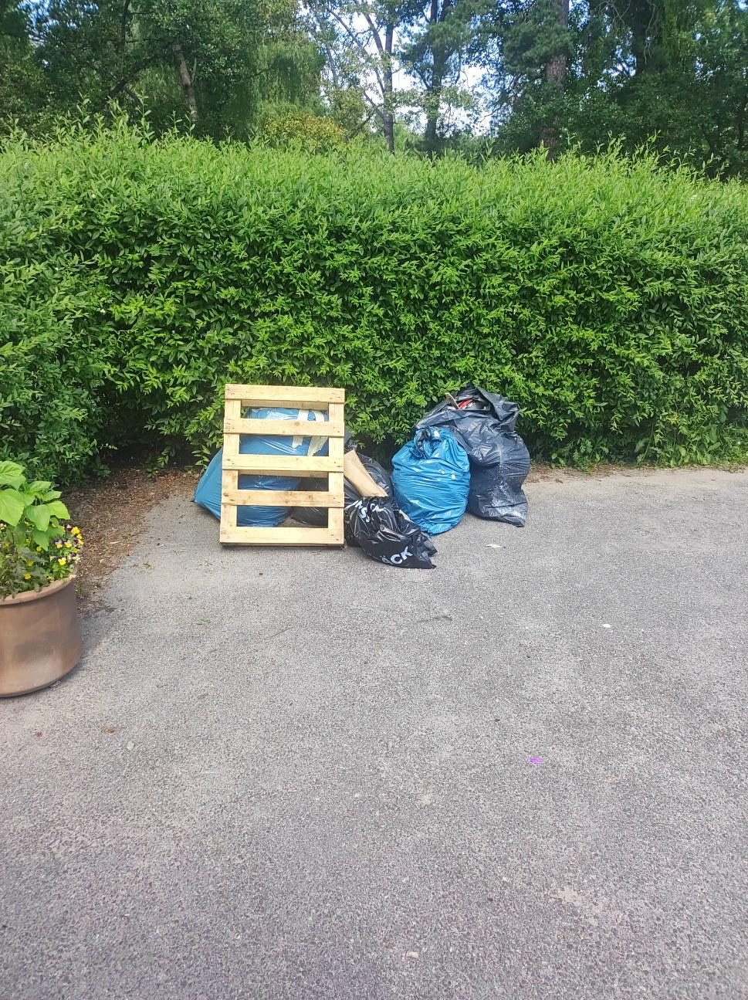
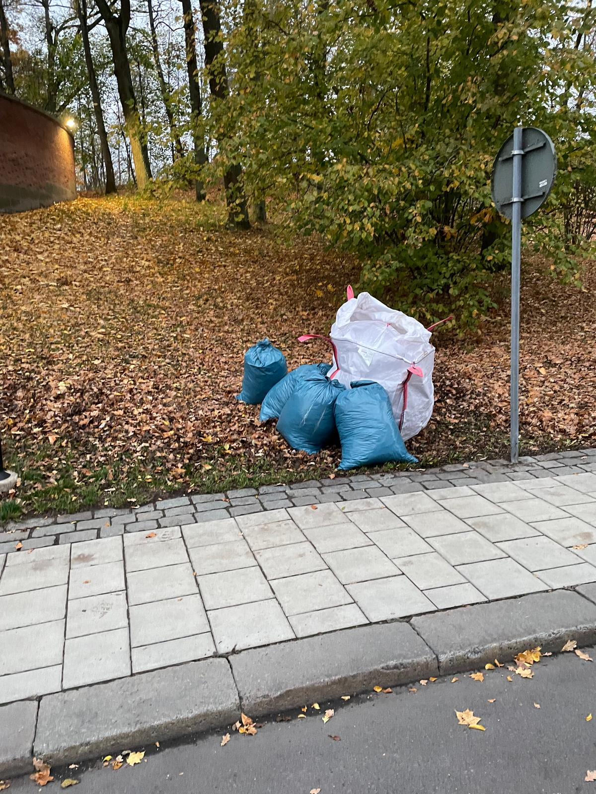
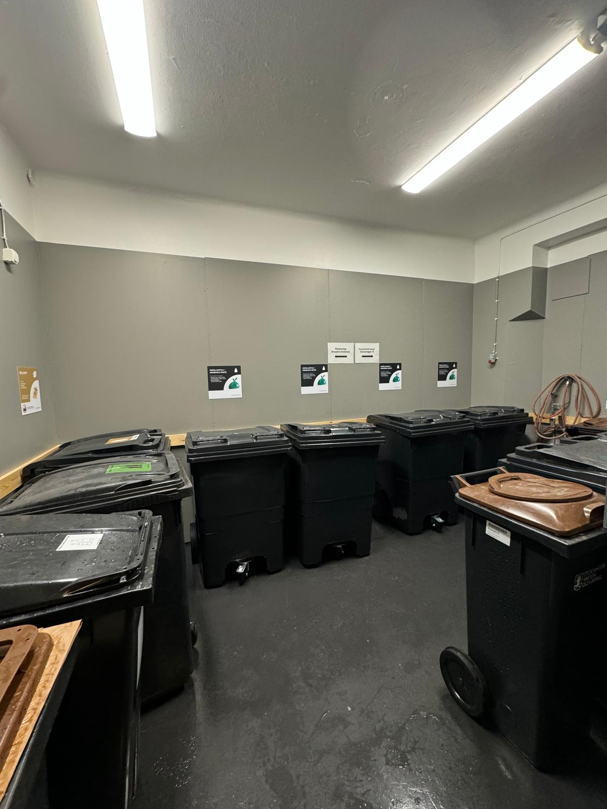

# Förpackningsinsamling

- **URL:** https://avfallskonsulten.se/forpackningsinsamling
- **Title-tagg:** Förpackningsinsamling | Avfallskonsulten
- **Meta description:** Få expertis och effektiva lösningar för förpackningsinsamling med Avfallskonsulten. Vi erbjuder skräddarsydda tjänster för att optimera insamlingen av förpackningar!
- **Canonical:** https://avfallskonsulten.se/forpackningsinsamling
- **Ord i brödtext:** 535
- **Bilder:** 6

---

# Förpackningsinsamling

På Avfallskonsulten erbjuder vi specialiserade tjänster för förpackningsinsamling, designade för att hjälpa företag och organisationer att effektivt hantera och återvinna sina förpackningar. Vi tillhandahåller skräddarsydda lösningar som möter dina specifika behov och bidrar till en hållbar avfallshantering.

[KONTAKTA OSS](#kontakt-form)

## Vårt erbjudande för förpackningsinsamling

Vi erbjuder ett omfattande utbud av tjänster för förpackningsinsamling, vilket inkluderar insamling, sortering och återvinning av alla typer av förpackningsmaterial. Vårt mål är att skapa en smidig och effektiv process för att säkerställa att ditt avfall hanteras korrekt och hållbart, samtidigt som vi anpassar våra tjänster efter dina specifika krav.

[Boka förpackningsinsamling](#kontakt-form)

### Vad för förpackningar återvinner vi?

Vi på Avfallskonsulten återvinner ett brett spektrum av förpackningsmaterial för att säkerställa en omfattande och effektiv avfallshantering. Här är några av de förpackningar vi hanterar:

1. Plastförpackningar: Inkluderar plastflaskor, plastpåsar och plastlådor. Vi sorterar och återvinner plastmaterial för att minska plastavfall och främja återanvändning.
2. Pappersförpackningar: Omfattar kartonger, tidningar, broschyrer och papper från olika källor. Pappersförpackningar återvinns till nytt papper och kartongprodukter.
3. Glasförpackningar: Inkluderar glasflaskor och glasburkar. Vi sorterar glaset efter färg och återvinner det för att skapa nya glasprodukter.
4. Metallförpackningar: Består av aluminiumburkar, konservburkar och andra metallförpackningar. Metallåtervinning hjälper till att spara energi och resurser genom att återanvända metallen.
5. Kompositförpackningar: Förpackningar som kombinerar flera material, såsom tetrapak och flerlagers kartonger. Vi använder specialiserade processer för att separera och återvinna dessa komplexa förpackningar.

[Kontakta oss](#kontakt-form) om ni vill att vi ska samla in förpackningar!

## Varför förpackningsinsamling är viktigt

Förpackningsinsamling är avgörande för att minska mängden avfall som går till deponi och för att främja återvinning. Genom att korrekt sortera och återvinna förpackningar bidrar vi till att spara resurser, minska miljöpåverkan och stödja en cirkulär ekonomi där material återanvänds och inte slösas bort.

## Fördelar med våra tjänster inom förpackningsinsamling

### Miljövänlig hantering av förpackningar

Våra förpackningsinsamlingstjänster är utformade för att minimera miljöpåverkan genom att säkerställa att alla förpackningar hanteras på ett miljövänligt sätt. Genom att använda effektiva återvinningsmetoder och främja återanvändning av material hjälper vi till att skydda miljön och stödja hållbar utveckling.

### Kostnadseffektiva lösningar

Vi erbjuder kostnadseffektiva lösningar som är anpassade efter ditt företags specifika behov och budget. Vårt mål är att ge dig en högkvalitativ tjänst till ett konkurrenskraftigt pris, vilket hjälper dig att spara pengar samtidigt som du bidrar till en mer hållbar framtid.

### Pålitlighet och kvalitet

På Avfallskonsulten är vi kända för vår pålitlighet och höga kvalitet på våra tjänster. Vårt team av experter är engagerat i att leverera konsekvent och professionell service, vilket garanterar att din förpackningsinsamling sker effektivt och utan problem. Vi strävar efter att bygga långvariga relationer med våra kunder genom att erbjuda enastående service och stöd.

[Boka insamling av förpackningar](#kontakt-form)

## Frågor?

Vid frågor eller funderingar når du oss på [08-68427888](tel:08-68427888) eller så kan du fylla i kontaktformuläret nedan så återkommer vi till dig.

### KONTAKTA OSS

Berätta lite mer om vad du vill ha hjälp med
