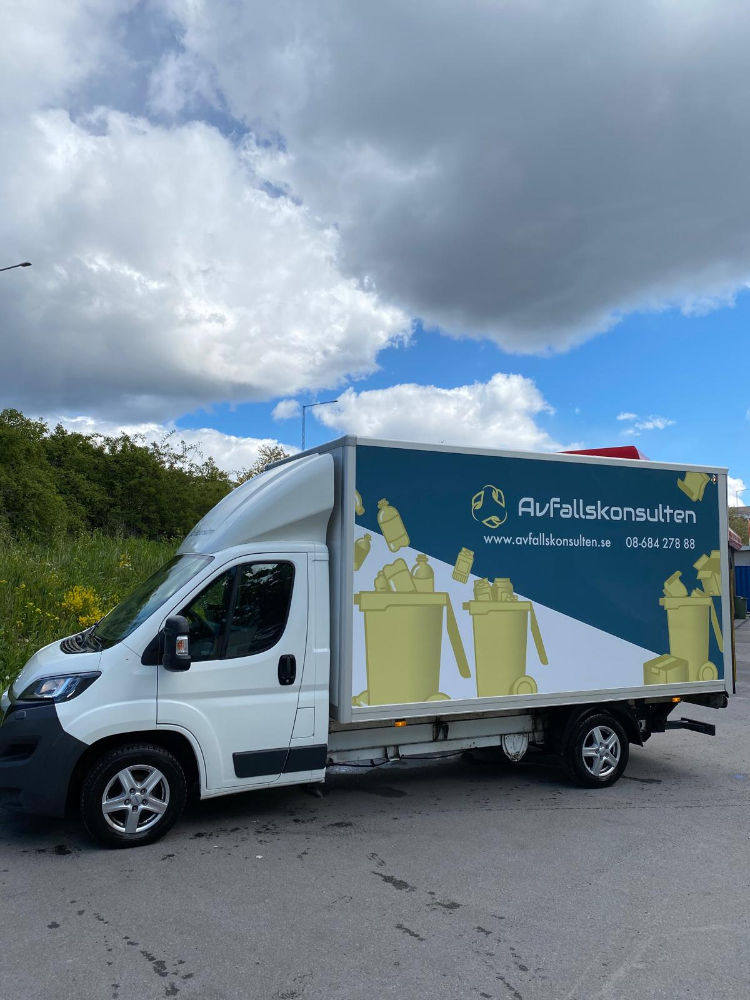

# Hämta grovavfall & grovsopor Stockholm

- **URL:** https://avfallskonsulten.se/hamta-grovsopor-stockholm
- **Title-tagg:** Hämta grovsopor Stockholm | Grovavfall | Avfallskonsulten
- **Meta description:** Avfallskonsulten erbjuder hantering av grovavfall i Stockholm. Vi hanterar och tar bort grovavfall på ett miljövänligt sätt. Få en kostnadsfri offert idag!
- **Canonical:** https://avfallskonsulten.se/hamta-grovsopor-stockholm
- **Ord i brödtext:** 1471
- **Bilder:** 7

---

# Hämta grovavfall & grovsopor Stockholm

Har du grovavfall hemma, på ditt kontor eller ska du rensa ett gammalt förråd? Vi hämtar upp dina grovsopor och ser till så att det sorteras rätt på miljöcertifierade återvinningscentraler och behandlingsanläggningar.

[KONTAKTA OSS](#kontakt-form)

## Hämta grovsopor Stockholm

Vår tjänst hämta grovsopor Stockholm erbjuder en bekväm och effektiv lösning för att hantera större avfallsmaterial som inte ryms i de vanliga sophanteringslösningarna. Vi specialiserar oss på att samla in och korrekt återvinna eller avyttra allt från uttjänta möbler och elektronik till byggavfall, [hämta byggsäckar](https://avfallskonsulten.se/hamta-byggsackar) och annat skrymmande skräp. Oavsett om du renoverar ditt hem, rensar ut ett förråd eller uppdaterar kontorsutrymmen, gör vår tjänst det enkelt för dig att få hämtning av grovavfall och att bli av med grovsopor utan krångel.

Vårt team av erfarna specialister är utrustade för att hantera alla typer av grovsopor och grovavfall, och vi ser till att varje objekt behandlas på ett miljövänligt sätt. Genom att välja vår tjänst för att hämta grovsopor i Stockholm kan du lita på att dina avfallsmaterial inte bara försvinner från din egendom, men också tas om hand på ett ansvarsfullt sätt som respekterar både miljön och gällande regelverk. Med vårt engagemang för kundservice och miljöansvar, strävar vi efter att göra processen av att hämta grovavfall så smidig och bekymmersfri som möjligt för alla våra kunder.

[Boka upphämtning av grovsopor](#kontakt-form)

## Grovsopor och grovavfall för bostadsrättsföreningar

Många bostadsrättsföreningar i Stockholm har ett särskilt utrymme för grovavfall och grovsopor, men det kan snabbt bli överfullt eller rörigt om grovavfallet inte hanteras regelbundet. Vi erbjuder flexibla abonnemangstjänster för hämtning av grovavfall Stockholm, anpassade efter föreningens behov och schema. Våra erfarna medarbetare ser till att grovsoprummet töms effektivt och på ett miljövänligt sätt, så att både boendemiljö och trivsel förbättras. Vid behov kan vi även inreda och organisera grovsoprummet med sopkärl, skyltar och tydliga sorteringsanvisningar för olika fraktioner – vilket gör det enklare för medlemmarna att sortera rätt och bidra till återvinning.

[Kontakta oss](#kontakt-form) om ni vill ha hjälp med era grovsopor!

## Hämta grovavfall från vind och källare

Behöver du hjälp med att rensa vinden eller att hämta grovavfall från källaren? Vi erbjuder professionella tjänster för vindsrensningar, gårdsröjningar och källarhämtningar - alltid anpassade efter dina behov. Med vår långa erfarenhet av tunga lyft och trapphämtningar kan du känna dig trygg med att arbetet utförs både säkert och effektivt. Vi tar hand om allt från möbler och vitvaror till byggavfall och andra större föremål som inte får slängas i vanliga sopkärl. Vid behov kommer vi gärna ut och gör en kostnadsfri platsbesiktning för att planera hämtningen på bästa sätt, så att grovavfallshanteringen blir så smidig som möjligt.

## Hämta grovavfall och grovsopor vid städdag Stockholm

Ett populärt och effektivt sätt för bostadsrättsföreningar i Stockholm att bli av med grovavfall är att erbjuda medlemmarna möjlighet att ställa fram sitt avfall på en anvisad plats i samband med städdagar. Vi på Avfallskonsulten kan sedan sköta hämtning av grovavfall i Stockholm, vilket sparar både tid och arbete för föreningens styrelse och medlemmar. Denna metod uppskattas särskilt av våra BRF-kunder, som ofta bokar tjänsten varje vår och höst för att hålla gemensamma utrymmen och gårdar rena och trivsamma. Vid behov kan vi även samla in elektronik, vitvaror och farligt avfall, och för större mängder erbjuder vi möjlighet att [hyra en container](hyra-container-stockholm) – en smidig lösning för effektiv grovavfallshantering Stockholm.

[Boka upphämtning av grovsopor](#kontakt-form)

## Smidig hantering av grovavfall Stockholm

Oavsett om du representerar en bostadsrättsförening, företag eller är privatperson erbjuder vi på Avfallskonsulten trygga och effektiva lösningar för grovavfall Stockholm. Vi tar hand om allt från möbler och vitvaror till byggrester och trädgårdsavfall, alltid med fokus på miljövänlig hantering och korrekt sortering. Genom att välja oss får du en pålitlig partner som ser till att ditt grovavfall hämtas, transporteras och återvinns på rätt sätt – samtidigt som du sparar tid och undviker onödigt krångel.

## Hämtning av grovavfall pris – vad kostar det?

Priset för hämtning av grovavfall börjar från cirka **275 kr per hämtning**. Den slutliga kostnaden beror framför allt på hur stor mängd grovavfall som ska hämtas och om hämtningen sker enligt ett schemalagt upplägg eller beställs vid behov.

För mindre mängder grovavfall eller återkommande hämtningar kan en planerad lösning vara ett smidigt alternativ. Om behovet istället uppstår vid enstaka tillfällen kan hämtning på avrop passa bättre. Vilken lösning som är mest kostnadseffektiv beror på mängden avfall och hur ofta hämtning behövs.

### Vad påverkar priset för hämtning av grovavfall?

Kostnaden påverkas främst av **mängden grovavfall och hur hämtningen planeras**. Större mängder eller uppdrag som kräver mer omfattande hantering kan påverka priset, medan återkommande och planerade hämtningar kan ge en enklare hantering.

Som riktpris kan du räkna med hämtning av grovavfall från cirka **275 kr per hämtning**. Kontakta oss och berätta hur mycket grovavfall du behöver få hämtat och om du önskar regelbunden hämtning eller hämtning på avrop, så hjälper vi dig att hitta en passande lösning.

### Hämtning av grovavfall i Stockholm

Avfallskonsulten hjälper företag, fastighetsägare, bostadsrättsföreningar och andra verksamheter med hämtning av grovavfall i Stockholm. Vi kan anpassa upplägget efter verksamhetens behov, oavsett om du behöver återkommande hämtning eller hjälp vid ett enstaka tillfälle.

## Vanliga frågor kring Avfallskonsultens hämtning av grovsopor område

1. ### Vad räknas som grovavfall?
   - Grovavfall omfattar större föremål som inte ryms i vanliga sopkärl eller som inte kan behandlas av vanliga sophanteringsanläggningar. Detta inkluderar exempelvis möbler, vitvaror, större elektronikprodukter och byggavfall.
2. ### Hur beställer jag hämtning av grovsopor område?
   - Du beställer det enkelt och smidigt via vår hemsida, [kontakta oss](#kontakt-form)!
3. ### Vad kostar det att hämta grovavfall område?
   - Priset för att hämta grovavfall område varierar beroende på mängden avfall och typen av material som ska hämtas. Kontakta oss för en exakt offert baserat på dina specifika behov och förutsättningar.
4. ### Hur ofta kan jag beställa hämtning av grovavfall?
   - Du kan beställa hämtning av grovavfall så ofta som du behöver det, antingen på regelbunden basis eller som enstaka hämtningar. Vi erbjuder flexibla scheman för att passa dina behov, oavsett om det är veckovis, månadsvis eller vid behov.
5. ### Vad händer med grovavfallet efter att det har hämtats?
   - Efter att vi har hämtat grovavfallet transporteras det till våra återvinnings- och behandlingsanläggningar. Där sorteras och bearbetas avfallet för att maximera återvinningen och minimera miljöpåverkan.
6. ### Behöver jag sortera mitt grovavfall innan hämtning?
   - Ja, vi rekommenderar att du sorterar ditt grovavfall i olika kategorier som metall, trä, elektronik och farligt avfall innan hämtning. Detta underlättar för oss att hantera och återvinna avfallet på ett effektivt och miljövänligt sätt.
7. ### Kan ni hämta grovavfall från en bostadsrättsförening?
   - Ja, vi hämtar grovavfall från bostadsrättsföreningar, [läs mer här](atervinning_fastighet_och_brf)!
8. ### I vilka områden hämtar vi grovsopor?
   - Vi [hämtar grovsopor över hela Stockholm](hamta-grovsopor-stockholm). Vi har avtal med dessa kommuner:

     - [grovsopor Sundbyberg](hamta-grovsopor-sundbyberg)
     - [grovsopor Järfälla](hamta-grovsopor-jarfalla)
     - [grovsopor Täby](hamta-grovsopor-taby)
     - [grovsopor Lidingö](hamta-grovsopor-lidingo)
     - [grovsopor Sollentuna](hamta-grovsopor-sollentuna)
     - [grovsopor Norrtälje](hamta-grovsopor-norrtalje)
9. ### Erbjuder ni abonnemang för hämtning av grovavfall i Stockholm?
   - Ja, vi erbjuder flexibla abonnemang för hämtning av grovavfall i Stockholm. Du kan välja intervall som passar dina behov, exempelvis veckovis, månadsvis eller kvartalsvis.
10. ### Kan ni hämta grovavfall vid kontorsflytt eller större utrensningar?
    - Absolut. Vi hanterar grovavfall vid kontorsflyttar, renoveringar och större utrensningar i Stockholm, så att du slipper logistiken och kan fokusera på verksamheten.
11. ### Vilka typer av möbler och vitvaror räknas som grovavfall?
    - Grovavfall inkluderar bland annat större möbler som soffor, sängar och bokhyllor samt vitvaror som kylskåp, frysar och tvättmaskiner. Vi tar hand om alla dessa föremål på ett miljövänligt sätt.
12. ### Hur snabbt kan ni hämta grovavfall i Stockholm vid akuta behov?
    - Vi erbjuder snabb och flexibel hämtning av grovavfall i Stockholm även vid akuta situationer. Kontakta oss så bokar vi en tid som passar dig.
13. ### Vilka är de miljömässiga fördelarna med att professionellt hantera hämtning av grovavfall?
    - Professionell hantering av hämtning av grovavfall bidrar till ökad återvinning och minskad mängd avfall som hamnar på deponier, vilket är bra för miljön. Dessutom säkerställer korrekt sortering och återvinning att farliga material hanteras på ett säkert sätt, vilket minskar risken för miljöföroreningar och främjar hållbar resursanvändning.

## Frågor?

Vid frågor eller funderingar når du oss på [08-68427888](tel:08-68427888) eller så kan du fylla i kontaktformuläret nedan så återkommer vi till dig.

### KONTAKTA OSS

Berätta lite mer om vad du vill ha hjälp med
