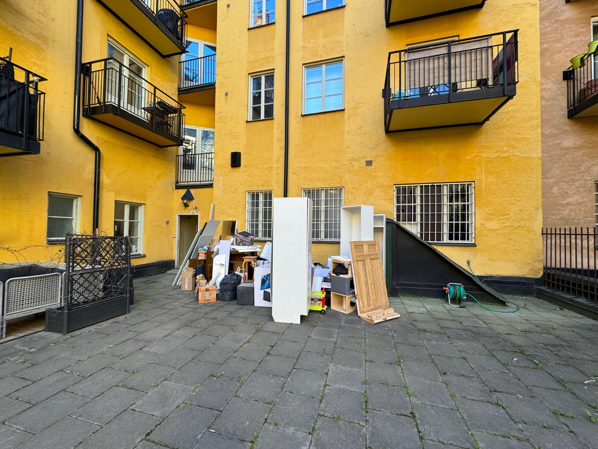
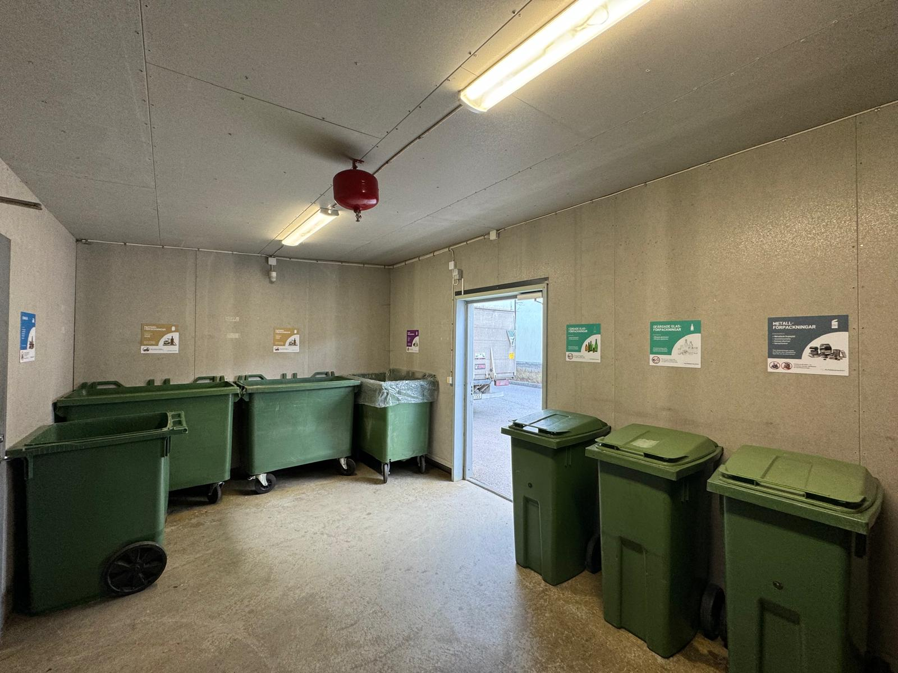
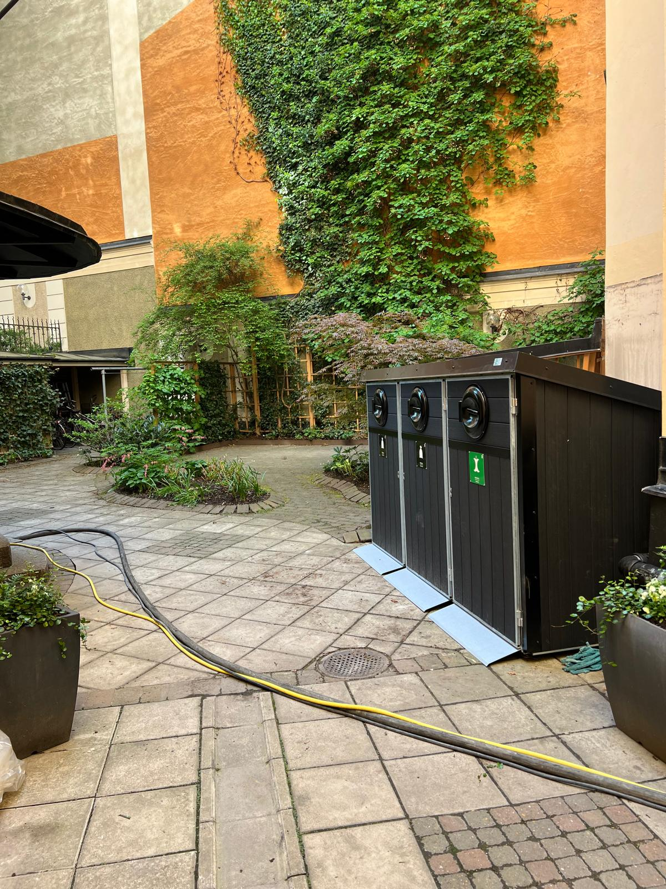

# Hämta skräp Stockholm

- **URL:** https://avfallskonsulten.se/hamta-skrap-stockholm
- **Title-tagg:** Hämta skräp stockholm - Avfallskonsulten
- **Meta description:** Behöver du hjälp med att hämta skräp i Stockholm? Avfallskonsulten erbjuder snabb och pålitlig avfallshantering för både företag och privatpersoner!
- **Canonical:** https://avfallskonsulten.se/hamta-skrap-stockholm
- **Ord i brödtext:** 565
- **Bilder:** 5

---

# Hämta skräp Stockholm

Behöver du hjälp med att hämta skräp och avfall i Stockholm? Avfallskonsulten erbjuder snabb och pålitlig skräpupphämtning för både privatpersoner, företag och bostadsrättsföreningar. Oavsett om det gäller byggavfall, grovsopor eller mindre mängder skräp ser vi till att det hanteras på ett miljövänligt och smidigt sätt.

[KONTAKTA OSS](#kontakt-form)

## Varför välja Avfallskonsulten för att hämta skräp i Stockholm?

Avfallskonsulten är ett erkänt företag inom avfallshantering som fokuserar på att erbjuda enkel, snabb och hållbar service. Vi har lång erfarenhet av att hantera olika typer av skräp, från mindre upphämtningar till större projekt som kräver speciallösningar. Med vår miljöfokuserade inställning och skräddarsydda tjänster kan du vara säker på att ditt avfall tas om hand på ett säkert och effektivt sätt. Dessutom erbjuder vi flexibla upphämtningstider och konkurrenskraftiga priser.

[Boka upphämtning av skräp](#kontakt-form)

## Våra tjänster för att hämta skräp i Stockholm

Vi på Avfallskonsulten erbjuder ett brett utbud av tjänster för att hämta skräp i Stockholm, anpassade för både privatpersoner och företag. Oavsett om du har behov av hjälp med avfallshantering efter en renovering eller vill bli av med gammalt skräp från källaren, finns vi här för att göra processen enkel och smidig.

### Privatpersoner, företag och brf

Vi hjälper privatpersoner, företag och bostadsrättsföreningar med att hämta skräp och hantera avfall. Vare sig det handlar om att rensa ur hemmet, kontoret eller en gemensamhetslokal ser vi till att skräpet hämtas och hanteras enligt alla miljökrav.

### Byggavfall och grovsopor

Om du nyligen har renoverat eller har byggprojekt på gång, kan det lätt samlas byggavfall och grovsopor som behöver tas om hand. Vi erbjuder säkra och pålitliga upphämtningar där vi tar hand om tunga material som gips, trä, metall, gamla möbler och vitvaror.

## Säker och effektiv hantering av byggavfall och stora föremål.

När det gäller hantering av byggavfall och stora föremål krävs expertis och rätt utrustning. Avfallskonsulten har lång erfarenhet av att hantera dessa typer av avfall, och vi ser till att allt transporteras och sorteras på ett miljövänligt sätt. Vi erbjuder även containeruthyrning om du behöver extra kapacitet för större projekt. Med vår effektiva och professionella service blir det enkelt att bli av med grovavfallet.

[Boka upphämtning av skräp](#kontakt-form)

## Vanliga frågor kring Avfallskonsultens hämtning av skräp område

1. ### Vilka typer av skräp kan ni hämta?
   - Vi kan hämta allt från byggavfall och grovsopor till hushållsavfall och trädgårdsavfall. Oavsett skräpmängd eller typ hjälper vi dig att få bort det på ett effektivt och miljövänligt sätt.
2. ### Vad kostar det att hämta skräp område?
   - Kostnaden beror på mängden och typen av skräp som ska hämtas, samt transportsträckan. Kontakta oss för en kostnadsfri offert, så skräddarsyr vi en lösning baserat på dina specifika behov, [kontakta oss](#kontakt-form)!
3. ### Hur snabbt kan ni hämta skräpet?
   - Vi erbjuder flexibla upphämtningstider och kan oftast boka in en tid inom ett par dagar. Behöver du snabb service, gör vi vårt bästa för att anpassa oss till dina behov.

## Frågor?

Vid frågor eller funderingar når du oss på [08-68427888](tel:08-68427888) eller så kan du fylla i kontaktformuläret nedan så återkommer vi till dig.

### KONTAKTA OSS

Berätta lite mer om vad du vill ha hjälp med
