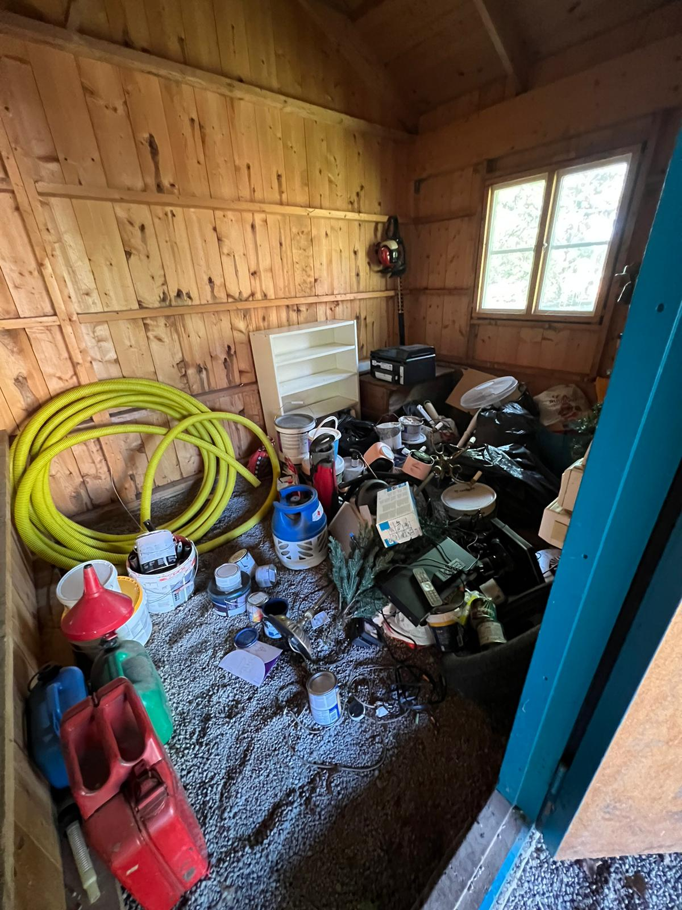
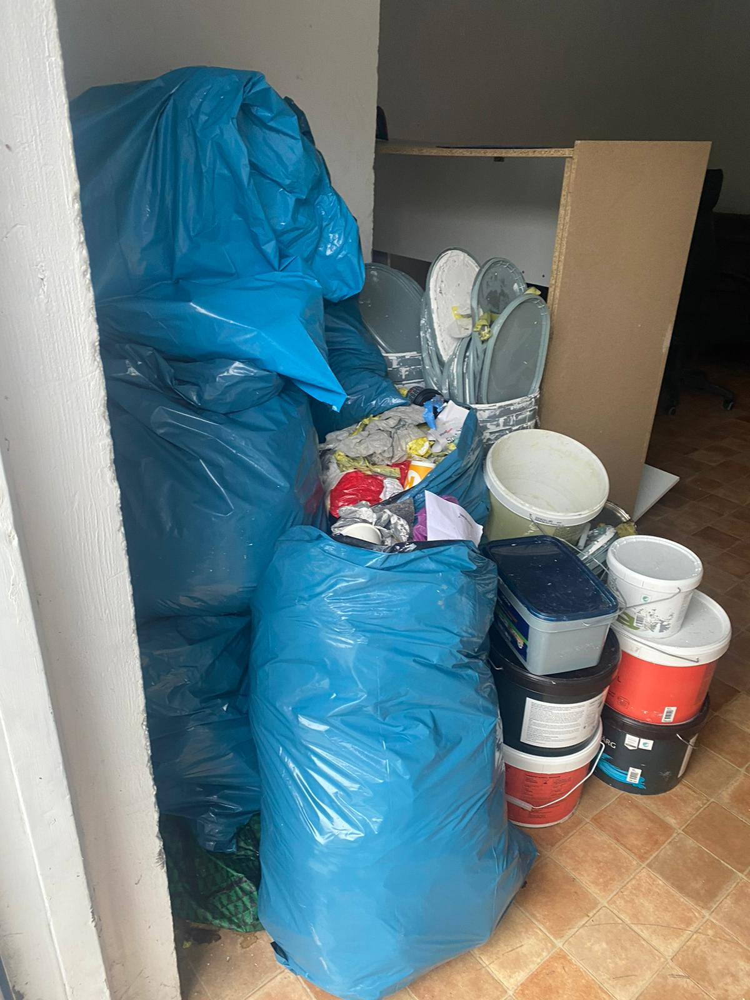
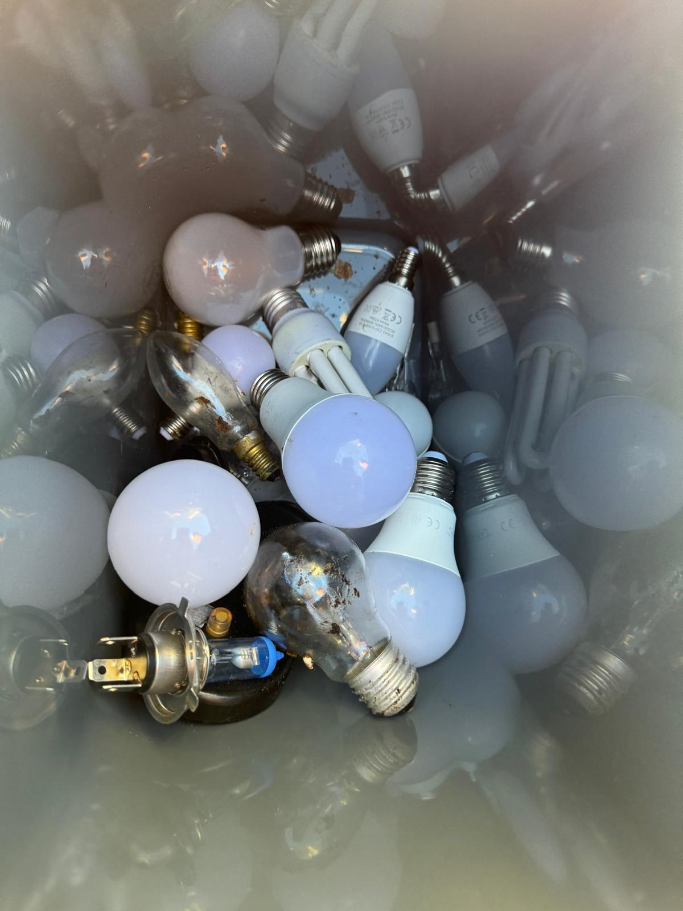

# Restavfall Stockholm

- **URL:** https://avfallskonsulten.se/hamtning-av-restavfall-stockholm
- **Title-tagg:** Restavfall Stockholm | Upphämtning | Avfallskonsulten
- **Meta description:** Hämta restavfall i Stockholm enkelt med Avfallskonsulten. Effektiva och skräddarsydda lösningar för smidig avfallshantering.
- **Canonical:** https://avfallskonsulten.se/hamtning-av-restavfall-stockholm
- **Ord i brödtext:** 719
- **Bilder:** 5

---

# Restavfall Stockholm

På Avfallskonsulten erbjuder vi effektiva lösningar för hantering och hämtning av restavfall i Stockholm. Vår tjänst är designad för att säkerställa smidig och hållbar avfallshantering, vilket hjälper dig att hålla både ditt hem och företag rent och organiserat, samtidigt som vi främjar miljövänliga processer.

[KONTAKTA OSS](#kontakt-form)

## Smidig upphämtning av restavfall i Stockholm!

Vi erbjuder ett brett utbud av lösningar för hämtning av restavfall Stockholm som är anpassade efter dina specifika behov. Genom att använda modern teknik och noggrant planerade rutiner optimerar vi insamlingen och ser till att ditt avfall hanteras effektivt och i enlighet med gällande miljöföreskrifter. Oavsett om det gäller hushållsavfall, kontorsavfall eller industriellt restavfall, garanterar vi en säker och effektiv hantering.

[Boka hämtning av restavfall](#kontakt-form)

## Vad hämtar vi för restavfall i Stockholm?

På Avfallskonsulten erbjuder vi hämtning av ett brett spektrum av restavfall i Stockholm, vilket säkerställer att allt avfall hanteras på ett korrekt och miljövänligt sätt. Här är några av de typer av restavfall vi hämtar:

- **Hushållsavfall:** Inkluderar allt som inte kan återvinnas, såsom förpackningar som inte kan separeras för återvinning, och övrigt avfall från hemmet. Vi ser till att detta avfall transporteras och hanteras enligt gällande miljöföreskrifter.
- **Kontorsavfall:** Består av pappersavfall, förbrukade kontorsmaterial och annat avfall från arbetsplatser. Vi erbjuder effektiva lösningar för att hantera kontorsavfall på ett sätt som minimerar påverkan på miljön.
- **Restprodukter från handel och industri:** Inkluderar avfall som uppstår vid produktion eller vid försäljning av varor, exempelvis emballage, trasiga verktyg och överskottsmaterial. Vi tillhandahåller skräddarsydda lösningar för att samla in och behandla detta avfall på ett hållbart sätt.
- **Bygg- och rivningsavfall:** Omfattar avfall från byggprojekt, såsom gammalt byggmaterial, rester från rivningar och överskottsmaterial. Vi erbjuder professionell hantering och bortforsling av byggavfall för att säkerställa att det hanteras på ett säkert och effektivt sätt.

## Fördelar med vår tjänst hämtning restavfall Stockholm

### Miljövänlig avfallshantering

Med våra tjänster för **restavfall Stockholm** bidrar du till en mer hållbar framtid. Vi fokuserar på att minimera miljöpåverkan genom att återvinna så mycket som möjligt och säkerställa korrekt hantering av det återstående avfallet.

### Kostnadseffektiva lösningar

Våra tjänster för hämtning av restavfall är både effektiva och kostnadseffektiva. Vi erbjuder flexibla prissättningsalternativ som är designade för att passa olika budgetar och behov, vilket hjälper dig att hålla kostnaderna nere samtidigt som du får högkvalitativ service.

### Pålitlighet och kvalitet

Vi på Avfallskonsulten är stolta över vår pålitlighet och det höga kvalitetsarbete vi levererar. Vårt team är dedikerat att ge dig en konsekvent och professionell service, vilket innebär att du kan lita på att ditt restavfall hanteras effektivt och i enlighet med alla gällande standarder och förordningar.

## Vanliga frågor kring restavfall

1. ### Hur fungerar er tjänst kring restavfall?
   - Vi erbjuder skräddarsydda lösningar för upphämtning av restavfall, anpassade efter era behov och förutsättningar.
2. ### Vad är restavfall?
   - Restavfall är det avfall som blir kvar när du har sorterat ut allt som kan återvinnas (t.ex. papper, plast, glas) eller lämnas som farligt avfall. Det är alltså det som inte kan återanvändas eller återvinnas och som behöver tas om hand genom transport och behandling
3. ### Kan vi hyra en container för restavfall?
   - Ja, vi erbjuder möjligheten att hyra container för olika typer av återvinningsbehov, vilket är perfekt för både företag och bostadsrättsföreningar.
4. ### Hur ofta kan ni hämta restavfall?
   - Vi kan skräddarsy hämtningstider efter ert behov, vare sig det är daglig, veckovis eller månadsvis hämtning av restavfall.
5. ### Tar ni hand om farligt avfall?
   - Ja, vi erbjuder tjänster för att hantera farligt avfall på ett säkert och miljövänligt sätt.
6. ### Vilka typer av restavfall kan ni hämta?
   - Vi hämtar många olika typer av restavfall — från hushållsavfall som inte går att återvinna till kontors‑ och verksamhetsavfall. Oavsett om det gäller vardagligt restavfall eller avfall från större projekt ser vi till att det hanteras på ett säkert och miljövänligt sätt.

## Frågor?

Vid frågor eller funderingar når du oss på [08-68427888](tel:08-68427888) eller så kan du fylla i kontaktformuläret nedan så återkommer vi till dig.

### KONTAKTA OSS

Berätta lite mer om vad du vill ha hjälp med
