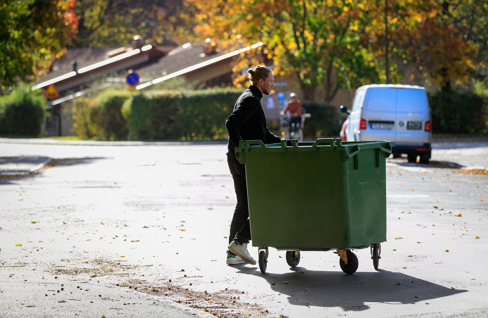
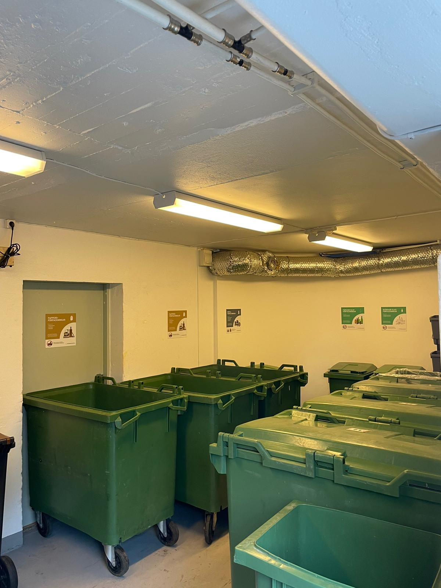
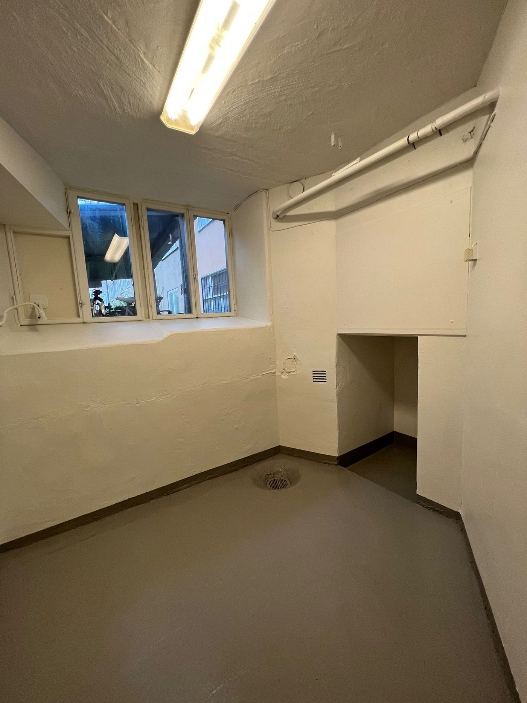
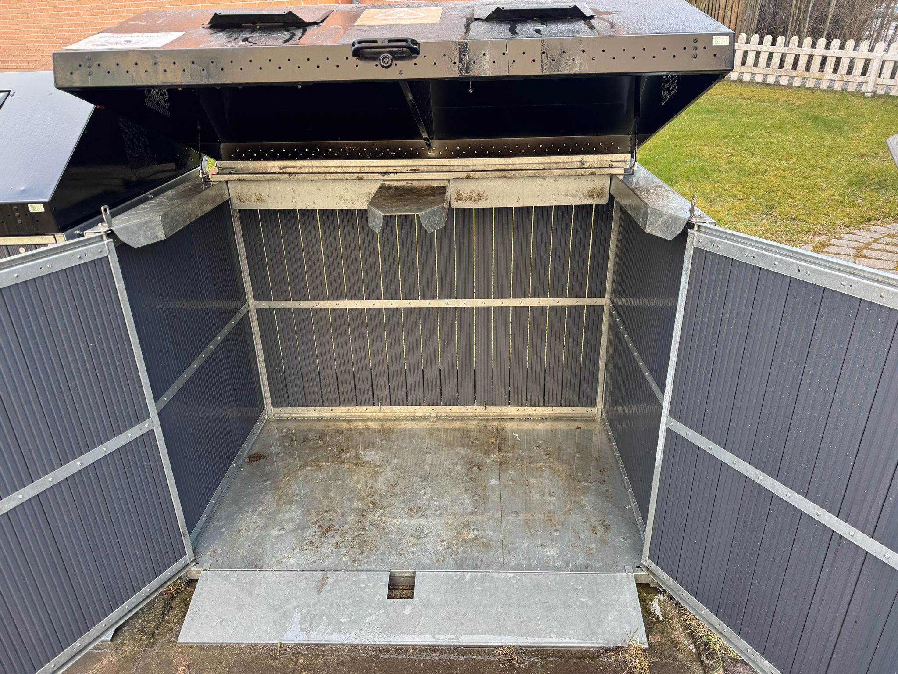
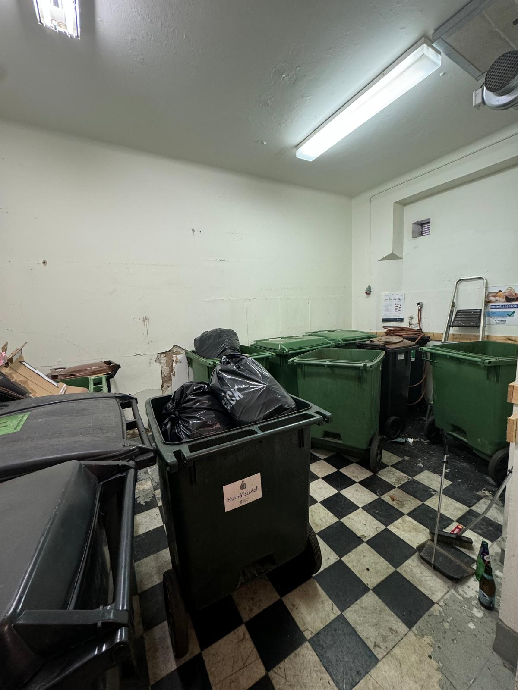

# Kärltvätt i Stockholm

- **URL:** https://avfallskonsulten.se/karltvatt
- **Title-tagg:** Kärltvätt Stockholm - Rengöring sopkärl - Avfallskonsulten
- **Meta description:** Kärltvätt Stockholm – Avfallskonsulten erbjuder professionell rengöring av sopkärl. Vi ser till att dina sopkärl blir grundligt rengjorda och fräscha!
- **Canonical:** https://avfallskonsulten.se/karltvatt
- **Ord i brödtext:** 1147
- **Bilder:** 7

---

# Kärltvätt i Stockholm

Undvik dålig lukt och ohyra med vår kärltvättstjänst i Stockholm. Vi hjälper er att hålla soprummen rena och fräscha. Kontakta oss för professionell tvätt av sopkärl!

[KONTAKTA OSS](#kontakt-form)

## Vad våra kunder säger om oss

## Varför tvätta sina kärl?

Att tvätta sina sopkärl regelbundet har många fördelar:

- **Förbättrad hygien:** Sopkärl blir smutsiga och fulla av bakterier med tiden. Regelbunden tvätt förhindrar lukt, bakterier och skadedjur.
- **Förlängd livslängd:** Regelbunden tvätt kan förlänga livslängden på sopkärl genom att förhindra rost och korrosion.
- **Bättre miljö:** Tvättade sopkärl luktar inte illa och lockar inte till sig skadedjur. Det kan bidra till en renare och mer trivsam boendemiljö.

[BOKA KÄRLTVÄTT](#kontakt-form)

## Hur går en kärltvätt till?

Vår process för kärltvätt är noggrant utformad för att säkerställa att alla sopkärl inte bara blir visuellt rena utan också hygieniskt säkra. Här följer en detaljerad beskrivning av hur denna process går till:

- ### Steg 1: Tömning av kärlen

  - Processen inleds med att varje kärl noggrant töms för att säkerställa att inga avfallsrester finns kvar. Detta är viktigt för att undvika hinder under tvättprocessen och för att säkerställa att tvättningen blir så effektiv som möjligt.
- ### Steg 2: Högtryckstvättning

  - Efter tömningen görs en rengöring av sopkärl med en omfattande högtryckstvättning. Vi använder högtryckssprutor för att rengöra både in- och utsidorna av sopkärlen. Detta kraftfulla tvättsteg är effektivt för att lösgöra och avlägsna fastsittande smuts, avlagringar och andra kontaminanter. Högtryckstvättningen är också avgörande för att nå svåråtkomliga ytor och hörn där smuts och bakterier ofta samlas.
- ### Steg 3: Användning av miljövänliga rengöringsmedel

  - Under högtryckstvättningen applicerar vi specialformulerade, miljövänliga rengöringsmedel som är ett viktigt när man tvättar sopkärl. Dessa medel är noggrant utvalda för sin förmåga att effektivt avlägsna oljor, fett, och organiskt material utan att skada kärlens material eller miljön. Medlen bryter ner smuts och bakterier på molekylär nivå, vilket säkerställer en grundlig rengöring.
- ### Steg 4: Desinficering

  - Efter att kärlen är rena från smuts och avfall, genomgår de en desinficeringsprocess. Vi använder godkända desinfektionsmedel som är effektiva mot ett brett spektrum av mikroorganismer, inklusive bakterier och virus. Detta steg är kritisk för att säkerställa att kärlen är hygieniskt säkra och för att minimera risken för ohyra och dålig lukt.
- ### Steg 5: Inspektion och kvalitetskontroll

  - Slutligen genomförs en noggrann inspektion av varje kärl för att säkerställa att de möter våra höga standarder för renlighet och hygien. Eventuella områden som kräver ytterligare åtgärder tas om hand innan kärlen återlämnas till användning.

Denna omfattande process för kärltvätt är avgörande för att upprätthålla en ren och hälsosam miljö runt soprum och avfallshanteringssystem.

## Hur ofta bör man tvätta sopkärlen?

Hur ofta du bör tvätta dina sopkärl beror på en rad faktorer, bland annat:

- **Typ av avfall:** Sopkärl som innehåller matavfall bör tvättas oftare än kärl som innehåller annat avfall.
- **Årstid:** Under varma månader kan sopkärl börja lukta illa snabbare och bör tvättas oftare.
- **Förekomst av skadedjur:** Om du har problem med skadedjur, till exempel råttor eller flugor, bör du tvätta dina sopkärl oftare.

Som en generell regel bör sopkärl tvättas minst en gång per månad!

[BOKA KÄRLTVÄTT](#kontakt-form)

## Vilka typer av kärl kan vi tvätta?

Vi kan tvätta de flesta typer av sopkärl, inklusive:

- Hushållskärl
- Matavfallskärl
- Kärl för återvinning

## Effektiv rengöring av sopkärl för företag och bostadsrättsföreningar

Att hålla sopkärl rena är viktigt både för att förebygga dålig lukt och för att skapa en hygienisk och trivsam miljö. På Avfallskonsulten erbjuder vi professionell rengöring av sopkärl som är anpassad för behoven hos företag och bostadsrättsföreningar. Vår service säkerställer att era sopkärl alltid är fräscha, vilket bidrar till att minska risken för skadedjur och ohälsa. Genom regelbunden rengöring av sopkärl håller vi era avfallsutrymmen i toppskick, vilket bidrar till en bättre arbets- och boendemiljö.

[BOKA KÄRLTVÄTT](#kontakt-form)

## Kärltvätt pris – vad kostar det att tvätta sopkärl?

Priset för kärltvätt består av en framkörningskostnad samt kostnaden för själva tvätten. Framkörning kostar cirka **650–895 kr**, medan tvätt av sopkärl kostar cirka **225–275 kr per kärl**.

Behöver även soprummet rengöras kostar tvätt av soprum cirka **1 200–1 800 kr**. Det lägre priset gäller vid avtal om minst två tvättar per år, vilket kan vara ett bra alternativ för fastighetsägare, bostadsrättsföreningar och verksamheter som vill hålla kärl och soprum rena löpande.

### Vad påverkar priset för kärltvätt?

Kostnaden beror bland annat på hur många kärl som ska tvättas, om även soprummet ska rengöras och om tvätten sker som enstaka uppdrag eller enligt ett återkommande avtal. Vid regelbunden kärltvätt kan priset per tillfälle bli lägre.

Som riktpris kan du räkna med **650–895 kr i framkörning**, **225–275 kr per kärl** samt **1 200–1 800 kr för tvätt av soprum**. Det lägre priset gäller vid avtal om minst två tvättar per år.

### Kärltvätt i Stockholm

Avfallskonsulten hjälper fastighetsägare, bostadsrättsföreningar och företag med professionell kärltvätt. Regelbunden rengöring av sopkärl och soprum bidrar till en fräschare miljö och minskar problem med smuts, lukt och avfallsrester.

## Vanliga frågor vi får kring vår kärltvätt i Stockholm

1. ### Vad kostar kärltvätt?
   - En kärltvätt kostar mellan 225-275 kr/kärl beroende på storlek och antal, sedan tillkommer en framkörningsavgift från 650 till 895kr.
2. ### Hur tvättar man sopkärl?
   - Det går att tvätta sina kärl själv men oftast är det svårt utan korrekt utrustning. Vi tvättar våra kärl med högtryckstvätt, skurborstar och medel som dödar bakterier, ett betydligt smidigare alternativ.
3. ### Hur går en kärltvätt till?
   - Vår kärltvättprocess inkluderar tömning av kärl, högtryckstvättning, användning av miljövänliga rengöringsmedel, desinficering och slutlig kvalitetskontroll. Detta garanterar att kärlen inte bara ser rena ut utan också är hygieniskt säkra.
4. ### Vilka typer av kärl kan ni tvätta?
   - Vi kan tvätta hushållskärl, matavfallskärl och kärl för återvinning. Våra tjänster passar både privatpersoner, bostadsrättsföreningar och företag.
5. ### Tar kärltvätt bort lukt och bakterier?
   - Ja, vår process inkluderar desinficering med godkända medel som effektivt tar bort bakterier, virus och dålig lukt, vilket gör sopkärlen hygieniska och fräscha.
6. ### Kan ni tvätta kärl för företag och bostadsrättsföreningar?
   - Ja, vi erbjuder professionell kärltvätt anpassad för företag, restauranger och bostadsrättsföreningar. Regelbunden rengöring säkerställer fräscha sopkärl och en trivsam miljö i soprum och avfallsutrymmen.
7. ### Hur får man bort vita maskar i soptunnan?
   - Se till att kärlen tvättas ordentligt 2-4 ggr/år. Undvik att kärlen står i direkt värme och att soppåsarnas som slängs är väl förslutna. Sommartid är det extra viktigt att tänka på detta eftersom då det främst då maskar/larver kan dyka upp i kärlen.

## Frågor?

Vid frågor eller funderingar når du oss på [08-68427888](tel:08-68427888) eller så kan du fylla i kontaktformuläret nedan så återkommer vi till dig.

### KONTAKTA OSS

Berätta lite mer om vad du vill ha hjälp med
