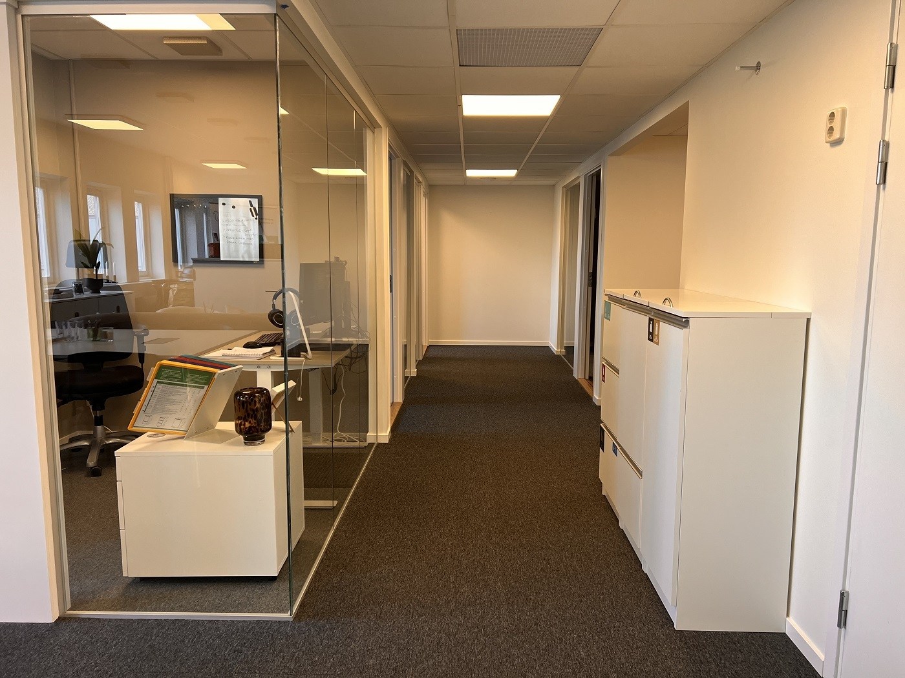

# Kontorsåtervinning & avfallshantering för kontor

- **URL:** https://avfallskonsulten.se/kontorsatervinning
- **Title-tagg:** Kontorsåtervinning & avfallshantering | Avfallskonsulten
- **Meta description:** Effektiv kontorsåtervinning och avfallshantering kontor i Stockholm. Få hjälp med sortering, upphämtning och kostnadsfri offert.
- **Canonical:** https://avfallskonsulten.se/kontorsatervinning
- **Ord i brödtext:** 1408
- **Bilder:** 9

---

# Kontorsåtervinning & avfallshantering för kontor

Återvinning ska vara en självklarhet – även på kontoret. Vi skräddarsyr lösningar för kontorsåtervinning och avfallshantering för kontor som gör det enkelt att sortera och återvinna. Dessutom erbjuder vi stilrena källsorteringsmöbler som smälter in i er arbetsmiljö och gör sophanteringen både effektiv och estetiskt tilltalande.

[KONTAKTA OSS](#kontakt-form)

## Vad våra kunder säger om oss

## Kontorsåtervinning för en hållbar arbetsmiljö

Många arbetsplatser saknar idag utsortering för olika material – inte på grund av bristande vilja, utan för att man inte vet hur man ska börja. Vi som [återvinningsföretag i Stockholm](https://avfallskonsulten.se/atervinningsforetag-stockholm) hjälper er genom hela processen med kontorsåtervinning och avfallshantering för kontor: från val av behållare och upphämtning till hämtfrekvens och rapportering. Ni kan fokusera på ert arbete samtidigt som ni skapar en hållbar arbetsplats och engagerade medarbetare. Vi erbjuder alltid ett kostnadsfritt platsbesök eller en första förfrågan för att ta fram ett skräddarsytt återvinningsförslag för ert kontor, så att sophanteringen blir enkel, effektiv och miljövänlig.

[BOKA UPPHÄMTNING](#kontakt-form)

## Så fungerar kontorsåtervinning – steg för steg

- ### Behovsanalys på plats

  - Vi börjar med ett kostnadsfritt platsbesök där vi går igenom era lokaler och ser vilket avfall som uppstår – till exempel papper, plast, matrester, elektronik eller metall. Målet är att förstå era behov och hur vi bäst kan underlätta sorteringen i vardagen.
- ### Lösningar som passar ert kontor

  - Utifrån analysen tar vi fram en lösning som passar just er. Det kan vara allt från enkla kärl vid skrivbordet till diskreta återvinningsmöbler i gemensamma ytor. Vi föreslår även lämplig hämtningsfrekvens och rätt skyltning för att göra det så enkelt som möjligt.
- ### Enkel uppstart

  - Vi levererar utrustningen, märker upp allt tydligt och ser till att det är lätt att förstå vad som ska sorteras var. Allt för att ni ska komma igång utan krångel – oavsett kontorsstorlek.
- ### Löpande hämtning och återkoppling

  - Med våra fordon sköter vi tömningen enligt överenskommet schema. Ni får dessutom regelbundna rapporter med statistik som visar hur mycket som återvinns – konkret och användbart i ert hållbarhetsarbete.
- ### Stöd för er personal

  - Vi hjälper gärna till med korta utbildningar eller digitalt informationsmaterial. Tydliga instruktioner och affischer vid återvinningsstationerna gör det enkelt för alla att sortera rätt – varje dag.

## Exempel på avfall vi hanterar i kontorsmiljö

Vi hjälper er sortera och återvinna allt vanligt kontorsavfall inom avfallshantering kontor, till exempel:

- **-** Pappersavfall (dokument, kuvert, broschyrer)
- **-** Förpackningar av plast, metall och kartong
- **-** Glas och burkar från lunchrum
- **-** Matavfall från kök eller personalmatsal
- **-** Elektronik som kablar, tangentbord och gamla datorer

Genom att identifiera dessa flöden tidigt kan vi skapa ett enkelt och effektivt system som minimerar både avfall och kostnader.

[BOKA UPPHÄMTNING](#kontakt-form)

## Sekretesshämtning

Vi erbjuder säker [hämtning av sekretesspapper](sekretesshantering) med låsta sopkärl som gör det enkelt och tryggt att slänga känsligt material. När kärlen är fulla hämtar vi dem och transporterar dem till anläggningen för säker destruktion. Rapportering av den destruerade mängden i kilo ingår i tjänsten.

[Kontakta oss](#kontakt-form) för hjälp med sekretesshantering!

## Avfallshantering kontor

Effektiv och hållbar avfallshantering på kontor är en viktig del av en modern arbetsplats. Hos Avfallskonsulten hjälper vi företag att skapa smarta, miljövänliga och anpassade lösningar för kontorsavfall. Vi ser till att allt från pappersåtervinning och elektronikskrot till matavfall och farligt avfall hanteras korrekt – enligt både lagkrav och era interna mål för miljö och hållbarhet.

Oavsett om ni är ett mindre kontor eller en stor organisation kan vi optimera er avfallshantering kontor med rätt kärl, tydlig sortering och uppföljning. Tillsammans skapar vi en renare, mer resurseffektiv arbetsmiljö.

[BOKA UPPHÄMTNING](#kontakt-form)

## Vad vinner ert företag på kontorsåtervinning?

Att införa kontorsåtervinning ger flera positiva effekter för både verksamheten och miljön. Genom att minska mängden restavfall kan ni sänka era avfallskostnader – en enkel åtgärd som snabbt ger resultat. Samtidigt bidrar ni till ett lägre koldioxidutsläpp och en mer hållbar resursanvändning.

Ett tydligt miljöarbete på arbetsplatsen skapar också större engagemang bland medarbetarna. Det stärker både stoltheten och känslan av att göra skillnad. Ni får dessutom tillgång till tydlig och löpande rapportering, vilket ger er stöd i hållbarhetsarbetet och kan användas i er redovisning.

Kontorsåtervinning är alltså inte bara ett steg mot en bättre miljö, det är också ett smart sätt att driva en modern och ansvarstagande organisation.

## Varför välja Avfallskonsulten för avfallshantering kontor?

Vi på Avfallskonsulten fokuserar på att göra kontorsåtervinning så enkel och effektiv som möjligt. Med lång erfarenhet och lokal närvaro i Stockholm erbjuder vi lösningar som anpassas efter era behov – från praktiska kärl och tydlig skyltning till fossilfria transporter och säker hantering av sekretessmaterial. Vi hjälper er hela vägen, med personlig service, regelbunden återkoppling och hållbara resultat som märks – både för miljön och verksamheten.

### Låt oss hjälpa er ta steget mot smart kontorsåtervinning!

Kontakta oss för ett kostnadsfritt platsbesök – vi hjälper er komma igång med kontorsåtervinning som verkligen fungerar!

[BOKA Platsbesök](#kontakt-form)

## Kontorsåtervinning pris – vad kostar det?

Priset för kontorsåtervinning ligger på cirka **145–195 kr per tömning och kärl**. Den slutliga kostnaden beror framför allt på hur många avfallsfraktioner som ska sorteras, vilken storlek kärlen har och hur ofta hämtning sker.

För verksamheter med flera fraktioner eller större kärl kan kostnaden bli högre, medan ett återkommande och välplanerat hämtningsschema kan ge en smidigare och mer kostnadseffektiv lösning över tid.

### Vad påverkar priset för kontorsåtervinning?

Kostnaden påverkas främst av **antalet fraktioner, kärlens storlek och tömningsfrekvensen**. Ett mindre kontor med få fraktioner och färre tömningar har ofta ett lägre behov än en större verksamhet med flera sorteringslösningar och tätare hämtning.

Som riktpris kan du räkna med cirka **145–195 kr per tömning och kärl**. Kontakta oss gärna med information om hur många kärl och fraktioner ni behöver hjälp med, så kan vi ta fram en lösning som passar verksamheten.

### Kontorsåtervinning i Stockholm

Avfallskonsulten hjälper företag och verksamheter med praktiska lösningar för kontorsåtervinning. Vi kan anpassa upplägget efter verksamhetens behov och skapa en enkel struktur för återkommande hämtning av sorterat avfall.

## Vanliga frågor kring kontorsåtervinning i Stockholm

1. ### Vad innebär kontorsåtervinning?
   - Kontorsåtervinning är processen att sortera och återanvända olika typer av material som genereras på kontoret, såsom papper, plast, metall och elektronik. Detta inkluderar allt från att återvinna skräppapper och tonerkassetter till att hantera elektroniskt avfall på ett miljövänligt sätt.
2. ### Varför är återvinning på kontoret viktigt?
   - Återvinning på kontoret är viktigt eftersom det minskar mängden avfall som skickas till soptippar och förbränningsanläggningar, vilket bidrar till att spara naturresurser och minska koldioxidutsläppen. Genom att återvinna kan företag också visa sitt miljöansvar och förbättra sin hållbarhetsprofil.
3. ### Hur börjar jag med kontorsåtervinning på min arbetsplats?
   - För att börja med kontorsåtervinning, starta med att genomföra en avfallsinventering för att identifiera vilka typer av material som mest frekvent genereras på ditt kontor. Sedan kan du införa tydligt märkta återvinningsbehållare på strategiska platser runt om i kontoret för att underlätta sortering och återvinning.
4. ### Vilka material kan jag återvinna på kontoret?
   - På kontoret kan du återvinna en mängd material inklusive papper, kartong, plastförpackningar, glasflaskor, metallburkar och elektronisk utrustning som datorer och mobiltelefoner. Det är också möjligt att återvinna specialmaterial som tonerkassetter och batterier genom särskilda återvinningsprogram.
5. ### Hur kan jag minska mängden avfall på mitt kontor?
   - För att minska mängden avfall på kontoret, överväg att implementera policyer för minskad pappersanvändning, som att skriva ut på båda sidorna av pappret och använda digitala dokumenthanteringssystem. Uppmuntra också användningen av återanvändbara produkter, såsom keramiska koppar och glas istället för engångsartiklar.
6. ### Vilka är de bästa praxiserna för kontorsåtervinning?
   - De bästa praxiserna för kontorsåtervinning inkluderar att utbilda personal om vikten av återvinning och korrekt sortering av avfall, samt att regelbundet kommunicera kontorets återvinningsmål och framsteg. Att ha ett tydligt system för återvinning och regelbundna uppföljningar för att säkerställa att alla följer riktlinjerna är också viktigt.
7. ### Finns det lagar eller regler som styr återvinning på kontor?
   - Ja, det finns lagar och regler som styr återvinning på kontor, och dessa varierar beroende på region och land. Det är viktigt att kontrollera lokala och nationella föreskrifter för att säkerställa att ditt kontor uppfyller alla krav och standarder för avfallshantering och återvinning.

## Frågor?

Vid frågor eller funderingar når du oss på [08-68427888](tel:08-68427888) eller så kan du fylla i kontaktformuläret nedan så återkommer vi till dig.

### KONTAKTA OSS

Berätta lite mer om vad du vill ha hjälp med
