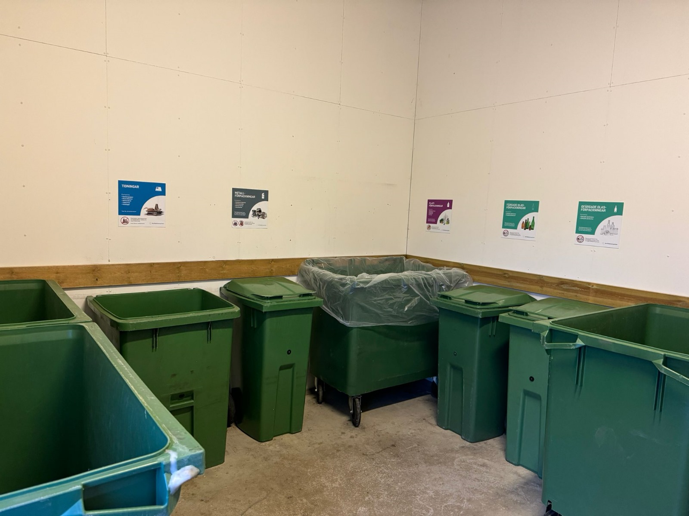

# Hantering av matavfall i Stockholm

- **URL:** https://avfallskonsulten.se/matavfall-i-stockholm
- **Title-tagg:** Matavfall Stockholm | Så funkar det | Avfallskonsulten
- **Meta description:** Det är obligatoriskt att samla in matavfall separat i Stockholm. Lär dig mer om hur det fungerar och få hjälp med hantering från Avfallskonsulten.
- **Canonical:** https://avfallskonsulten.se/matavfall-i-stockholm
- **Ord i brödtext:** 705
- **Bilder:** 6

---

# Hantering av matavfall i Stockholm

Att hantera matavfall i Stockholm på rätt sätt är inte bara en viktig del av att skydda miljön, utan det är också ett lagkrav. Genom att sortera ditt matavfall separat bidrar du till att minska mängden avfall som går till deponi och öka återvinningen, vilket hjälper till att skapa en mer hållbar framtid. Avfallskonsulten finns här för att svara på dina frågor kring matavfallshantering och erbjuder dessutom andra lösningar inom återvinning och avfallshantering för både hushåll och verksamheter. Oavsett dina behov kan vi ge dig den vägledning och de tjänster du behöver för att hantera avfall på ett effektivt och miljövänligt sätt.

[KONTAKTA OSS](#kontakt-form)

## Obligatoriskt att sortera matavfallet i Stockholm

I Stockholm är det nu ett lagkrav att sortera matavfall separat från övrigt avfall. Detta initiativ syftar till att minska mängden avfall som skickas till deponi och öka återvinningsgraden. Genom att följa reglerna bidrar du till en hållbar avfallshantering som hjälper till att skydda vår miljö. Stockholm Vatten och Avfall (SVOA) ansvarar för insamlingen av matavfall där alla verksamheter är skyldiga att ha ett abonnemang för hämtning av matavfall.

[Boka upphämtning av matavfall](#kontakt-form)

## Vad räknas som matavfall?

Matavfall inkluderar alla typer av livsmedelsrester och biologiskt nedbrytbart material. Detta kan vara skal från frukt och grönsaker, kaffesump, matrester och annat som enkelt kan omvandlas till energi eller gödsel. Genom att sortera detta korrekt kan det bearbetas och återanvändas i olika processer, vilket bidrar till en grönare framtid.

[Kontakta oss](#kontakt-form) om ni vill att vi ska hämta era grovsopor!

## Vad händer med matavfallet som samlas in?

Cirka 40 procent av det avfall som slängs i soporna idag består av matrester och annat biologiskt nedbrytbart material. När detta matavfall samlas in genom kommunens avfallshantering, genomgår det en process där det omvandlas till både biogas och biogödsel. Biogasen fungerar som ett förnybart bränsle och används framförallt för att driva fordon, vilket är ett miljövänligt alternativ till fossila bränslen. Biogödslet, som utvinns ur samma process, används inom jordbruket för att förbättra markens näringsinnehåll och öka produktiviteten på ett naturligt sätt. Detta kretsloppsbaserade återvinningssystem spelar en viktig roll i att minska vårt beroende av fossila bränslen och bidrar till att skapa ett mer hållbart och cirkulärt samhälle.

## Fördelar med hantering av matavfall

Förutom att bidra till en bättre miljö, finns det också ekonomiska fördelar med att hantera matavfallet korrekt. Genom att sortera ut matavfallet minskar du mängden restavfall i den vanliga soppåsen, vilket i sin tur kan sänka kostnaderna för ditt avfallskärl. Med mindre restavfall kan du välja ett mindre eller färre kärl, vilket leder till lägre avfallshanteringskostnader för både hushåll och företag.

[Boka upphämtning av matavfall](#kontakt-form)

## Vanliga frågor kring matavfall Stockholm

1. ### Vad räknas som matavfall i Stockholm?
   - Matavfall är livsmedelsrester och biologiskt nedbrytbart material som inte längre kan ätas, t.ex. skal från frukt och grönsaker, kaffesump, matrester och liknande.
2. ### Hur sorterar jag matavfall i praktiken?
   - Matavfallet läggs i särskilda bruna papperspåsar eller behållare för matavfall och placeras i de uppsamlingskärl som finns i soprummet eller vid avfallsstationen.
3. ### Vad händer med matavfallet efter insamling?
   - När matavfallet samlas in i Stockholm rötas det och omvandlas till biogas och biogödsel, vilket används som fordonsbränsle och som naturlig gödsel i jordbruket.
4. ### Får jag använda vanliga papperspåsar för matavfall?
   - Nej - du ska helst använda de matavfallspåsar som är avsedda för matavfall, ofta bruna papperspåsar som delas ut av fastighetsägare eller kommunen.
5. ### Varför är matavfallshantering viktig i Stockholm?
   - Genom att sortera matavfall bidrar du till en mer hållbar avfallshantering, minskar mängden restavfall och hjälper till att producera förnybar energi samt biogödsel.
6. ### Kan jag lägga komposterbart plast i matavfallet?
   - Nej - plast, även komposterbar plast, får inte läggas i matavfallet eftersom det stör processerna för biogas och biogödselproduktion.

## Frågor?

Vid frågor eller funderingar når du oss på [08-68427888](tel:08-68427888) eller så kan du fylla i kontaktformuläret nedan så återkommer vi till dig.

### KONTAKTA OSS

Berätta lite mer om vad du vill ha hjälp med
