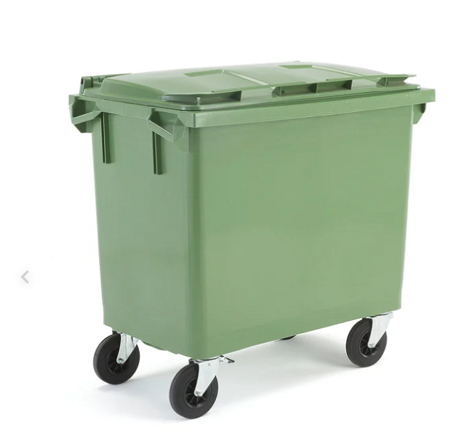
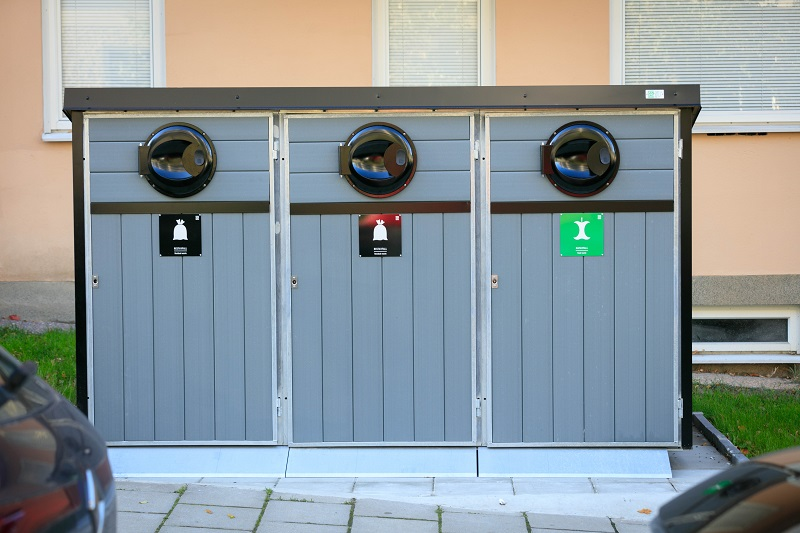
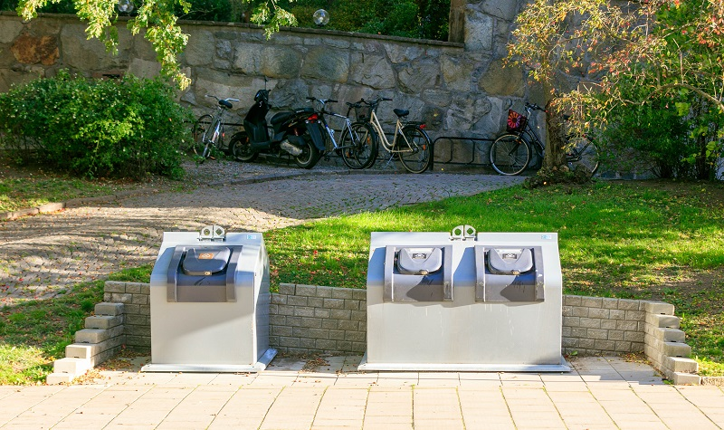
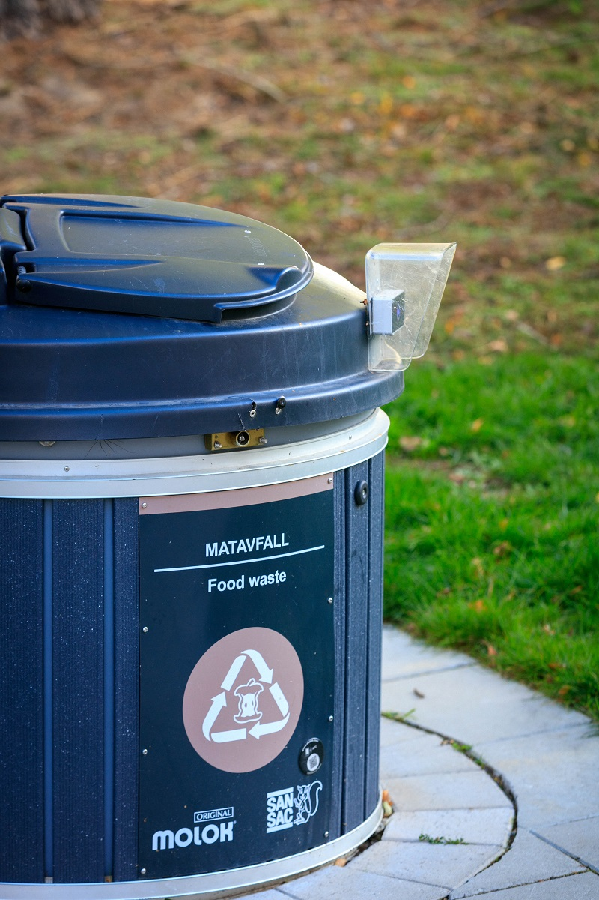

# Produkter

- **URL:** https://avfallskonsulten.se/produkter
- **Title-tagg:** Produkter | Allt inom återvinning | Avfallskonsulten
- **Meta description:** 
- **Canonical:** 
- **Ord i brödtext:** 326
- **Bilder:** 6

---
# Produkter

## Sopkärl

Vi säljer och hyr ut sopkärl i storlekarna 140-, 190-, 240-, 370- & 660-liter. Kärlen finns i flera olika
färger och med olika typer av lock. Beroende på vilka fraktion ni tänkt sortera ut hjälper vi er att hitta
rätt storlek för just ert behov. Vi ger även rådgivning när det kommer till [rengöring av sopkärl](karltvatt).

[Ladda ner produktblad](avfallskonsulten_produktblad.pdf)

## Skyltar & dekaler

Tydlig skyltning är ett måste för att få sorteringen att fungera. Våra skyltar följer den nordiska
färgkoden och finns både i plast för inomhusbruk och i aluminium när de ska sitta utomhus.

[Ladda ner produktblad](avfallskonsulten_produktblad.pdf)

## Kärlskåp

Kärlskåp är ett enkelt sätta att bygga in sopkärlen för att få en trevlig utomhusmiljö. Skåpen finns i
tryckimpregnerat trä, underhållsfritt kompositmaterial eller betong och går att få i flera olika färger
och storlekar. Som tillval finns låsbara luckor, antingen med nyckel eller elektroniskt taggsystem. Vi erbjuder även [professionell kärltvätt](https://avfallskonsulten.se/karltvatt).

[Ladda ner produktblad](avfallskonsulten_produktblad.pdf)

## Underjordsbehållare

Bottentömmande behållare eller underjordsbehållare är utmärkta system för er med stor
avfallsvolym och lite plats. Behållarna finns i storlekar från 500-liter ända upp till 5000-liter.

Behållarna finns i flera modeller med olika panelval och som tillval finns låsbara luckor.

[Ladda ner produktblad](avfallskonsulten_produktblad.pdf)

## Tillbehör & reservdelar

Vi utför service och reparation av de flesta avfallssystem. Kanske behöver ni service av er
underjordsbehållare eller nytt lock till ert sopkärl. Vi har ofta reservdelar på lager och kan bistå med
snabb åtgärd.

## Frågor?

Vid frågor eller funderingar når du oss på [08-68427888](tel:08-68427888) eller så kan du fylla i kontaktformuläret nedan så återkommer vi till dig.

### KONTAKTA OSS

Berätta lite mer om vad du vill ha hjälp med
