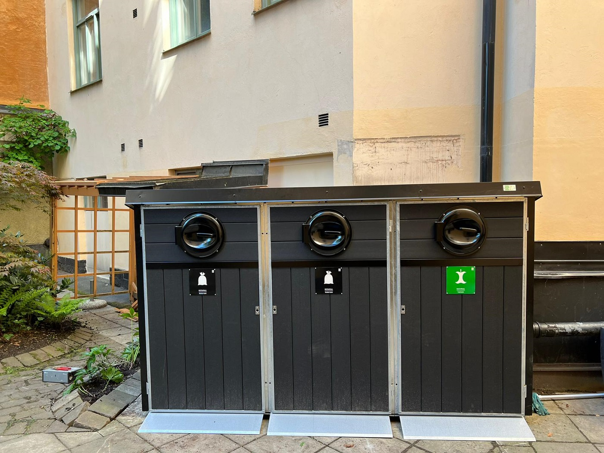
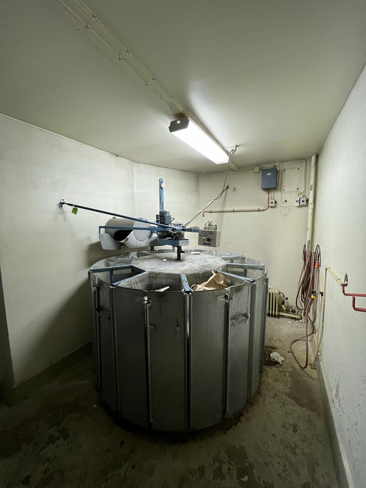
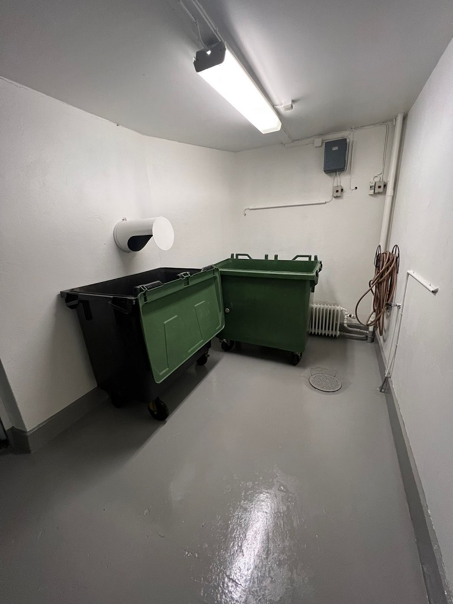
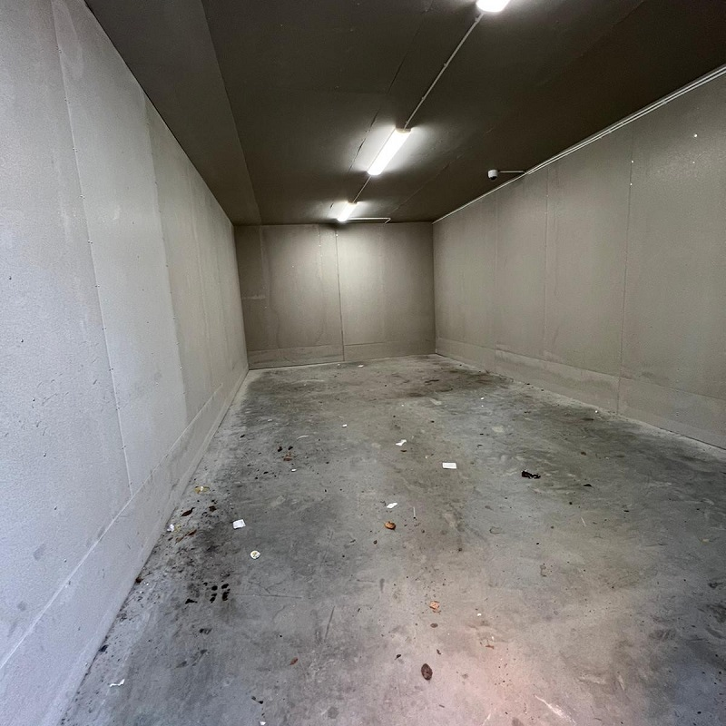
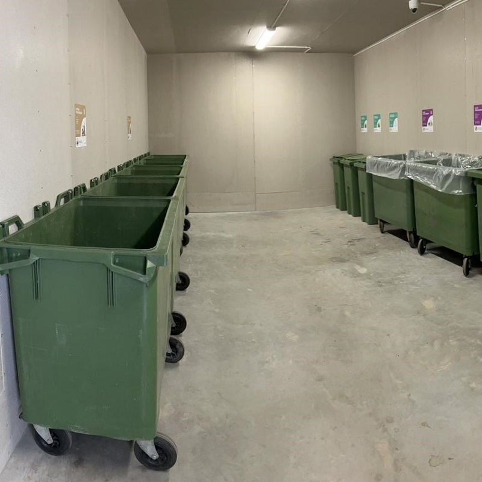
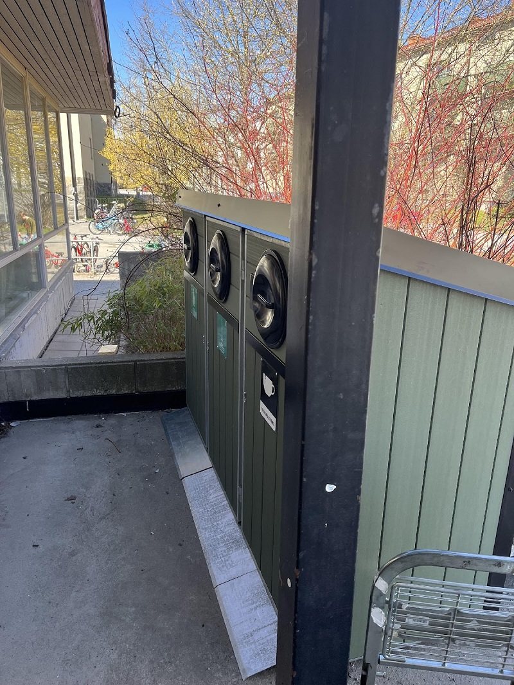
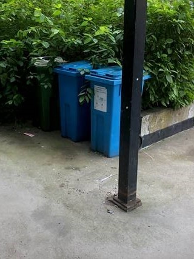
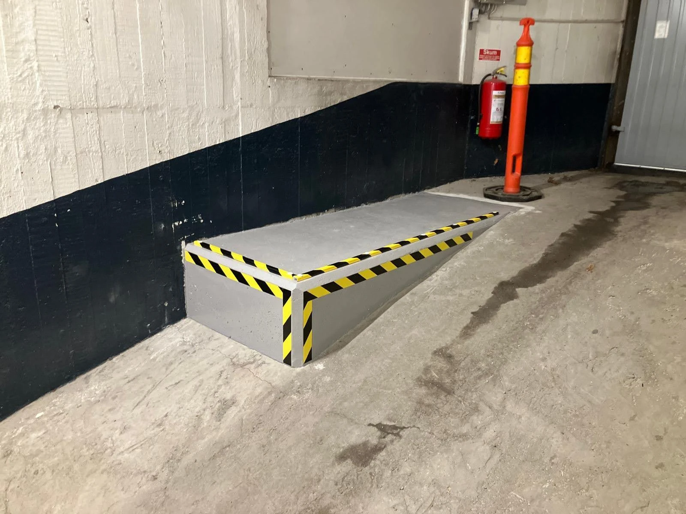

# Ett axplock av Avfallskonsulten

- **URL:** https://avfallskonsulten.se/projekt
- **Title-tagg:** Projekt | Tidigare uppdrag inom avfall och återvinning | Avfallskonsulten
- **Meta description:** 
- **Canonical:** https://avfallskonsulten.se/projekt
- **Ord i brödtext:** 602
- **Bilder:** 11

---

# Ett axplock av Avfallskonsulten

Utforska några av våra genomförda projekt och lär dig mer om hur vi har hjälpt våra kunder med skräddarsydda avfallslösningar. Läs mer här nedan.

[KONTAKTA OSS](kontakt)

## Brf Narva

Vi tog kontakt med Brf Narva och föreslog en renovering av deras två stycken soprum. I rummen stod det gamla sopkaruseller.

Många av problemen med dessa karuseller är att det saknas reservdelar och det ofta blir stopp i nedkaströret.

Istället för enbart en [kärltvätt](karltvatt) föreslog vi att riva ut karusellen, fräscha upp rummen med ny färg och ställa in sopkärl istället. Sopnedkasten kunde i det här fallet behållas då ett kärl står under röret.

I och med denna förändring kunde föreningen komma ner till hälften av deras dåvarande driftkostnad hos Stockholm och vatten AB. Boka ett platsbesök ifall din fastighet behöver [renovera sitt soprum](radgivning)?

[BOKA PLATSBESÖK](kontakt)

## Brf Engelbrektshöjden

Brf Engelbrektshöjden hade planer på att införa källsortering för sina medlemmar. Efter ett platsbesök föreslog vi att göra om nuvarande cykelrum till ett återvinningsrum.

Cyklarna flyttades till befintliga cykelställ utanför fastigheten.

Det nya återvinningsrummet inreddes med nya behållare och skyltar. Antalet behållare och tömningsintervall anpassas utifrån lägenheter och från första början uppskattades den nya möjligheten att nu kunna slänga sina förpackningar i så nära anslutning till sitt hem.

## Alviksskolan

Alviksskolan letade efter ett sätt få deras sopkärl på lastkajen förvarade på bästa sätt.

Efter ett kortare platsbesök föreslogs inköp av ett kärlskåp i komposit. Efter noga tagna mått på plats såg det ut att passa perfekt.

Vi föreslog att riva ut karusellen, fräscha upp rummen med ny färg och ställa in sopkärl istället. Sopnedkasten kunde i det här fallet behållas då ett kärl står under röret.

I och med denna förändring kunde föreningen komma ner till hälften av deras dåvarande driftkostnad hos Stockholm och vatten AB.

[BOKA PLATSBESÖK](kontakt)

## Brf Markisen

Brf Markisen kontaktade oss på Avfallskonsulten för att få hjälp med att [renovera deras soprum](karltvatt), där den gamla sopkaruseller fortfarande var i bruk. Denna sopkarusell hade ofta problem med stopp i nedkaströret och saknade tillgängliga reservdelar.

Vi föreslog vi en fullständig renovering: att riva ut karusellerna, fräscha upp rummen med ny färg och ställa in ett sopkärl. I detta fall kunde sopnedkasten behållas, eftersom kärl placerades direkt under nedkastet.

Genom denna förändring kunde Brf Markisen halvera sina tidigare driftkostnader hos Stockholm Vatten och Avfall. Behöver din fastighet renovera sitt soprum? Boka ett kostnadsfritt platsbesök!

[BOKA PLATSBESÖK](kontakt)

## Högbergsgatan 30A

Vi på Avfallskonsulten i Huvudstaden AB fick i uppdrag att hjälpa en fastighetsägare att lösa ett långvarigt problem med deras avfallshantering. Tidigare hade fastigheten en sopkarusell i porten, vilket ofta ledde till stopp i nedkaströret och spridning av otrevliga lukter ut i porten. För att lösa problemet tog vi fram en ny och effektiv avfallslösning.

Vi rev ut sopkarusellen och byggde i stället en specialdesignad ramp för att möjliggöra placeringen av ett sopkärl på en mer praktisk och lättillgänglig plats. Rampen är robust och säker, vilket gör det enkelt för både fastighetens boende och avfallshanteringspersonal att använda sopkärlet. Med den här lösningen har vi inte bara minimerat risken för stopp och luktproblem utan också skapat en smidigare och mer hygienisk hantering av avfallet.

[BOKA PLATSBESÖK](kontakt)
