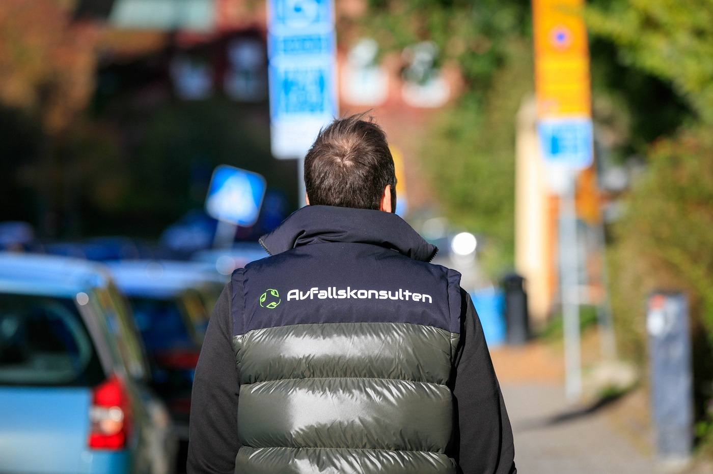
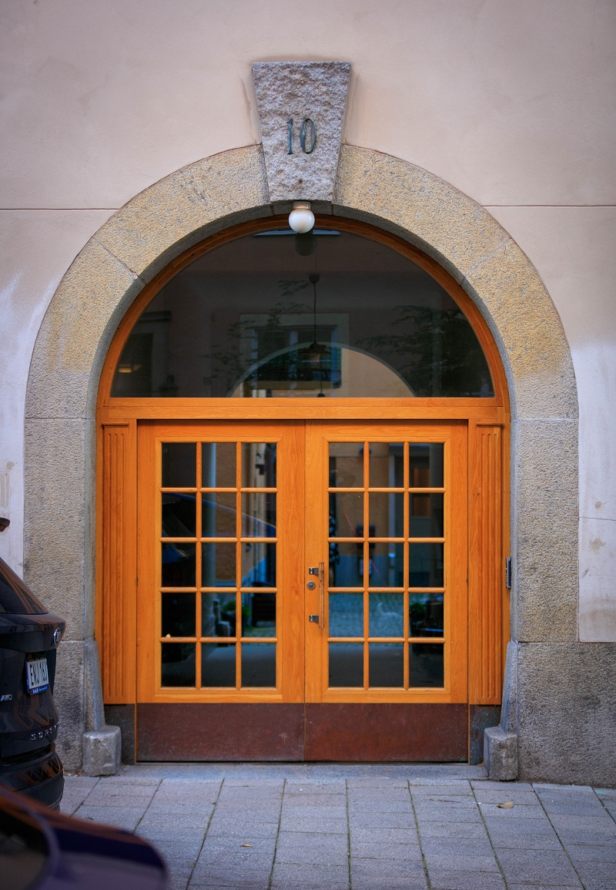

# Rådgivning

- **URL:** https://avfallskonsulten.se/radgivning
- **Title-tagg:** Rådgivning | Experthjälp kring soprum | Avfallskonsulten
- **Meta description:** Avfallskonsulten förbättrar ditt soprum, vare sig det gäller att möta kommande lagkrav eller en ny avfallslösning. Kontakta oss för en gratis offert.
- **Canonical:** 
- **Ord i brödtext:** 398
- **Bilder:** 5

---

# Rådgivning

Att navigera i avfallsbranschen kan vara utmanande, och det är ofta svårt att hitta rätt svar. Med vår långa erfarenhet inom [avfallshantering](/) och återvinning erbjuder vi på Avfallskonsulten professionell rådgivning, oavsett om frågorna är stora eller små. Vi finns här för att hjälpa er!

[TA KONTAKT](#kontakt-form)

## Ombyggnation av soprum

Många fastighetsägare behöver idag uppgradera sina soprum, antingen för att möta nya lagkrav eller för att modernisera gamla avfallslösningar som inte längre fungerar. Vi hanterar det mesta inom soprumsrenovering i egen regi – från rivning av sopkaruseller och ommålning till installation av ramper och anpassning efter era behov. Genom en smartare avfallshantering kan driftkostnader ofta minskas, och vi hjälper gärna till att ta fram en kostnadskalkyl för detta.

[BOKA PLATSBESÖK](#kontakt-form)

## Avfallsutredningar

För fastighetsägare, förvaltare eller större bostadsrättsföreningar kan en avfallsutredning vara en värdefull investering. Vi analyserar nuvarande avfallsvolymer och kostnader, föreslår förbättringar utifrån lagkrav och hjälper till med implementeringen av den valda lösningen. Med erfarenhet från både kommunala uppdrag och hushållsavfallsfrågor bistår vi även kommuner med kompetens inom praktiska och upphandlingsrelaterade frågor.

[Kontakta oss](#kontakt-form) om ni behöver vår hjälp!

## Utsortering av matavfall och förpackningar

Med ökande fokus på miljö och hållbarhet skärps kraven på avfallssortering. I Stockholms stad är det sedan 1 januari 2023 obligatoriskt för flerfamiljshus att sortera ut matavfall, med undantag för de med tekniska lösningar och 240-literssäckar där kravet gäller från 1 juni 2024. Vi hjälper er att hitta lösningar, vilket ofta innebär ombyggnation eller investering i nya behållare.

För fastighetsägare kommer det även att bli obligatoriskt att erbjuda sortering av förpackningar – såsom papper, plast och glas – till de boende. Exakta detaljer är ännu inte klara, men det är sannolikt en fråga om **när**, inte **om**, detta blir ett krav. Att redan nu planera för källsortering är ett positivt steg mot ökad materialåtervinning och en hållbar fastighet.

Vi erbjuder gärna ett kostnadsfritt platsbesök för att se över era förutsättningar och hjälpa till med planeringen.

[TA KONTAKT](#kontakt-form)

## Frågor?

Vid frågor eller funderingar når du oss på [08-68427888](tel:08-68427888) eller så kan du fylla i kontaktformuläret nedan så återkommer vi till dig.

### KONTAKTA OSS

Berätta lite mer om vad du vill ha hjälp med
