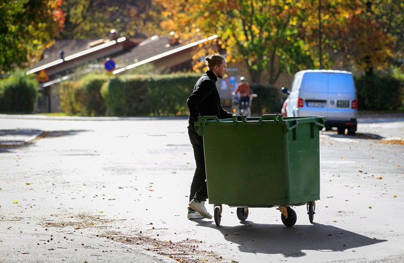
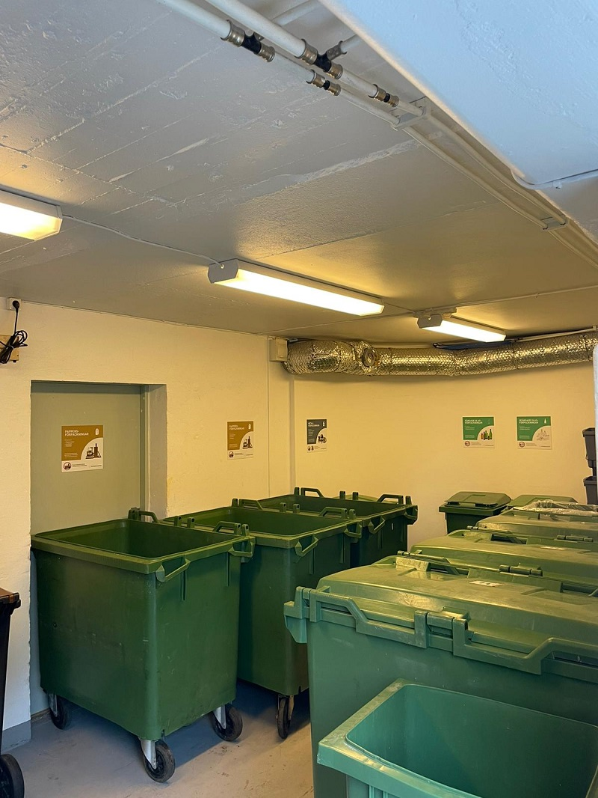

# Renovera soprum för bättre funktionalitet

- **URL:** https://avfallskonsulten.se/renovera-soprum
- **Title-tagg:** Renovera soprum för bättre funktionalitet | Avfallskonsulten
- **Meta description:** Behöver du renovera ditt soprum? Avfallskonsulten erbjuder effektiva lösningar för att förbättra funktionaliteten och optimera förvaringen av avfall.
- **Canonical:** https://avfallskonsulten.se/renovera-soprum
- **Ord i brödtext:** 653
- **Bilder:** 6

---

# Renovera soprum för bättre funktionalitet

Renovering av soprum kan göra det enklare och smidigare för alla som använder dem. Genom att förbättra designen och skapa bättre lösningar blir det lättare att hantera avfall. Avfallskonsulten hjälper privatpersoner, företag, fastighetsägare och bostadsrättsföreningar (BRF) att renovera soprum för bättre funktion och hållbarhet.

[KONTAKTA OSS](#kontakt-form)

## Varför renovering av soprum är viktigt

Renovering av soprum är inte bara en fråga om estetik, utan en viktig investering i funktionalitet, säkerhet och hållbarhet. Ett välfungerande soprum gör det lättare att hantera avfall effektivt, minskar risken för olägenheter som lukt och ohyra, samt förbättrar den övergripande hygiennivån. Avfallskonsulten hjälper privatpersoner, företag, fastighetsägare och BRF:er att skapa optimala förvaringslösningar som uppfyller både lagkrav och miljökrav.

[Boka renovering av soprum](#kontakt-form)

### Fördelar med att renovera soprum

**En renovering av soprum kan innebära flera fördelar:**

- **Effektivare avfallshantering:**Bättre layout och uppdelning av avfallssortering gör det enklare att hantera avfallet.
- **Minskad lukt och ohyra:**Genom att förbättra ventilation och hygienlösningar skapas en renare och mer trivsam miljö.
- **Ökad säkerhet:**Modernisering kan också minska risken för olyckor och förbättra tillgången till soprummen.
- **Hållbarhet:** Vi hjälper dig att hitta lösningar som är både miljövänliga och kostnadseffektiva.

### Vanliga problem i gamla soprum och hur de kan åtgärdas

**Äldre soprum kan ha en rad problem som kan lösas genom en renovering:**

- **Bristande ventilation:**Förbättra luftflödet för att minska lukt och fuktproblem.
- **Otillräcklig avfallssortering:**Genom att implementera moderna och funktionella lösningar kan vi hjälpa till att optimera avfallssorteringen.
- **Skräp och ohyra:**Täta utrymmen och förbättra hygieniska lösningar för att minska ohyra.
- **Dålig belysning:**Vi installerar energieffektiv belysning för bättre synlighet och säkerhet.

## Våra tjänster inom renovering soprum

**Avfallskonsulten erbjuder ett brett utbud av tjänster för att renovera soprum på bästa sätt. Våra tjänster inkluderar:**

- **Planering och design:**Vi skapar skräddarsydda lösningar för att passa dina behov och lokaler.
- **Materialval:**Vi hjälper till att välja hållbara och funktionella material för både väggar, golv och förvaringslösningar.
- **Installation:**Vi genomför renoveringen med fokus på kvalitet och effektivitet.
- **Hygienlösningar:**Vi erbjuder effektiva och miljövänliga lösningar för avfallshantering och förvaring.
- **Uppföljning och underhåll:**Efter renoveringen erbjuder vi också löpande stöd och underhåll.

[Boka renovering av soprum](#kontakt-form)

## Varför välja Avfallskonsulten för renovering av soprum?

Avfallskonsulten är den självklara partnern när det gäller renovering av soprum. Vi har lång erfarenhet av att arbeta med både privatpersoner, företag, fastighetsägare och BRF:er. Vi erbjuder skräddarsydda lösningar som är anpassade för varje kunds specifika behov. Vårt fokus är på hållbarhet, funktionalitet och kostnadseffektivitet, och vi ser till att alla lösningar är i linje med aktuella miljö- och säkerhetskrav.

### Kontakta oss för en kostnadsfri bedömning av ditt soprum

Tveka inte att höra av dig för en kostnadsfri bedömning av ditt soprum. Vi hjälper dig att hitta den bästa lösningen för just dina behov.

## Vanliga frågor kring renovera soprum

1. ### Vad innebär det att renovera ett soprum?
   - Att renovera soprum innebär att uppgradera golv, väggar, ventilation och belysning för bättre funktion och hygien.
2. ### När behövs en renovering av soprum?
   - En renovering av soprum behövs när det luktar, är smutsigt, slitet eller har dålig ventilation.
3. ### Hur går det till att renovera soprum?
   - Processen för att renovera soprum är besiktning, planering, materialval, genomförande och färdigställande.
4. ### Hur lång tid tar en renovering av soprum?
   - Tiden för renovering av soprum varierar: mindre projekt tar några dagar, större 1–2 veckor.
5. ### Vad kostar det att renovera soprum?
   - Kostnaden för att renovera soprum beror på storlek och omfattning. En offert ger exakt pris.

## Frågor?

Vid frågor eller funderingar når du oss på [08-68427888](tel:08-68427888) eller så kan du fylla i kontaktformuläret nedan så återkommer vi till dig.

### KONTAKTA OSS

Berätta lite mer om vad du vill ha hjälp med
