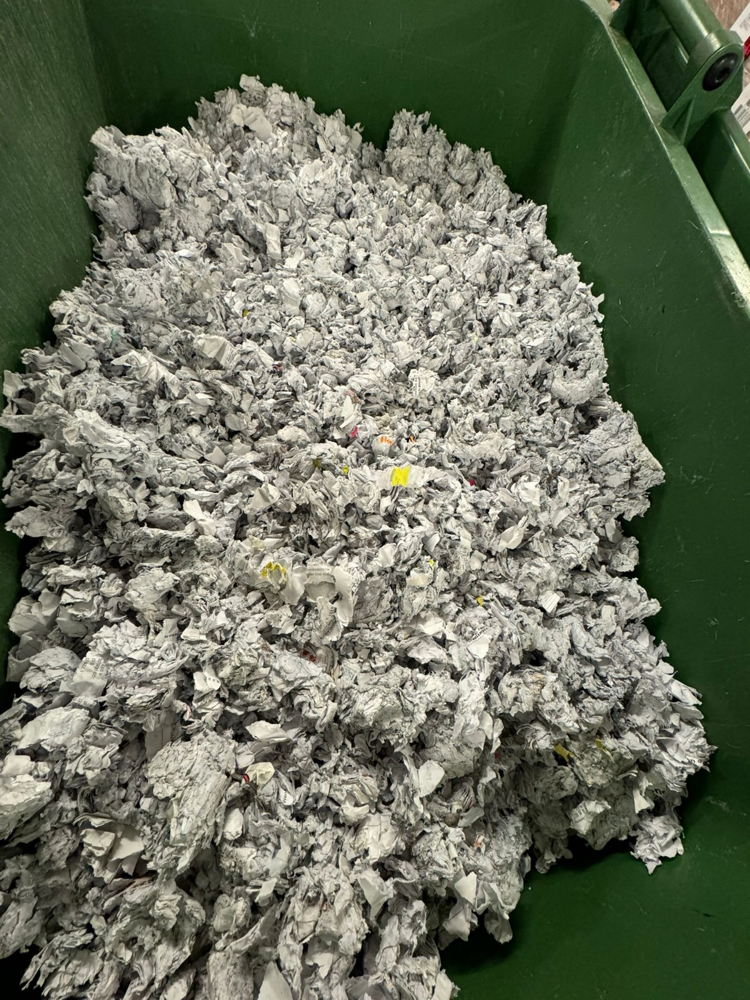

# Sekretesspapper återvinning

- **URL:** https://avfallskonsulten.se/sekretesshantering
- **Title-tagg:** Sekretesspapper återvinning | Avfallskonsulten
- **Meta description:** Sekretesspapper återvinning och säker sekretesshantering med Avfallskonsulten. Vi erbjuder pålitlig hantering och destruktion av känsliga dokument.
- **Canonical:** https://avfallskonsulten.se/sekretesshantering
- **Ord i brödtext:** 908
- **Bilder:** 7

---

# Sekretesspapper återvinning

Återvinning av sekretesspapper handlar om att hantera känsliga dokument på ett säkert sätt som skyddar integritet och förhindrar att information hamnar i fel händer. På Avfallskonsulten erbjuder vi professionell sekretesshantering och återvinning av sekretesspapper, med fokus på att säkerställa att våra kunders känsliga uppgifter tas om hand på ett tryggt och pålitligt sätt.

[KONTAKTA OSS](#kontakt-form)

## Varför är sekretesshantering avgörande?

Sekretesshantering och återvinning av sekkretesspapper är kritiskt för att skydda konfidentiella uppgifter från att bli exponerade för obehöriga. För företag innebär detta ett ansvar att skydda sina kunders, anställdas och partners information. En effektiv sekretesshantering minimerar risken för dataintrång och identitetsstöld samt hjälper till att följa lagstadgade krav.

### Riskerna med att slänga känsliga papper utan rätt hantering

Att slänga sekretesspapper i vanliga sopor kan utsätta företag och privatpersoner för stora risker, inklusive identitetsstöld och affärssabotage. Dokument som inte sekretesshanteras på rätt sätt kan hamna i fel händer, vilket kan leda till kännbara konsekvenser som ekonomiska förluster och förlorat förtroende.

[Boka återvinning av sekretesspapper](#kontakt-form)

## Våra tjänster inom återvinning av sekretesspapper och sekretesshantering

På Avfallskonsulten erbjuder vi säker sekretesshantering och återvinning av sekretesspapper. Vi använder låsta transportfordon och utbildad personal för att säkerställa att informationen är trygg genom hela hanteringskedjan. Efter insamling destrueras dokumenten med metoder som gör det omöjligt att återskapa dem.

När vi hämtar sekretesspapper från din plats transporteras de tryggt till vårt destruktioncenter, där dokumenten hanteras med certifierade metoder för maximal säkerhet.

Oavsett om du har små eller stora mängder sekretesspapper erbjuder vi en snabb, pålitlig och kostnadseffektiv tjänst. Kontakta oss för att boka hämtning och få mer information om vår trygga och effektiva sekretesshantering.

### Destruktion av sekretesspapper

Destruktion av sekretesspapper är en viktig tjänst för att skydda känslig information och förhindra att den hamnar i fel händer. På Avfallskonsulten säkerställer vi att alla sekretessbelagda dokument destrueras på ett sätt som gör det omöjligt att återskapa informationen.

Vi använder certifierade och miljövänliga metoder för att fysiskt förstöra både papper och elektroniska dokument. Efter destruktionen får du en bekräftelse som visar att allt har hanterats på ett säkert och effektivt sätt. Våra tjänster är pålitliga, flexibla och kan hantera både små och stora mängder sekretesspapper, vilket gör dem perfekta för företag och privatpersoner som vill säkerställa trygg sekretesshantering.

## Slänga sekretesspapper som privatperson i Stockholm

Att slänga sekretesspapper som privatperson kräver särskild försiktighet för att skydda din personliga information. På Avfallskonsulten erbjuder vi en säker lösning för att hantera och destruera sekretesspapper på rätt sätt i Stockholm.

Vi förstår vikten av att skydda känslig information, och därför erbjuder vi både hämtning och destruktion av dokument direkt från din bostad. Våra tjänster är designade för att vara både bekväma och säkra – vi hämtar sekretesspapper med låsta transportfordon och säkerställer att dokumenten förstörs på ett sätt som gör det omöjligt att återskapa informationen.

Genom att använda våra tjänster slipper du oroa dig för att känsliga uppgifter ska hamna i orätta händer. Vi följer strikta säkerhetsrutiner och ser till att din information hanteras på ett ansvarsfullt och miljövänligt sätt.

## Vad ska man tänka på vid sekretesshantering och återvinning av sekretesspapper?

Det är viktigt att sekretesspapper alltid hålls skyddade tills de kan tas om hand på ett säkert sätt. Använd därför särskilda, låsta behållare för förvaring och se till att dokumenten aldrig lämnas utan uppsikt. Genom att välja en pålitlig partner för sekretesshantering och återvinning av sekretesspapper minskar du risken för informationsläckor och säkerställer att känsliga uppgifter hanteras tryggt hela vägen.

[Boka sekretesshantering](#kontakt-form)

## Varför välja Avfallskonsulten för återvinning av sekretesspapper?

Hos Avfallskonsulten sätter vi kundens säkerhet och trygghet i fokus. Som ett ungt och engagerat företag är vi flexibla och anpassningsbara för att möta varje kunds specifika behov, från små till stora mängder sekretesspapper. Med moderna, säkra rutiner och ett optimeringsprogram som effektiviserar transporterna, säkerställer vi att dina känsliga dokument hanteras snabbt och tillförlitligt. Vår dedikation till service och säkerhet gör oss till en trygg partner för företag som vill ha en skräddarsydd och pålitlig lösning för sin sekretesshantering.

## Vanliga frågor om sekretesshantering och återvinning

1. ### Vilka typer av dokument räknas som sekretesspapper?
   - Sekretesspapper inkluderar dokument som innehåller personuppgifter, finansiell information, juridiska dokument och all annan information som kan skada individer eller företag om den läcker ut.
2. ### Vad händer med sekretesspapper efter återvinning?
   - Efter säker insamling och destruktion återvinns sekretesspapperet på ett sätt som är miljövänligt och resurseffektivt. Processen säkerställer att inget material går förlorat samtidigt som konfidentiell information förblir skyddad.
3. ### Behöver jag förbereda dokumenten innan hämtning?
   - Det är inte nödvändigt att förbereda dokumenten på något särskilt sätt. Vi hanterar allt från insamling till destruktion, men vi rekommenderar att du samlar dokumenten på en lättillgänglig plats.
4. ### Hur säkerställer Avfallskonsulten sekretess i återvinningsprocessen?
   - Vi på Avfallskonsulten använder utbildad personal och säker utrustning för att garantera en trygg hantering från insamling till slutlig destruktion.

## Frågor?

Vid frågor eller funderingar når du oss på [08-68427888](tel:08-68427888) eller så kan du fylla i kontaktformuläret nedan så återkommer vi till dig.

### KONTAKTA OSS

Berätta lite mer om vad du vill ha hjälp med
