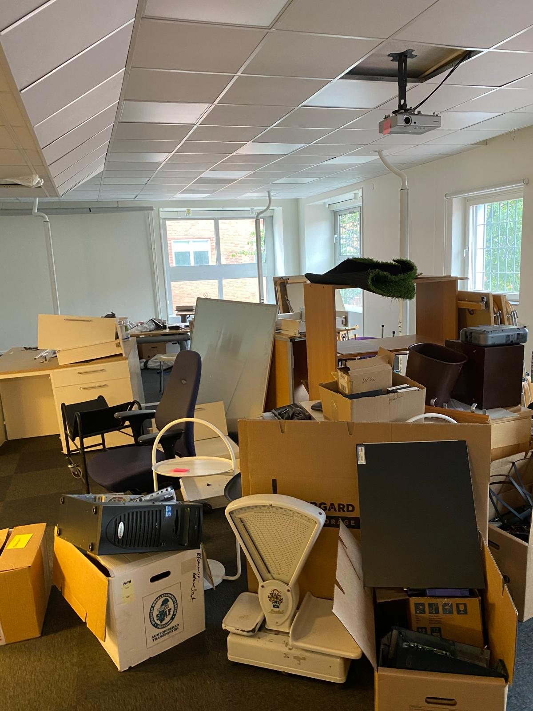

# Sophämtning Stockholm företag

- **URL:** https://avfallskonsulten.se/sophamtning-stockholm-foretag
- **Title-tagg:** Sophämtning Stockholm företag – Smidig service | Avfallskonsulten
- **Meta description:** Effektiv & pålitlig sophämtning i Stockholm för företag. Avfallskonsulten erbjuder skräddarsydda lösningar för avfallshantering, anpassade efter era behov.
- **Canonical:** https://avfallskonsulten.se/sophamtning-stockholm-foretag
- **Ord i brödtext:** 894
- **Bilder:** 7

---

# Sophämtning Stockholm företag

Vi erbjuder professionell sophämtning för företag i hela Stockholm. Med våra skräddarsydda lösningar ser vi till att ditt företags avfall hanteras på ett effektivt och miljövänligt sätt. Oavsett om ditt behov är daglig sophämtning eller enstaka uppdrag kan vi hjälpa till. Låt oss ta hand om sophanteringen så att du kan fokusera på din verksamhet.

[KONTAKTA OSS](#kontakt-form)

## Våra tjänster inom sophämtning Stockholm för företag

Vi erbjuder ett komplett utbud av tjänster inom sophämtning och avfallshantering för företag i Stockholm. Våra lösningar är anpassade efter olika typer av verksamheter, från små kontor till större verksamheter. Vi tar hand om allt från sortering och insamling till transport och återvinning, vilket ger dig en enkel och bekymmersfri hantering av allt ditt avfall.

[Boka sophämtning för företag i Stockholm](#kontakt-form)

## Varför välja oss för sophämtning Stockholm företag?

Vår erfarenhet och expertis inom sophämtning för företag i Stockholm gör oss till det självklara valet för de som vill ha en pålitlig partner. Vi erbjuder bland annat:

- **Flexibla avtal:** Anpassa tjänsten efter ditt företags specifika behov.
- **Miljöansvar:** Vi arbetar enligt de senaste riktlinjerna för hållbar avfallshantering.
- **Kundfokus:** Snabb respons och personlig service är en självklarhet för oss.
- **Kostnadseffektivitet:** Konkurrenskraftiga priser och möjlighet att optimera avfallshanteringen för att spara pengar.

[Kontakta oss](#kontakt-form) ifall ni behöver hjälp med sophämtning i Stockholm

## Vilka typer av avfall hanterar ni för sophämtning av företag i Stockholm?

Vi hanterar många olika typer av avfall för företag, allt från kontorsavfall till större byggprojekt. Vårt mål är att säkerställa att varje typ av avfall tas om hand på rätt sätt och att så mycket som möjligt återvinns eller återanvänds.

### Kontorsavfall och elektronikåtervinning

Kontorsavfall kan inkludera papper, förpackningar och elektronik. Vi erbjuder regelbunden hämtning och korrekt sortering av elektronik och batterier för att säkerställa att farliga ämnen inte hamnar i naturen. Vi kan också hjälpa till med dokumentförstörelse och återvinning av gamla IT-produkter.

### Byggavfall och större skräpupphämtningar

Har ditt företag ett pågående byggprojekt? Vi erbjuder tjänster för upphämtning av byggavfall, inklusive trä, metall, betong och andra material. Med våra specialanpassade fordon kan vi snabbt och effektivt ta hand om större volymer av skräp och byggavfall. Vi ser till att avfallet transporteras till godkända återvinningsanläggningar för en hållbar hantering.

### Organiskt avfall och emballage

Vi erbjuder tjänster för upphämtning av organiskt avfall och emballage, inklusive matrester, frukt- och grönsaksavfall, förpackningsmaterial och andra biprodukter. Vi ser till att avfallet hanteras på ett miljövänligt sätt. Genom transport till godkända återvinningsanläggningar bidrar vi till hållbar återvinning, kompostering och energiutvinning – en enkel väg mot en mer ansvarsfull livsmedelsindustri.

## Så fungerar sophämtning Stockholm företag

Vi har gjort det enkelt för företag att hantera sitt avfall i Stockholm. Så här fungerar det:

1. **Kontakt och behovsanalys:**Vi diskuterar dina behov och skräddarsyr en lösning.
2. **Upphämtning:**Våra fordon hämtar ditt avfall enligt en fastställd tidsplan.
3. **Sortering och återvinning:**Avfallet sorteras och transporteras till våra återvinningspartners för en säker hantering.
4. **Uppföljning:** Vi håller dig uppdaterad om mängden återvunnet material och kan ge råd för att ytterligare minska avfallsmängderna.

[Kontakta oss](#kontakt-form) ifall ni behöver hjälp med sophämtning i Stockholm

## Miljövänlig sophämtning för hållbara företag

Vi är stolta över att erbjuda miljövänlig sophämtning för företag i Stockholm. Vår ambition är att minska miljöpåverkan och bidra till en cirkulär ekonomi genom att återvinna så mycket som möjligt av det insamlade avfallet. Vi samarbetar med certifierade återvinningsanläggningar och använder fordon med låga utsläpp för att minimera vår klimatpåverkan. När du väljer oss bidrar ditt företag till ett mer hållbart Stockholm.

[Boka sophämtning för företag i Stockholm](#kontakt-form)

## Vanliga frågor kring Avfallskonsultens sophamtning för företag område

1. ### Vilka typer av avfall kan ni hantera?
   - Vi hanterar allt från vanligt hushållsavfall till specialavfall som byggmaterial, farligt avfall och elektronik. Vi hjälper till med korrekt sortering och ser till att det återvinns där det är möjligt.
2. ### Hur ofta kan ni hämta avfall från vårt företag?
   - Vi erbjuder flexibla scheman som anpassas efter ditt företags behov. Oavsett om du behöver dagliga, veckovisa eller månadsvisa upphämtningar, ser vi till att det sker på ett sätt som passar din verksamhet.
3. ### Vad kostar sophämtning i Stockholm?
   - Kostnaden för sophämtning i Stockholm varierar beroende på avfallstyp, mängd och hur ofta du behöver hämtning. Vi erbjuder transparenta och flexibla prisplaner som är anpassade efter olika verksamheters behov. Kontakta oss för en kostnadsfri offert så hjälper vi dig att hitta den bästa lösningen för ditt företag, oavsett om det gäller en engångshämtning eller ett långsiktigt avtal.
4. ### Hur säkerställer ni att avfallet hanteras miljövänligt?
   - Vi samarbetar med certifierade återvinningsstationer och följer alla miljöregler för att säkerställa att så mycket av avfallet som möjligt återvinns eller återanvänds. Vi hjälper även företag att sortera avfallet korrekt för att maximera återvinningsmöjligheterna.

## Frågor?

Vid frågor eller funderingar når du oss på [08-68427888](tel:08-68427888) eller så kan du fylla i kontaktformuläret nedan så återkommer vi till dig.

### KONTAKTA OSS

Berätta lite mer om vad du vill ha hjälp med
