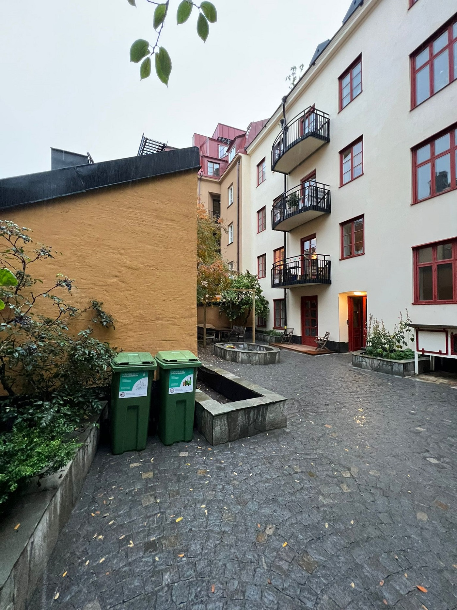
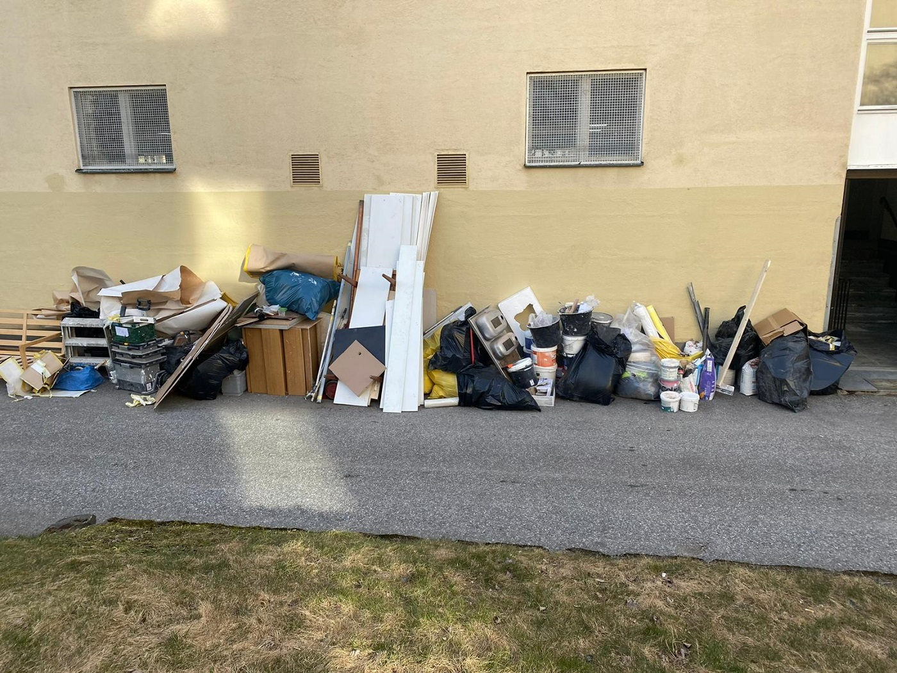
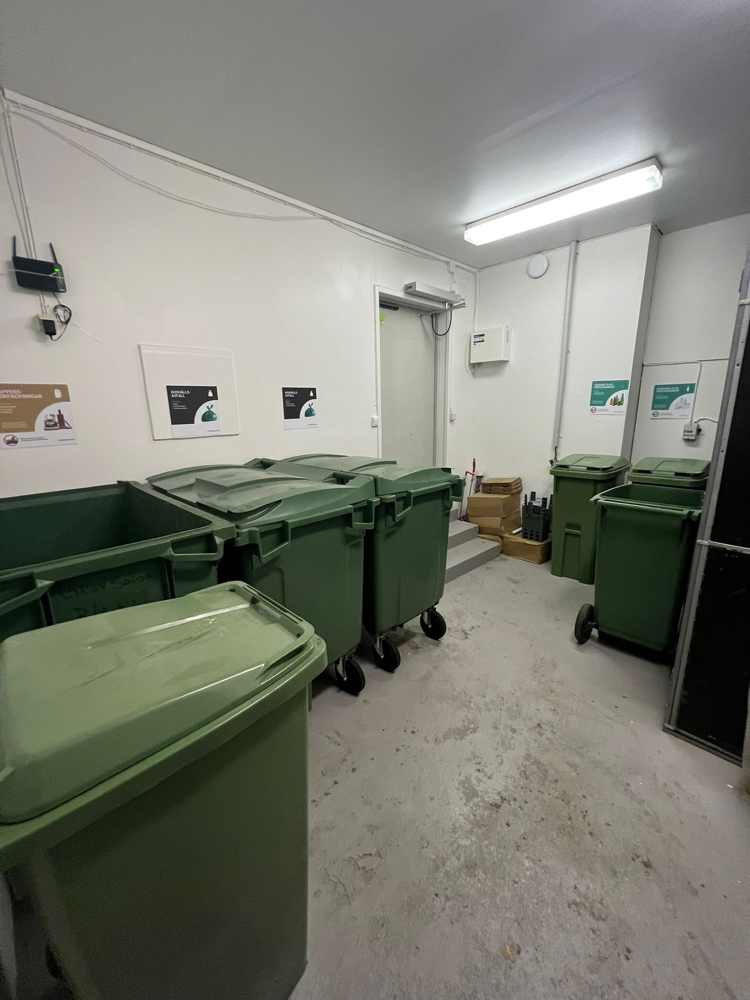
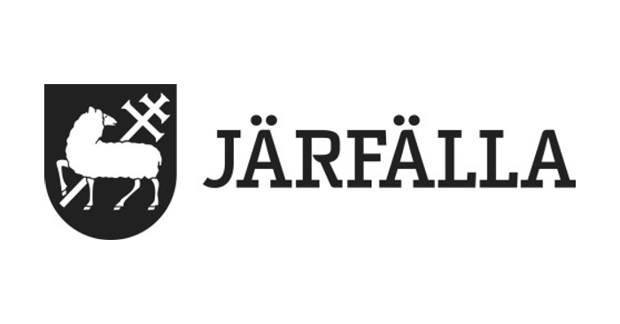

# Avfallshantering Stockholm

- **URL:** https://avfallskonsulten.se/
- **Title-tagg:** Avfallshantering Stockholm | 5/5 på Reco | Avfallskonsulten
- **Meta description:** Avfallshantering Stockholm - vi hjälper dig med effektiva och hållbara lösningar för avfallshantering och återvinning. Kontakta Avfallskonsulten idag!
- **Canonical:** https://avfallskonsulten.se/
- **Ord i brödtext:** 1156
- **Bilder:** 13

---
# Avfallshantering Stockholm

## Vi är en pålitlig avfallsentreprenör med personlig service

### Avfallskonsulten erbjuder kvalitativ avfallshantering i Stockholm för fastighetsägare, företag och privatpersoner i Stockholm

[BOKA UPPHÄMTNING](kontakt)

[BOKA RÅDGIVNING](kontakt)

## Vad våra kunder säger om oss

## Några av våra tjänster inom avfallshantering i Stockholm

Vi levererar våra tjänster inom avfallshantering med både noggrannhet och kort framförhållning, så att ditt projekt alltid flyter smidigt. Hos Avfallskonsulten är vårt främsta mål att du som kund ska vara helt nöjd med vårt arbete, oavsett om det handlar om hämtning av återvinning, hämtning av grovavfall, eller planering av miljörum. Vi arbetar alltid med högsta kvalitet och effektivitet och ser till att alla avfallsfraktioner hanteras på ett miljöriktigt sätt. Med vår erfarenhet och expertis kan vi skapa lösningar som både förenklar din vardag och säkerställer en hållbar och korrekt avfallshantering.

### Hämtning av återvinning

Som [återvinningsföretag i Stockholm](hamta-grovsopor-stockholm) hämtar vi alla typer av återvinning, från pappers- och plastförpackningar till övrigt återvinningsmaterial. Tillsammans med dig som kund skapar vi en skräddarsydd återvinningslösning som passar just era behov. Vi erbjuder anpassade behållare och ser till att era avfallsutrymmen alltid är i gott skick genom regelbunden tillsyn. Oavsett om uppdraget är stort eller litet finns vi här för att hjälpa er med professionell återvinning i Stockholm.

[Läs mer om återvinning](atervinning)

### Hämtning av grovavfall

Har du en gammal soffa, säng eller byrå, eller är ni ett kontor som behöver bli av med gamla pärmar? Vi erbjuder smidig hämtning av grovavfall på plats, oavsett om det gäller en lägenhet, källare eller företagslokal. Allt material hanteras på bästa möjliga sätt, där vi ser till att så mycket som möjligt återvinns eller återbrukas. Behöver du hjälp med att [hämta grovsopor i Stockholm](hamta-grovsopor-stockholm)?

[Läs mer om grovavfall](hamta-grovsopor-stockholm#upphamtning-pa-plats)

### Renovering av soprum

Vi utför ombyggnationer av soprum och avfallsutrymmen för att uppfylla dagens lagar och standarder inom avfallshantering. Många fastigheter har äldre lösningar, och vi har de senaste åren förvandlat dessa till moderna, trivsamma miljörum som underlättar avfallshantering. Som fastighetsägare kan ni dessutom ofta minska driftskostnaderna genom våra lösningar. Läs mer om våra <projekt> och hur vi kan förbättra avfallshanteringen i er fastighet i Stockholm.

[Läs mer om rådgivning](radgivning#ombyggnation-av-soprum)

## Vi är auktoriserade och hanterar avfall i dessa kommuner:

## Avfallskonsulten - Din pålitliga partner för avfallshantering i Stockholm

På Avfallskonsulten erbjuder vi professionell avfallshantering i Stockholm för både företag och privatpersoner. Vi hanterar allt från förpackningar och grovavfall till återvinning av papper, plast och metall på ett ansvarsfullt sätt. Vår tjänst är flexibel och anpassas efter dina behov, med smidig hämtning, moderna avfallsutrymmen och regelbunden tillsyn. Oavsett om uppdraget är stort eller litet, ser vi till att din avfallshantering fungerar effektivt och miljöriktigt. Med Avfallskonsulten får du en pålitlig partner för avfallshantering i hela Stockholm.

## Vanliga frågor vi får kring avfallshantering Stockholm

1. ### Vilka typer av avfall hanterar ni?
   - Vi hanterar alla typer av avfall, inklusive hushållsavfall, byggavfall, farligt avfall, elektronik och återvinningsmaterial som plast, papper, glas och metall. Vi erbjuder skräddarsydda lösningar för både privatpersoner och företag, för att säkerställa att avfallet tas om hand på rätt sätt.
2. ### Hur kan vi minska vårt avfall och bli mer hållbara?
   - För att minska ert avfall rekommenderar vi att ni fokuserar på att minska konsumtionen, återanvända material och optimera er källsortering. Genom att implementera hållbara rutiner och välja miljövänliga alternativ kan ni både minska mängden avfall och öka er återvinning.
3. ### Vad händer med vårt avfall efter att ni har hämtat det?
   - När vi hämtar ert avfall transporteras det till certifierade återvinningsanläggningar och deponier där det sorteras och behandlas enligt gällande miljöregler. Återvinningsbara material sorteras för att kunna återanvändas, medan farligt avfall tas om hand på ett säkert och miljövänligt sätt.
4. ### Hur ofta kan ni hämta vårt avfall?
   - Vi erbjuder flexibla lösningar för avfallshämtning och kan hämta ert avfall så ofta som ni behöver, från daglig till veckovis eller månadsvis hämtning. Tjänsten kan anpassas efter era specifika behov och avfallsmängder.
5. ### Varför ska vi anlita Avfallskonsulten för avfallshantering i Stockholm?
   - Avfallskonsulten har lång erfarenhet och kunskap om avfallshantering, vilket gör att vi kan erbjuda effektiva, miljövänliga och kostnadseffektiva lösningar för både små och stora kunder. Vi hjälper er att optimera avfallshanteringen och säkerställer att allt avfall tas om hand på ett korrekt och hållbart sätt.
6. ### Kan ni hjälpa oss att skapa en plan för avfallshantering?
   - Ja, vi hjälper gärna till att skapa en skräddarsydd plan för avfallshantering som passar era behov och mål. Vi analyserar era nuvarande rutiner och ger råd om hur ni kan effektivisera och minska ert avfall på bästa sätt.
7. ### Hur fungerar abonnemang för avfallshantering Stockholm?
   - Med ett abonnemang för avfallshantering Stockholm får du regelbunden hämtning av avfall enligt ett schema som passar dig. Vi skräddarsyr lösningen efter dina behov, oavsett om det gäller en bostadsrättsförening, ett företag eller en privatfastighet.
8. ### Vad kostar avfallshantering i Stockholm?
   - Priset för avfallshantering Stockholm beror på avfallsmängden, avfallstypen och hur ofta hämtning sker. Vi lämnar alltid en tydlig offert och kan även komma ut på plats för att ge en mer exakt prisbild.
9. ### Kan ni hjälpa till med engångshämtningar av avfall?
   - Ja, förutom löpande avfallshantering i Stockholm erbjuder vi även engångshämtningar – perfekt vid flytt, renovering eller större rensningar.
10. ### Hur säkerställer ni att avfallshanteringen sker miljövänligt?
    - Vi arbetar med godkända återvinningsanläggningar och följer alla regler för sortering och transport. Genom att välja oss för din avfallshantering i Stockholm bidrar du till en mer hållbar stad.
11. ### Hur fungerar avfallshantering i Stockholm för företag jämfört med privatpersoner?
    - För företag kan vi erbjuda fasta hämtningar och lösningar som passar verksamheten, till exempel byggavfall eller källsortering på kontor. Privatpersoner använder oss oftare vid flytt, renovering eller engångshämtningar.
12. ### Hjälper ni bostadsrättsföreningar med avfallshantering i Stockholm?
    - Ja, vi hjälper många bostadsrättsföreningar. Vi kan sköta regelbunden avfallshantering, kärltvätt och hämtning av grovsopor, samt ge tips för bättre källsortering i föreningen.
13. ### Hur skiljer sig era tjänster för avfallshantering i Stockholm från andra aktörer?
    - Vi är en lokal aktör som är flexibel och enkel att nå. Vi anpassar oss efter kundernas behov och ser alltid till att avfallet tas om hand på ett miljövänligt sätt.
14. ### Hur kan vi förbättra vår källsortering?
    - För att förbättra er källsortering rekommenderar vi att ni utbildar personalen och gör det enkelt för alla att sortera rätt genom tydlig märkning av avfallsbehållare. Genom att implementera effektiva system och rutiner för sortering kan ni öka mängden återvunnet material och minska mängden restavfall.

Skapad av [Emax Media](https://emaxmedia.se/)
