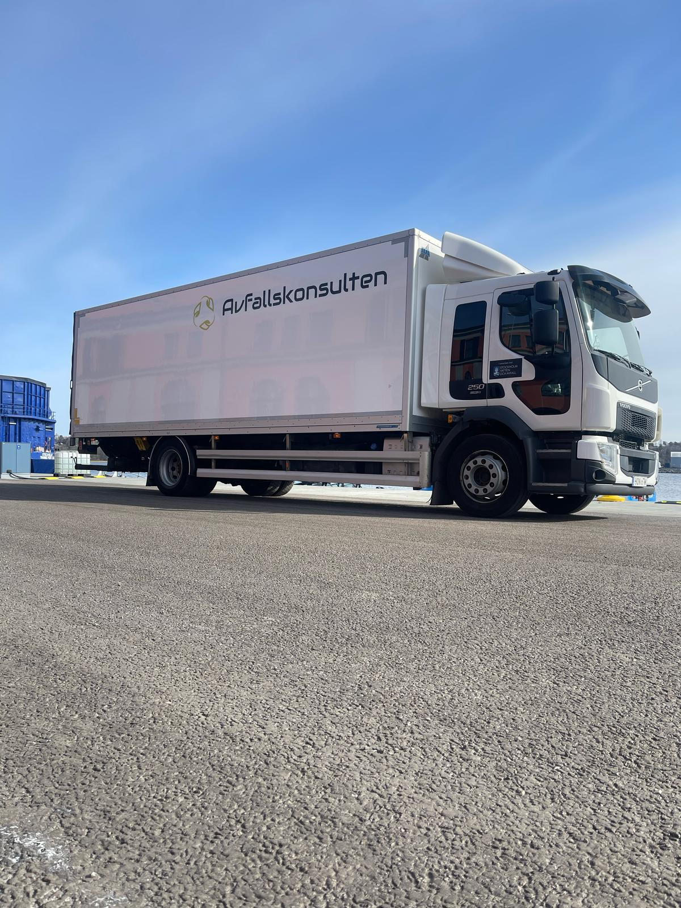
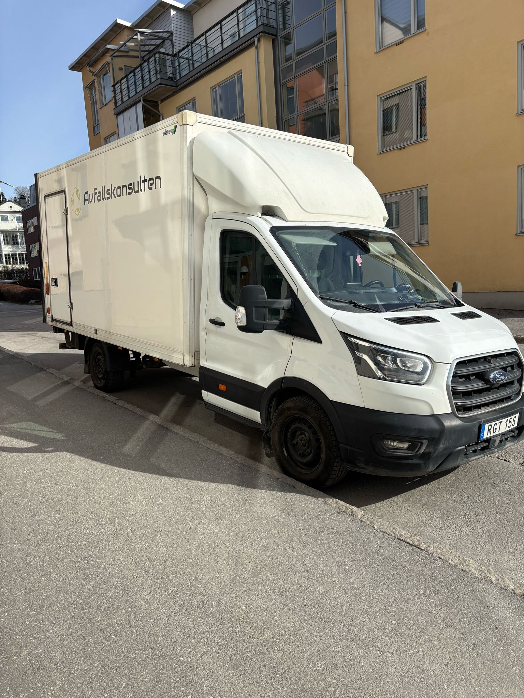
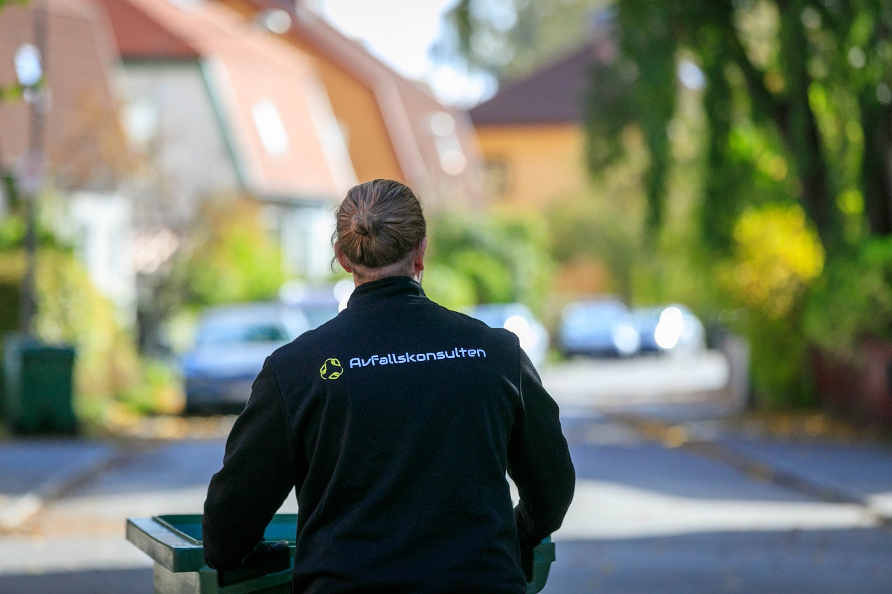

# Tömma dödsbo i Stockholm

- **URL:** https://avfallskonsulten.se/tomma-dodsbo
- **Title-tagg:** Tömma dödsbo i Stockholm | Avfallskonsulten
- **Meta description:** Behöver du tömma ett dödsbo i Stockholm? Vi hjälper till med tömning, bortforsling och sortering av möbler, bohag och grovavfall. Enkelt och smidigt.
- **Canonical:** https://avfallskonsulten.se/bortforsling
- **Ord i brödtext:** 876
- **Bilder:** 6

---

# Tömma dödsbo i Stockholm

Att tömma ett dödsbo kan vara ett omfattande arbete, särskilt när en hel bostad ska rensas från möbler, bohag och annat som blivit kvar. Avfallskonsulten hjälper dig med tömning av dödsbo, bortforsling och avfallshantering, så att du slipper ta hand om allt själv.

Vi kan hjälpa till att tömma exempelvis lägenheter, villor, förråd, vindar och andra utrymmen. Vi tar hand om möbler, inredning och annat som ska transporteras bort och ser till att avfallet sorteras och hanteras på rätt sätt.

[KONTAKTA OSS](#kontakt-form)

## Hjälp med att tömma hela eller delar av dödsboet

Ett dödsbo kan innehålla stora mängder möbler och andra föremål som behöver tas om hand. Det kan vara allt från soffor, sängar och garderober till köksutrustning, kartonger och annat som inte längre ska finnas kvar i bostaden.

Avfallskonsulten kan hjälpa till med både hela och delar av en dödsbotömning. Du behöver inte själv ordna med släp, transport eller flera vändor till återvinningscentralen. Vi hämtar det som ska bort och transporterar det vidare för sortering och korrekt hantering.

Vi kan bland annat hjälpa till att forsla bort:

- Möbler och annan inredning
- Sängar och madrasser
- Skåp, garderober och bokhyllor
- Köks- och hushållsföremål
- Kartonger och förrådsinnehåll
- Grovavfall och annat skräp
- Övrigt bohag som ska transporteras bort

[Boka bortforsling](#kontakt-form)

## Tömning av dödsbo med sortering och återvinning

När ett dödsbo töms kan det uppstå flera olika typer av avfall. Genom att sortera materialet kan sådant som går att återvinna tas om hand på rätt sätt.

Efter hämtningen transporteras avfallet vidare för sortering och återvinning eller annan lämplig avfallshantering. På så sätt kan du få hjälp med hela den praktiska delen av bortforslingen samtidigt som material tas tillvara där det är möjligt.

[Kontakta oss](#kontakt-form) om ni vill forsla bort avfall!

## Tömning av lägenhet, villa och förråd

Vi kan hjälpa till med dödsbotömning i olika typer av bostäder och utrymmen. Det kan exempelvis handla om en lägenhet eller villa som ska tömmas inför försäljning, eller om ett förråd, en vind eller källare behöver rensas.

Om det finns stora eller tunga möbler på plats kan vi även hjälpa till med att bära ut och transportera bort dem. Berätta gärna hur bostaden ser ut och hur mycket som behöver tas bort när du kontaktar oss, så kan vi bedöma uppdragets omfattning.

## Kontakta oss för att få hjälp med att tömma dödsbo i Stockholm

Vi hjälper till med dödsbotömning och bortforsling i Stockholm. Vi kan ta hand om allt från mindre mängder bohag till omfattande tömningar av hela bostäder.

Att komma i kontakt med oss är enkelt. Du kan antingen ringa oss direkt för att boka en tid eller fylla i vårt kontaktformulär på hemsidan. Vi ser till att du får hjälp snabbt och effektivt, och vi är alltid här för att svara på dina frågor.

[Boka bortforsling!](#kontakt-form)

## Vanliga frågor om att tömma dödsbo

1. ### Hur lång tid tar det att få hjälp med bortforsling?
   - Vanligtvis kan vi komma och hämta ditt avfall samma dag eller inom 24 timmar efter att du kontaktat oss. För större eller mer komplexa uppdrag kan det ta något längre, men vi gör alltid vårt bästa för att anpassa oss efter dina behov.
2. ### Vad kan ni ta hand om vid en dödsbotömning?
   - Vi kan bland annat hjälpa till med möbler, inredning, kartonger, förrådsinnehåll, grovavfall och andra föremål som ska transporteras bort.
3. ### Kan ni bära ut möbler från bostaden?
   - Efter att vi har hämtat bort ditt avfall sorterar vi det noggrant för att återvinna så mycket som möjligt. Farligt avfall tas om hand på rätt sätt, och allt annat tas till en godkänd återvinningsanläggning där det återvinns eller hanteras på ett miljövänligt sätt.
4. ### Kan ni hjälpa till med bortforsling av farligt avfall?
   - Ja, vi kan hjälpa till med att bära ut möbler och annat avfall som ska transporteras bort. Informera oss gärna om förutsättningarna i bostaden när du bokar.
5. ### Kan ni tömma både lägenhet och förråd?
   - Ja, vi kan hjälpa till med tömning av flera olika utrymmen, exempelvis bostad, förråd, vind och källare.
6. ### Hur lång tid tar bortforsling av möbler och skräp?
   - Tiden beror på mängden och typen av avfall som ska hämtas. Mindre uppdrag kan oftast genomföras snabbt, medan större mängder eller tunga möbler kan ta längre tid att lasta och forsla bort. Kontakta oss för en uppskattning baserat på ditt uppdrag.
7. ### Vad händer med bohaget efter tömningen?
   - Det som hämtas transporteras vidare för sortering och korrekt avfallshantering. Material som kan återvinnas tas om hand så långt det är möjligt.
8. ### Vad kostar det att tömma ett dödsbo?
   - Priset beror bland annat på mängden bohag, bostadens storlek och hur mycket som ska transporteras bort. Kontakta oss med information om uppdraget så kan vi bedöma omfattningen och återkomma med pris.

## Frågor?

Vid frågor eller funderingar når du oss på [08-68427888](tel:08-68427888) eller så kan du fylla i kontaktformuläret nedan så återkommer vi till dig.

### KONTAKTA OSS

Berätta lite mer om vad du vill ha hjälp med
